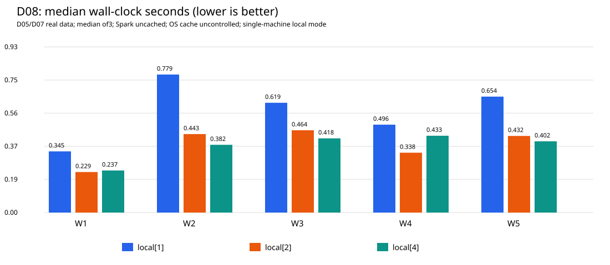
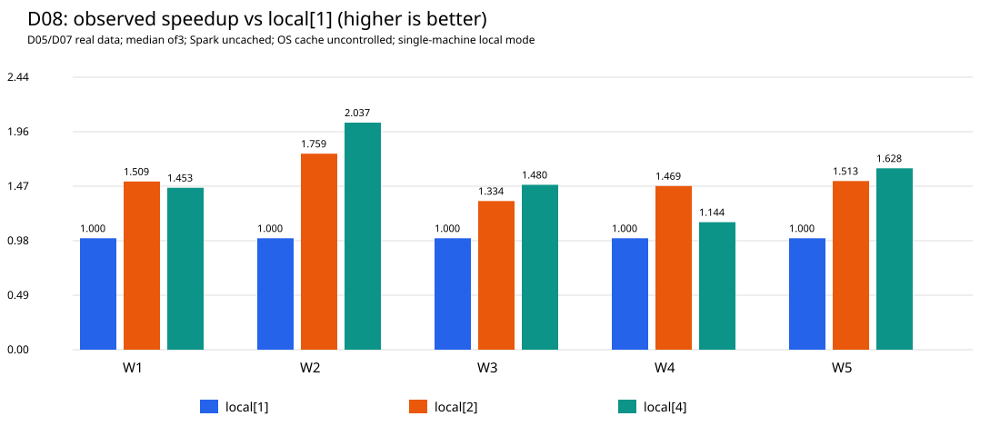

# D08 — Spark benchmark: available D05/D07 workloads

Ngày:20/10/2026, Asia/Bangkok. Đây là benchmark thật trên datasets có sẵn, **không
phải full-pipeline benchmark**, không benchmark D06 Full hoặc official IT salary.
Baseline D07 `479d3d83ff3194a5556ce29884c92478c90a969c`; branch mới
`feat/tv1-d08-benchmark`. Không commit/push/merge trong lượt này.

## A. Hardware / software environment

Máy đơn: Intel Core i5-11400H @2.70GHz,6 physical cores/12 logical processors,
RAM16888979456 bytes (~15.73GiB), Windows11 Home Single Language10.0.26300.
Snapshot ban đầu free RAM2325254144 bytes (~2.17GiB); không phải continuous peak.
Vì ít RAM trống, chọn JVM heap1GiB và **chỉ một Spark process tại một thời điểm**.
Không tắt ứng dụng khác, xóa cache hệ điều hành hoặc đổi cấu hình hệ thống.

Runtime yêu cầu Python3.11, PySpark4.2.0, Java21. Java21 chỉ process-scoped.
Actual versions/config/startup timing được ghi từ mỗi Spark session vào manifest.
`local[1]`, `local[2]`, `local[4]` là luồng trên cùng máy, **không phải cluster nhiều node**.

## B. Input datasets / baseline safety

- D05: `data/processed/canonical/jobs`,123849 rows/unique,50 fields;4 Parquet files,
  397164694 bytes. Đây là tổng stored-file size, KHÔNG là bytes thật mỗi query đọc.
- D07: `data/processed/d07/staging/d07_20261019_01/salaries.parquet`,123849 rows/unique,
  28 fields;4 files2846357 bytes. USABLE36059/MISSING87776/INVALID14.
- D06 Full: NOT EXECUTED. Không import/call classifier hoặc dùng Pilot làm population.

Parent kiểm input SHA inventories + D07 seal output binding trước run. Mỗi config
preflight distributed keys/null/duplicate, anti-join2chiều và status counts. Toàn bộ
BASE tracked files + raw/processed files hash/size/mtime được snapshot trước/sau.
Không có output Parquet mới, không overwrite canonical/salary, chỉ audit/tmp evidence.

## C. Workload descriptions / correctness

| ID | Query thật | Correctness / result materialization |
| --- | --- | --- |
| W1 | D05 Parquet scan, count và countDistinct(job_id), null keys | rows=unique123849/null0; đọc job_id, không decode đủ50 fields |
| W2 | GroupBy formatted_experience_level, work_type, location; countDistinct(job_id) | Native NULL group riêng; sum group counts123849; deterministic group digest |
| W3 | explode(job_industries); group industry_id/name, countDistinct(job_id) | Unique job/industry memberships; sum đúng exploded distinct membership count; giữ ID khi label NULL |
| W4 | D07 group normalization_status, canonical_currency; countDistinct(job_id) | sum123849; currency riêng, NULL currency giữ bucket riêng; không salary median |
| W5 | Inner JOIN D05/D07 job_id; count/countDistinct và salary status coverage | rows=unique123849, không nhân/mất jobs; usable36059/missing87776/invalid14 |

W2 không coalesce NULL thành sentinel có thể đụng real value, không suy location
thành city hoặc remote NULL thành onsite. W3 dùng explode (không outer): jobs không
có industry links không ở nhóm ngành; tổng memberships không phải tổng jobs.
W4 dùng canonical_currency, không normalized_currency, để giữ currency known của
INVALID khi normalized currency NULL. W5 coverage denominator là all canonical jobs.

Mỗi grouped query được materialize qua distributed aggregate: count groups,
sum/min/max job_count và sum(xxhash64(dimensions,job_count)) dạng decimal38,0.
Như vậy Spark phải thực hiện group counts, không chỉ lazy plan hoặc count-of-groups
có thể prune phần tính counts. Chỉ một scalar-summary row trở về driver, không
collect123849 keys/predictions hoặc toàn bộ location groups. Hash là consistency
fingerprint có collision risk, không thay mọi semantic test/preflight counts.

## D. Experimental methodology

Mỗi config chạy trong **fresh Python process/JVM**, Spark startup đo riêng.
Một warmup/workload/config, sau đó3 measured runs/workload/config. Tổng dự kiến
15 warmups+45 measured actions. Warmup ghi nhận nhưng không vào median/min/max.
Random config order với seed42; workload order từng measured round cũng seeded,
giữ cùng order giữa configs. Manifest lưu config/order và mỗi observation.

Timing bằng perf_counter, từ build query đến collect scalar result hoàn tất.
Correctness comparison, executed-plan capture, preflight, hashing và event-log parse
ở ngoài duration. Giá trị duration bao gồm planning/scheduling/execution/collect,
không chỉ executor CPU. Startup không cộng vào workload runtime.

Không persist/cache DataFrame; clear Spark catalog cache và assert persistentRDDs0
trước mỗi observation. Tắt exchange/subquery reuse, AQE và broadcast joins cho cùng
query regime. File metadata/JVM JIT/OS page cache có thể warm. Snapshot SHA cũng đọc
files trước run. Vì vậy cache policy là **Spark uncached, post-warmup, OS cache
uncontrolled**; KHÔNG gọi cold cache hoặc đo lợi ích DataFrame.cache().

## E. Configuration

Primary comparison chỉ đổi master1/2/4 threads, cùng shuffle partitions4. Không
tuyên bố đã tìm partitions tối ưu. Default parallelism4, file minPartitionNum4,
file maxPartitionBytes128MiB cố định; số input partitions thực tế ghi riêng.
UTC, ANSI=true, speculation=false, AQE=false, autoBroadcastJoinThreshold=-1,
exchange/subquery reuse=false, parquet aggregatePushdown=false. Spark UI tắt;
event logs uncompressed bật, raw logs nằm tmp, SHA/path lưu manifest.

## F–G. Timing / speedup

Chỉ chốt số đo từ successful benchmark_results.csv và benchmark_summary.csv sau
thực thi. Representative=median3; min/max là observed range, không confidence
interval. Speedup(workload,master)=median(local[1])/median(master), cùng query,
input/config/cache regime. Speedup<1 là chậm hơn baseline, không sửa số để ép tăng.

## H. Validation / tests

Unit/integration tests dùng fixtures synthetic nhỏ và ghi scope riêng, không
đưa timing synthetic vào official observations. Tests kiểm5query shapes, keys/join
duplication/null, NULL group, industry distinct membership, currency separation,
repartition digest, minimum repeats/config, summary excludes warmup, CSV/SVG output
format/exclusive-write và event metrics không bịa missing values.

Official run chỉ dùng D05/D07 thật. Correctness check cùng summary query mỗi lần;
so exact scalar/group digests giữa repeats và cả3configs. Không chỉ tin Markdown.

## I. Limitations

- Một máy, một block/session mỗi config,3 timing repeats. Không cross-day repeat,
  temperature control, workload isolation hoặc thống kê confidence interval.
- OS cache/JIT/background load/paging không kiểm soát, free RAM thấp; không suy
  config nhanh nhất thành tối ưu phổ quát hoặc số liệu cluster scalability.
- W1 projection scan, không đọc/decode toàn bộ50 columns/397MB mỗi lượt.
- Task metric sums không là system CPU%, RAM peak hoặc wall-clock GC. Concurrent
  tasks có thể báo overlapping JVM GC intervals; peak execution memory là max task
  observation, không tổng heap/RSS. Không tự tạo unavailable metrics thành0.
- Shuffle read local/remote là Spark task counters, không suy thành network traffic
  giữa nhiều máy trong local mode. Raw event-log fields là evidence cho spill0.
- Chưa CSV-vs-Parquet, cache-on/off, partition sweep, write throughput hoặc ETL end-to-end.

## J. Evidence / charts

Versioned audit dưới `data/audit/d08/<run_id>/`: benchmark_results.csv (cả warmups),
benchmark_summary.csv, benchmark_manifest.json, benchmark_validation.json,
runtime_median.svg, speedup.svg. Manifest chứa actual config/startup/environment,
event-file hashes, references và protection count. Raw logs/plans nằm
`tmp/d08_benchmark/<run_id>/`; không commit raw logs hoặc dataset.

SVG charts là vector tự chứa, không cần thư viện plotting:1) median seconds theo
W1–W5/master;2) observed speedup vs local[1]. SVG chỉ median/speedup, không errorbars;
đưa kèm min/max table nếu dùng cho slide. Không gán đồ thị smoke vào official chart.

## K. D06 dependency

D08 FULL-PIPELINE BENCHMARK **PENDING D06 FULL**. Chưa đo classification,
official IT salary/population hoặc pipeline D05→D06→D07 end-to-end. Smoke branch
support/tv1-d08-benchmark-scaffold được review read-only, không merge: smoke cũ có
metadata-only timing/single observations, DEV_SMOKE_ONLY/official=false; không dùng
làm baseline hoặc suy ra speedup so với benchmark mới khác workloads.

## L. Reproduction

```powershell
$env:JAVA_HOME='C:\Program Files\Eclipse Adoptium\jdk-21.0.12.101-hotspot'
$env:PYTHONIOENCODING='utf-8'
.\.venv\Scripts\python.exe -B src/d08_benchmark.py --run-id d08_20261020_01 --partitions 4 --repeats 3 --seed 42 --windows-fs-jar tmp/d04-localfs/d04-localfs-adapter.jar
```

Run ID trên là lượt dự kiến đầu; nếu tồn tại phải chọn NEW run_id. Hàm run từ chối
overwrite audit/tmp output và từ chối D01–D07 tracked file changes. Fresh machine
cần datasets exact fingerprints, venv/Java và filesystem JAR (không bundle dữ liệu
vào Git). Module này chỉ workload benchmarking, không ETL/classifier execution.

## Actual completed run — d08_20261020_01

**D08 D05/D07 BENCHMARK PASS**:15 warmups+45 measured observations; all60 correctness
checks và cross-config scalar/group digests khớp. Audit:
`data/audit/d08/d08_20261020_01/`. Không chạy lại normalization/classifier.
Actual Python3.11.0/Spark4.2.0/Java21.0.12.1. JVM max heap1073741824bytes.
Benchmark-start free RAM1720344576bytes (~1.60GiB), khác initial hardware snapshot;
không đo continuous system CPU/RAM.

### Runtime (seconds; min / median / max)

| Workload | local[1] | local[2] | local[4] |
| --- | --- | --- | --- |
| W1 | 0.3041 / 0.3450 / 0.4108 | 0.2206 / 0.2286 / 0.2682 | 0.2112 / 0.2375 / 0.2478 |
| W2 | 0.5859 / 0.7786 / 0.9145 | 0.4405 / 0.4427 / 0.5782 | 0.3218 / 0.3821 / 0.5913 |
| W3 | 0.5534 / 0.6192 / 0.6696 | 0.4223 / 0.4642 / 0.4692 | 0.3050 / 0.4185 / 0.4487 |
| W4 | 0.4920 / 0.4958 / 0.5019 | 0.2848 / 0.3376 / 0.4670 | 0.2522 / 0.4333 / 0.5556 |
| W5 | 0.5071 / 0.6540 / 0.6679 | 0.4054 / 0.4321 / 0.5054 | 0.3866 / 0.4018 / 0.5591 |

### Observed speedup vs measured local[1]

| Workload | local[2] | local[4] |
| --- | ---: | ---: |
| W1 | 1.509× | 1.453× |
| W2 | 1.759× | 2.037× |
| W3 | 1.334× | 1.480× |
| W4 | 1.469× | 1.144× |
| W5 | 1.513× | 1.628× |

Execution order local[2]→local[1]→local[4], fresh process/JVM mỗi config.
Startup riêng: local[1]5.6073s, local[2]6.9070s, local[4]5.8606s. Mỗi config có
D05 scan5 partitions, D07 scan4, shuffle4; không đồng nhất input partitions với số
physical files hoặc local threads.

### Actual output/correctness

| Workload | Actual result |
| --- | --- |
| W1 | rows=unique123849, null0 |
| W2 | 26872 groups; sum123849 jobs; smallest1/largest2324 |
| W3 | 421 groups;158963 distinct job/industry memberships; smallest1/largest17762 |
| W4 | 8 status/currency groups; sum123849; NULL currency bucket retained |
| W5 | rows=unique123849; USABLE36059/MISSING87776/INVALID14; ambiguous/excluded0 |

Preflight key sets bằng nhau,0null/duplicates ở cả3configs.172 protected baseline
files không đổi hash/size/mtime. D06 output vẫn không tồn tại.

### Actual Spark event metrics

60 job groups có task evidence.45 measured queries có585 task attempts.
W1:3stages/10tasks mỗi query; W2/W3/W5:4stages/14tasks; W4:4stages/13tasks.

| Workload | Shuffle read bytes/query | Shuffle write bytes/query |
| --- | ---: | ---: |
| W1 | 745937 | 745937 |
| W2 | 4409900 | 4409900 |
| W3 | 2422419 | 2422419 |
| W4 | 774171 | 774171 |
| W5 | 1511124 | 1511124 |

Memory/disk spill đều0 ở measured queries, theo Task Metrics thực. Max observed task
peak execution memory69730240bytes, KHÔNG phải system/process memory peak.
Sum task-reported executor CPU17937500000ns và JVM GC645ms qua45queries; không
diễn giải thành system CPU% hoặc wall-clock GC. Raw event logs3files và exact
SHA nằm trong manifest; từng observation có counters ở benchmark_results.csv.
Physical plans nằm trong tmp mỗi config.

### Interpretation / caution

Trong block này local[4] median nhanh nhất W2/W3/W5; local[2] nhanh nhất W1/W4.
Không tăng tuyến tính với cores, không kết luận local[4] tối ưu mọi workload.
Có drift: local[4]W4 lần1/2/3≈0.5556/0.4333/0.2522s. Một warmup chưa đảm bảo
JIT/cache/host hoàn toàn ổn định. Speedup chỉ là descriptive observed ratio,
không causal proof hay cluster scalability. Để kết luận tuning mạnh hơn cần tăng
warmups/repeats, independent session blocks, kiểm background load/resources,
randomize/interleave configs và khảo sát partitions trong lượt được phép sau.

### Tests / evidence / next action

11/11 tests PASS,0failures/errors/skips,146.146s. Evidence:
tmp/d08_tests/suite_1140f96aa2/summary.json và audit/tests_summary.json.
Source SHA55da8a2166659d319067868e84fc366d50732c56f514c51ca9746818ce809b3e.
Scaffold branch reviewed at217ececadbd8f9cf25c8e6aa49505a4dff1b1dd3;
không dùng smoke làm baseline hoặc gộp với observations mới.

Charts dùng được trong report/slide (kèm min/max table và local/cache caption):





Bảo toàn raw event logs cho reviewer. Chưa có Spark UI screenshots (UI disabled,
event logs là evidence). Chưa benchmark CSV-vs-Parquet/cache/partition sweep/write
hoặc D06/end-to-end. Không có official IT population.

`post_run_verification.json` lưu kiểm tra hậu nghiệm độc lập:60 observations/15
summary rows, recompute timing statistics/speedups, parse lại3event logs và60metric
groups, SVG XML/bar counts, source/test hashes và172 protected files không đổi.

D08 D05/D07 BENCHMARK **PASS**; D08 FULL-PIPELINE BENCHMARK **PENDING D06 FULL**;
D06 FULL **NOT EXECUTED**. Không tự chấm toàn pipeline PASS, không commit/push.
