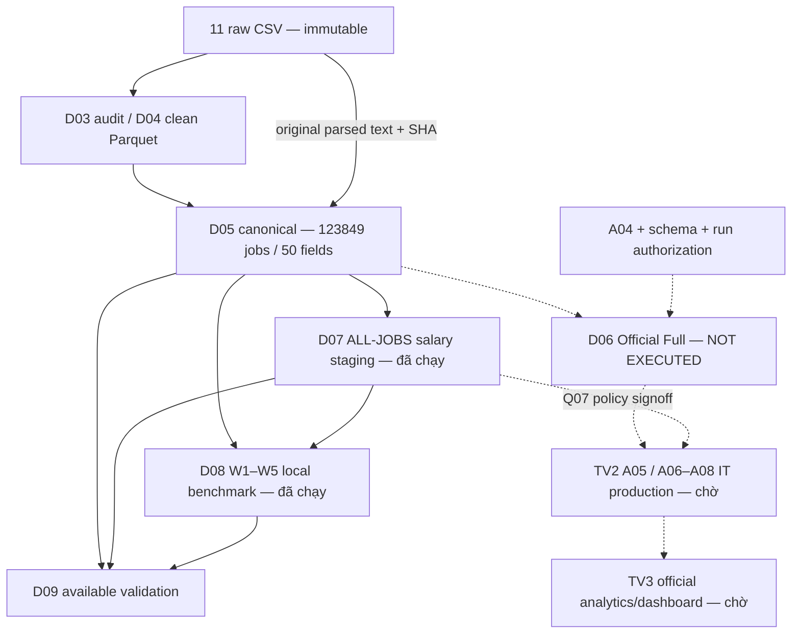

# D10 — Báo cáo kỹ thuật TV1: pipeline Big Data tuyển dụng

Ngày tổng hợp: **21/10/2026**, Asia/Bangkok. **PHASE 1 — AVAILABLE EVIDENCE**.
Baseline tài liệu: D09 `b668c763a3d7bf10a604a11b61a9e7b2f9e9edf5`.
Đây là phần kỹ thuật có thể đưa vào báo cáo môn học, không phải nghiệm thu toàn
pipeline hoặc công bố thống kê IT production. **D06 Full: NOT EXECUTED**.

Tài liệu đi cùng: [D11 bàn giao/tái lập](d11_handoff_reproducibility.md),
[evidence index](d10_d11_evidence_index.md), [status/gates](d10_d11_status_matrix.md).
Mã E01–E20 trỏ đến hàng evidence trong index; đó là nguồn của các số liệu dưới đây.

## 1. Giới thiệu và câu hỏi nghiên cứu

Đồ án xây dựng pipeline Apache Spark để kiểm kê, làm sạch và tích hợp tin tuyển
dụng LinkedIn, chuẩn bị phân loại nghề CNTT, trích kỹ năng và phân tích có kiểm
soát nguồn. Vai trò TV1 là data engineering/Spark, TV2 là taxonomy–extraction–
analytics, TV3 là dashboard và tích hợp báo cáo. Phân công này không thay người
nghiệm thu nghiệp vụ. [README](../README.md), E01, E16–E17.

Các hướng phân tích dự kiến: nhóm nghề, nhãn kinh nghiệm, location, work type/
remote flag, job functions, kỹ năng trích từ mô tả, lương và thời gian đăng tin.
Trong Phase 1, các hướng này là câu hỏi/phụ thuộc, không phải kết quả IT đã chạy.
Q07 đặt vấn đề so sánh posted salary theo nhóm nghề/experience trong cùng đơn vị;
chưa có tổng số IT jobs, tỷ lệ IT hay median IT salary đủ điều kiện công bố. E16.

Giá trị môn học nằm ở thiết kế schema, xử lý dữ liệu nhiều bảng, chống nhân dòng,
provenance, thực thi Spark action, thực nghiệm local parallelism và audit có thể
kiểm chứng. Dùng Spark local không tự chứng minh triển khai cluster hoặc dữ liệu
đại diện cho thị trường lao động Việt Nam/toàn thế giới.

## 2. Nguồn và cấu trúc dữ liệu

Theo [data manifest](data_manifest.md), dữ liệu là LinkedIn Job Postings
(2023–2024), tác giả Arsh Koneru, Kaggle; ngày nhận 04/10/2026, 11 CSV, khoảng
530.72 MB theo manifest. Nguồn và license CC BY-SA 4.0 được ghi trong manifest
của dự án; lượt tổng hợp này không xác minh lại website hoặc bổ sung phiên bản tải
mới. Khi nộp cần giữ attribution và kiểm điều kiện chia sẻ. E01.

| CSV tương đối dưới `data/raw/` | Vai trò | Raw rows | Clean rows |
| --- | --- | ---: | ---: |
| postings.csv | Bảng gốc theo job_id | 123849 | 123849 |
| companies/companies.csv | Thuộc tính doanh nghiệp | 24473 | 24473 |
| companies/company_industries.csv | Ngành doanh nghiệp, nhiều giá trị | 24375 | 24375 |
| companies/company_specialities.csv | Chuyên môn doanh nghiệp | 169387 | 169367 |
| companies/employee_counts.csv | Snapshot nhân sự | 35787 | 35665 |
| jobs/benefits.csv | Job–benefit | 67943 | 67943 |
| jobs/job_industries.csv | Job–industry | 164808 | 164808 |
| jobs/job_skills.csv | Job–job function | 213768 | 213768 |
| jobs/salaries.csv | Salary source bổ sung | 40785 | 40785 |
| mappings/industries.csv | Mapping industry | 422 | 422 |
| mappings/skills.csv | Mapping job function | 35 | 35 |

Nguồn bảng: [D04 report](d04_cleaning_report.md), [D05 report](d05_official_report.md),
E02–E03. Raw postings có31 cột; clean postings có35 do thêm bốn trường timestamp
raw phục vụ truy vết. Không diễn giải31/35/50 thành ba lần tăng số jobs.

`skills`/`job_skills` ở bộ nguồn là35 job functions/domains, **không phải** Python,
SQL, AWS. Technical skills cần A05 riêng. Company industry không xác định nghề
của người được tuyển. Các quan hệ nhiều-nhiều không thể JOIN phẳng rồi count rows
làm số tin. Employee snapshots là dữ liệu theo thời gian, không một dòng/công ty.

Chất lượng dữ liệu gồm missing salary/remote, NULL và sentinel, mojibake, timestamp
khác đơn vị, duplicate logical keys và orphan foreign keys. D04 giữ raw bất biến,
typed bigint/decimal/boolean/timestamp, NULL không thành0/false; cách ly122 employee
snapshot rows và20 speciality rows, cân bằng input=clean+rejected. Source text gốc
được phục hồi riêng ở D05, không dùng clean text sửa encoding làm evidence gốc.

## 3. Kiến trúc và ranh giới thực thi

**Hình 1 — caption đề xuất:** Kiến trúc tại Phase 1. Mũi tên liền là nhánh dữ liệu
đã được thực thi/kiểm định; mũi tên đứt là phụ thuộc chưa được mở. D07 ALL-JOBS
được tạo trực tiếp từ D05, không ngụ ý D06 Full đã chạy. E03–E14.

| Tầng | Input → output | Grain/schema | Trạng thái kỹ thuật |
| --- | --- | --- | --- |
| D05 | Clean + original text → canonical/jobs | 1 job_id/row;50 fields;d05-v1 | Released, available |
| D06 | Original text → predictions | 1 job_id/row;27 fields;d06-official-v1 | Runner/schema ready; Full NOT EXECUTED |
| D07 | D05 → staging salaries.parquet | 1 job_id/row;28 fields;d07-salary-v1 | Released ALL-JOBS staging |
| D08 | D05/D07 → measurements/audit/SVG | 1 observation/query/config/repeat | Released available-workload benchmark |
| D09 | Existing artifacts → check records | 1 validation ID/record | Released available-artifact validation |

Các nhãn released/technical PASS không phải chữ ký nghiệm thu business.

## 4. D05 Canonical: tích hợp không mất grain

Thiết kế lấy clean postings làm tập nền. Gom job_functions, job_industries,
benefits thành sorted distinct arrays trước LEFT JOIN; gom company industries/
specialities và chọn latest employee snapshot trước nối company dimension.
Salary record đã kiểm tối đa một dòng/job trong dữ liệu này, giữ riêng source
postings và source salaries. Từng bước JOIN giữ123849 rows/distinct, null keys0.
E03–E04; [join reconciliation](../data/audit/d05_official_join_reconciliation.csv).

Orphan child records được audit và giữ ở clean staging, không tạo jobs mới trong
canonical. Ví dụ salaries có4712 orphan rows, job_skills7990, job_industries5845,
benefits2550. Missing company links không đồng nghĩa company tồn tại nhưng lookup
lỗi; status/flags giữ khác biệt này. Không xóa orphan khỏi raw để ép kiểm tra PASS.

### 4.1 Schema và semantics

| Nhóm fields thực tế | Type/ý nghĩa | Consumer cần lưu ý |
| --- | --- | --- |
| job_id | bigint; runtime non-null/unique | Không qua float; JOIN bằng khóa canonical |
| title, description | string clean D04 | Không thay cho source text của classifier |
| source_title, source_description và SHA | original parsed CSV text/string | Hash UTF-8, không hash bytes escaping CSV |
| job_functions | array struct skill_abr/skill_name/mapping_status | Explode riêng để đếm nhãn; countDistinct(job_id) |
| job_industries | array struct industry_id/name/mapping_status | Membership count không bằng job count |
| benefits | array struct type/inferred | Giữ cờ inferred; không JOIN nổ nhiều nhánh |
| salary_record | nullable struct, decimals20,4 và metadata | Không coalesce từng cột với postings |
| company | struct + arrays + latest_employee_snapshot | Latest trong nguồn, không phải as-of posting |
| timestamps và *_raw | TimestampType/session UTC + string gốc | Hai basis listed_time/original_listed_time riêng |

Full50-field nested schema: [schema D05](../data/audit/d05_canonical_schema.json).
Parquet readback báo nullable=true; ràng buộc khóa không-null là runtime invariant,
không phải storage tự cưỡng chế. Bridge vắng giữ NULL và flags, không tự suy không
có kỹ năng. Experience label không tương đương số năm kinh nghiệm; location là
chuỗi nguồn, không tự suy quốc gia hoặc work location chuẩn hóa. E03–E04.

### 4.2 Kiểm định

Run UTC `2026-10-15T12:33:59.660114+00:00`,72 checks lưu trong audit;5 regression
tests có evidence riêng. Output4 Parquet files,397164694 bytes. D09 đọc lại source
và keys, xác nhận các invariant; không gọi72 checks lịch sử thành72 checks mới.
Source hashes, nested roundtrip và UTC epochs được bảo toàn. E04, E13–E14.

## 5. D06: classification readiness, chưa phải production

Classifier rule-based của TV2 kết hợp title, role/task/context, section/actor,
blockers, evidence tiers và priority trong taxonomy. Không dùng company ngành hay
job-function labels làm ground truth membership. Candidate v0.2.2 được chỉ định
explicit; active v0.2.0 không tự promote. TV2 pin và exact hashes ở evidence index.

Python replay/Spark parity **176/176 exact**, field mismatches0; Parquet roundtrip
PASS. Pilot có scope thử nghiệm riêng, không được dùng để suy IT population của
123849 jobs. Official runner reuse adapter/package, `mapPartitions`, validation và
completion journal; implementation/preflight PASS không phải Full success. E05–E07.

### 5.1 Schema27 fields

Schema `d06-official-v1` gồm decision/group/subgroup/rules/reasons/candidates,
source title/description/SHA, taxonomy identity, nested match_evidence,
description_processing/segments và `_d06_*` transport/metrics. `_d06_field_keys`
giữ missing-vs-null; fields description-only trong evidence có nullable hợp lý.
`is_it`, primary_group_code, subgroup_code, selected_rule_id có thể NULL.

| Decision | is_it | Xử lý |
| --- | --- | --- |
| ACCEPT | true | Chỉ vào IT population khi policy population được duyệt |
| REJECT | false | Giữ để audit, không xóa khỏi reconciliation |
| REVIEW | NULL | Hàng đợi riêng, không coi ngoài IT/FN |

job_id bigint unique/non-null; adapter chuyển sang canonical integer string cho
API Python. Evidence raw offsets là Unicode code points `[start,end)` của original
field; title/description không được trim/replace trước classify. JVM consumer phải
phân biệt code points với UTF-16 units. Full validator kiểm raw excerpt/ranges,
source hashes, nested codec, key sets và version/hash sau Parquet. E06–E07.

### 5.2 A04 và release gates

Reference candidate còn5 FN,33 REVIEW (17 CNTT/16 NGOAI_CNTT),3 bất đồng group,
9 subgroup,4 CHUA_RO. Mẫu phát triển đã dùng sửa rules, không là independent test.
Workbook chính160 labels **MISSING tại audit TV1 gần nhất**, dù frozen snapshot và
TV2 handoff mô tả nhãn đã review. Snapshot không thay workbook exact bytes. E15.

Full đòi3 human records: A04_BUSINESS, D06_SCHEMA, D06_FULL_RUN, cùng exact SHA,
reviewer/time/decision identity và bindings workbook/config/schema/input/package/
run_id/output. Chưa cung cấp hợp lệ → **NOT GRANTED**. JSON hash là consistency
check, không chứng minh thẩm quyền tổ chức. Không tạo record thay người review.

## 6. D07 Salary: staging trên toàn bộ jobs

Policy `d07-salary-v1` chọn trọn một nguồn. Chỉ một nguồn có amounts thì chọn
POSTINGS hoặc SALARIES; hai nguồn khớp cả amounts và metadata chuẩn hóa thì
BOTH_AGREE, tính một bundle/job; khác nhau thì CONFLICT/AMBIGUOUS, không chọn
max/average/coalesce. Cả raw structs và upstream normalized_salary vẫn bảo toàn,
nhưng upstream normalized_salary không làm fallback vì policy chưa rõ. E08–E09.

| Trạng thái | Ý nghĩa chính |
| --- | --- |
| MISSING | Không source amount |
| AMBIGUOUS | Conflict hoặc metadata thiếu/period chưa hỗ trợ |
| INVALID | Amount<=0 hoặc thứ tự min/med/max sai khi cặp tồn tại |
| EXCLUDED | Currency/compensation ngoài policy |
| USABLE | Đạt điều kiện cơ học, không tự thành business-verified salary |

Priority cụ thể theo code/reasons; một dòng có thể nhiều reason codes, không cộng
reason counts làm partition. Missing endpoints vẫn NULL; không ép đủ min/med/max.
Canonical metadata upper/trim nhưng source metadata/raw values không bị ghi đè.

Native posted decimals20,4 khác normalized decimals38,4/ANNUAL_EQUIVALENT.
YEARLY×1, MONTHLY×12, WEEKLY×52, BIWEEKLY×26, HOURLY×2080 (40×52) là giả định policy.
Giữ riêng USD/EUR/CAD/AUD/GBP/BBD, **không FX**. Annual equivalent không bảo đảm số
giờ làm, overtime, unpaid leave hoặc actual annual earnings. Chỉ BASE_SALARY.

| Kết quả `d07_20261019_01` | Giá trị |
| --- | ---: |
| Output rows / unique job_id | 123849 / 123849 |
| Fields / NULL keys / duplicates | 28 / 0 / 0 |
| USABLE / MISSING / INVALID | 36059 / 87776 / 14 |
| AMBIGUOUS / EXCLUDED / conflicts | 0 / 0 / 0 |
| Eligible min / med / max observations | 29793 / 6266 / 29793 |
| Reported coverage | 36073/123849 =29.1266% |
| Usable coverage | 36059/123849 =29.1153% |

Status sum36059+87776+14=123849.14 INVALID đều med_salary=0; normalized amounts
NULL, không biến0 thành missing. Full-field in-memory replay/readback khớp ở D09.
Output4 Parquet files,2846357 bytes; completion SUCCEEDED không phải IT acceptance.
19/19 release tests PASS riêng. Không có outlier exclusion business tự động. E09,E13.

## 7. D08: thực nghiệm Spark local

Máy Intel Core i5-11400H,6 physical cores/12 logical, RAM16888979456 bytes,
Windows11 Home Single Language10.0.26300; Python3.11.0/Spark4.2.0/Java21.0.12.1.
Heap1GiB, configs thực thi tuần tự. Đó là môi trường run D08, không yêu cầu máy
người đọc phải có cùng hardware để mở artifacts. E10–E12.

| ID | Workload |
| --- | --- |
| W1 | Projection scan job_id, count/countDistinct/null — không decode đủ50 fields |
| W2 | Group experience/work_type/location, distinct jobs, distributed digest |
| W3 | Explode job_industries, group ID/name, distinct job memberships |
| W4 | Group salary status/canonical_currency, giữ NULL currency bucket |
| W5 | D05–D07 inner JOIN, row/unique counts và salary statuses |

Mỗi workload/config có1 warmup +3 measured;5×3×3=45 measurements và5×3=15 warmups.
Fresh Python/JVM mỗi config; config order seeded local[2]→local[1]→local[4]. Cùng
shuffle4/defaultParallelism4, actual input partitions D05=5/D07=4. SQL actions
collect một scalar summary sau distributed aggregation, không chỉ xây lazy plan.
Timing từ query construction đến scalar collect, không gồm correctness/hash/event
parsing; startup đo riêng. Không đưa synthetic test timing vào measurements.

| Workload | Median local[1] s | local[2] s | local[4] s | Speedup local[2] | local[4] |
| --- | ---: | ---: | ---: | ---: | ---: |
| W1 | 0.345028 | 0.228631 | 0.237470 | 1.509× | 1.453× |
| W2 | 0.778560 | 0.442659 | 0.382126 | 1.759× | 2.037× |
| W3 | 0.619240 | 0.464199 | 0.418495 | 1.334× | 1.480× |
| W4 | 0.495787 | 0.337567 | 0.433281 | 1.469× | 1.144× |
| W5 | 0.653983 | 0.432118 | 0.401826 | 1.513× | 1.628× |

Nguồn số đầy đủ: [summary CSV](../data/audit/d08/d08_20261020_01/benchmark_summary.csv),
[raw measurements](../data/audit/d08/d08_20261020_01/benchmark_results.csv), E10–E12.
Speedup=median(local[1])/median(target). Table làm tròn để hiển thị, không tính
speedup từ số làm tròn. Min/max từng cell ở [report D08](d08_benchmark_report.md).

**Hình 2 — caption:** Median3 lượt đo trên D05/D07 thật, máy đơn Spark local,
Spark uncached, OS cache không kiểm soát; đơn vị giây, nhỏ hơn tốt hơn. Đọc kèm
min/max, không xem observed range là confidence interval.

**Hình 3 — caption:** Observed speedup so với local[1], cùng workload/input/settings.
Không phải multi-node scaling hoặc full-pipeline speedup.

local[4] median nhanh nhất W2/W3/W5; local[2] nhanh nhất W1/W4. Không tuyến tính
theo số threads; W4 local[4] drift rõ giữa repeats. Một warmup chưa ổn định hết JIT,
metadata/OS page cache, paging và background load. Không persist/cache DataFrames
nhưng không kiểm soát OS cache; không gọi cold-cache benchmark. Chỉ3 measured
repeats/config, không independent cross-day blocks hoặc confidence interval.

585 measured task attempts có event evidence; spill0 là task metric thực, không
suy thành unlimited memory. Max task execution memory không phải peak system RAM;
task CPU/GC sums không phải system CPU%/wall-clock GC.11 tests PASS riêng. Chưa đo
write throughput, partition sweep, CSV-vs-Parquet, multi-node hoặc D06 Full.

## 8. D09: validation không che blocker

Run `d09_20261020_01` kiểm available artifacts thật;52.964 giây là validator elapsed,
không benchmark runtime pipeline. [Report D09](d09_available_validation_report.md).

| Kết quả | Số checks |
| --- | ---: |
| PASS | 22 |
| FAIL | 0 |
| BLOCKED | 9 |
| NOT APPLICABLE | 2 |
| Tổng | 33 |

7 validator unit tests tính riêng, không cộng33 thành40. D09 kiểm source raw hashes,
schema/keys/1:1 JOIN, D07 whole-field replay trong bộ nhớ, seals/inventories, D08
statistics/events/SVG và ZIP CRC/member SHA.184 protected files giữ size/mtime/SHA.
FX/USD conversion và multi-node benchmarking là N/A theo scope, không PASS. E13–E14.

Chín blockers: A04 acceptance; schema approval; Full authorization; Full keys/
schema/nested validation; Full decisions/source/Parquet validation; official IT
salary JOIN; Q07 signoff/IT analytics; full-pipeline benchmark; dashboard acceptance.
Đây là kết hợp human gates/missing upstream/output, không phải9 engineering bugs.

## 9. TV2/TV3 integration

TV2 nhận D05/D07 và manifests, không lấy canonical làm IT population. D06 Full
sau này cần seal scope FULL, key/source reconciliation và taxonomy identity trước
ACCEPT view. A05 official trích kỹ năng theo nguồn text đã bind; không dùng35 job
functions làm technical skills. Candidate A05 stable không chứng minh official
run đã thực thi. E15–E17.

Q07 v2 tại TV2 pin `8323b5b9f4025ec4909ead912aafbef6c5825e6c` dùng
selected_salary.min/max, canonical currency/period/compensation và salary_source;
native posted basis, không normalized fallback. Min/max samples độc lập, Q1/P50/Q3
exact continuous interpolation trả double, IQR=Q3−Q1. Coverage dùng all population
trong group/experience trước salary/unit/source filters; không cộng denominators
lặp hoặc median-of-medians.5 quyết định còn chờ: eligibility, grain/source/basis,
outliers, quantile/tolerance, minimum sample/suppression. Code candidate chỉ gắn
adequate flags, chưa suppress quantiles. Đề xuất n≥30 không phải policy đã duyệt.

TV3 local contract vẫn DRAFT. Các tên overview_analytics/skills_analytics/
salary_quality_analytics là thiết kế UI dự kiến, không xác nhận output production
đã có. Contract draft có assumptions NULL→Unknown, gộp work type/remote và một
median_salary cần đối chiếu lại với actual contracts; không áp vào source tự động.
Q07 v2 chia ba bảng riêng, không ánh xạ mù sang một median_salary. Coverage fraction
0..1 chỉ đổi sang% đúng một lần; filters không hỗ trợ ALL/pooled multiselect nếu
chưa recompute job-level population. Không hiển thị mock metrics như kết quả thật.

## 10. Giới hạn và hướng tiếp nối

Phase 1 đủ cho chương data engineering, provenance, local benchmark và validation.
Không có kết quả chính thức về quy mô IT, top technical skills, median IT salary,
hoặc full-pipeline runtime. Chưa có bằng chứng nghiệm thu chéo toàn nhóm, độc lập
toàn dataset, cluster failure/retry hoặc delivery lên Drive. D05/D07 là artifacts
local ngoài Git; exact hashes/line endings cần bảo toàn khi chuyển máy.

Tiếp theo: bàn giao workbook chính, human chốt A04 và schema, cấp run authorization,
operator kiểm lại tài nguyên/preflight; chỉ sau đó mới chạy D06 Full trong lượt
được phép. Sau Full, kiểm completion/keys/sources/nested evidence, nhận TV2/TV3 và
thực thi official analytics theo policy đã duyệt. D08 end-to-end benchmark nếu
được yêu cầu là run/evidence mới, không thay measurements cũ.

## 11. Phụ lục nguồn và hướng ghép báo cáo

Giữ các chương D01–D04 từ [methodology draft](report/data_methodology_draft.md),
nhưng thay trạng thái TODO lỗi thời bằng thông tin có version trong tài liệu này.
Dùng [report integration outline](final/report_integration_outline.md) làm khung
báo cáo nhóm, không coi đây là bản thay thế slide/V10/V11 của TV3. Các metrics IT
trống trong [registry cũ](final/final_metrics_registry.md) phải tiếp tục trống đến
khi có official outputs, không điền bằng staging/Pilot.

Evidence, full hashes, commits, run IDs và đường dẫn cụ thể ở
[D10–D11 evidence index](d10_d11_evidence_index.md). QA/gaps/owners ở
[status matrix](d10_d11_status_matrix.md). Mỗi hình/bảng khi trích vào slide cần
giữ caption phạm vi, denominator, version/run và các caveat tương ứng.

**D10 AVAILABLE TECHNICAL DOCS: PASS (Phase 1, chờ nhóm review).**
**D10–D11 FINAL INTEGRATION: PENDING D06 FULL AND TEAM ACCEPTANCE.**
**D06 FULL: NOT EXECUTED.**
