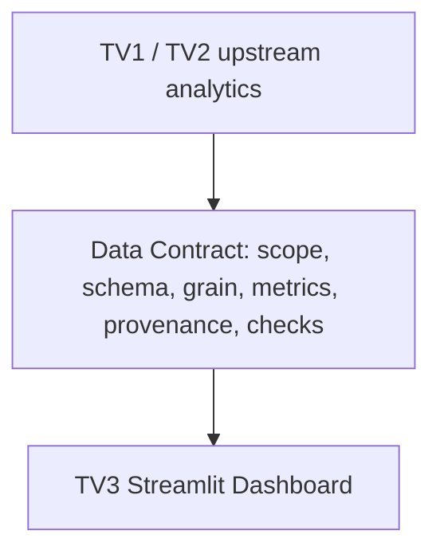

# V03.1 — DISCUSSION DRAFT: Dashboard Data Contract

> **NOT APPROVED**
> **NOT PRODUCTION READY**
> Bản nháp thảo luận cho TV1/TV2 review; không phải schema chính thức, không xác nhận production và không tự đánh V03 PASS.

## 1. Nguồn và phân loại bằng chứng

Ngày soạn V03.1: **19/10/2026**, base `e0d5d96a9542d9c0a713d810429335ea4eb810e6`. Cập nhật evidence V03.4B và Q07 v2 V03.4F: **20/10/2026**, branch `feat/tv3-dashboard`, review base `ba57c728d56e887c7555e545032e93a762b77801`. Chỉ cập nhật tài liệu này, không triển khai loader/validator hoặc V04–V06.

Nguồn: [wireframe V01.3](dashboard_wireframe.md), [demo design](demo_script_draft.md), A01 và assessment V03.0 trong cuộc trao đổi TV3. A01 do TV2 bàn giao, khảo sát 07/10, cập nhật raw 08/10/2026; nguồn phía TV2 `docs/a01_analysis_questions.md`, branch `feat/tv2-analysis`, phiên bản khảo sát `2386394`; SHA-256 bản đã dùng `30CA76E433492F0ACA52CF2C0D05CF178552CB2CC8AEEDF4D4F6593BEA3B7F22`. Không mặc định file có trong checkout TV3, không tạo link tới đích chưa có.

| Nhãn | Ý nghĩa |
| --- | --- |
| VERIFIED ARTIFACT | Đã trực tiếp đọc tài liệu/artifact; audit/schema lịch sử chỉ chứng minh nội dung lưu sẵn, không xác minh lại output hiện tại |
| TEAM REPORTED | TV1/TV2 reported qua user; chưa kiểm chứng artifact tương ứng tại TV3 |
| PROPOSED | Logical datasets/fields/keys/types/capabilities để thảo luận; chưa phải physical schema hoặc enum cuối |
| PENDING CONFIRMATION | Cần owner bàn giao artifact/version/checks và phản hồi; chưa nhận là đã ký duyệt |

**Quy tắc tên:** Logical datasets/analytics aliases, metadata/metric fields, keys và output types mới vẫn **PROPOSED**; physical production contract **PENDING CONFIRMATION**. Các physical source fields được ghi rõ VERIFIED ARTIFACT dưới đây chỉ xác minh schema/metadata tại commit nguồn, không tự khóa schema analytics hoặc nghiệm thu output IT. Cột nguồn A01/D04 không thay evidence D05/D06/D07.

V01: TV1 conditional design OK; TV2 design OK with corrections — **TEAM REPORTED**, không là full V01 PASS. V03 Discussion Draft đã publish, đã nhận feedback TV1/TV2; bản này cập nhật evidence, physical schema/sign-off vẫn PENDING CONFIRMATION.

### 1.1. Evidence snapshot cho V03.4B

Đã đọc artifact TV1 bằng `git show` tại đúng commit, không checkout/merge; **không readback Parquet tại TV3**, không chạy lại validation/Spark. Các counts sau là nội dung evidence lưu sẵn, không phải analytics mới.

| Evidence | Commit ghim / artifact đã đọc | Phạm vi xác minh |
| --- | --- | --- |
| D05 — VERIFIED ARTIFACT | `457f90ae4c8074a468ec6ac8f410dd31bbbb4a6b`; `data/audit/d05_canonical_schema.json`, `data/audit/d05_official_run_manifest.json`, `data/audit/d05_official_validation.csv`, `docs/d05_official_report.md` | Schema, manifest, 72/72 checks PASS và report; group acceptance PENDING |
| D06 — VERIFIED ARTIFACT | `5fda1789b84494a856743c087d10fc511d013d93`; `src/d06_official_contract.py`, `data/audit/d06/pilot_spark_schema.json`, `docs/d06_official_readiness.md` | Contract/runner/readiness; không chứng minh Full output |
| D07 — VERIFIED ARTIFACT | `479d3d83ff3194a5556ce29884c92478c90a969c`; `data/audit/d07/d07_20261019_01/output_schema.json`, `data/audit/d07/d07_20261019_01/run_manifest.json`, `data/audit/d07/d07_20261019_01/validation_summary.json`, `data/audit/d07/d07_20261019_01/completion.json`, `data/audit/d07/d07_20261019_01/source_profile.json`, `docs/d07_salary_report.md`, `config/d07_salary_policy_v1.json`, `src/normalize_salary.py` | Schema/metadata/report của ALL JOBS staging; không readback hoặc nghiệm thu IT |
| TV2 review — TEAM REPORTED / TV2 REVIEW (snapshot V03.4B) | Findings ban đầu do user cung cấp cho review TV3 commit `ba57c728`; khi soạn V03.4B chưa trực tiếp đọc report/code TV2 | V03.4E/V03.4F đã đọc Git objects TV2 tại commit ghim mục 1.2; không checkout/copy artifact vào TV3. Không dùng snapshot cũ thay implementation hiện tại |

D06 Full, A05 official run, A06–A08 IT production và D07 IT acceptance vẫn **PENDING CONFIRMATION**.

### 1.2. TV2 Q07 v2 — evidence update V03.4F

**VERIFIED ARTIFACT — VERIFIED CODE AT PINNED COMMIT:** `8323b5b9f4025ec4909ead912aafbef6c5825e6c` trên `feat/tv2-analysis`. Đọc bằng `git show` full SHA, không checkout/merge: `src/q07_salary.py:20–92`, `config/q07_salary_contract_v2.json:2–80`, `src/a06_a08_spark_analysis.py:76–87,252–274`, `src/d06_handoff_validation.py:7–12,43–66`. Đây là xác minh code và candidate schema, không phải final physical schema hoặc xác minh production output. Phân loại gốc vẫn VERIFIED ARTIFACT / TEAM REPORTED / PROPOSED / PENDING CONFIRMATION.

**VERIFIED ARTIFACT — saved regression evidence:** `data/audit/tv2_publication_20261020.json` lưu 103 test khác nhau: **102 PASS, 1 SKIP, 0 FAIL, 0 ERROR**, khớp khi đếm records. SKIP `test_confirmed_d06_end_to_end`: thiếu confirmed D06 Full; không thay bằng 105 development jobs. `data/audit/tv2_q07_contract_v2_20261020.json` lưu kiểm thử Q07 synthetic và D05/D07 ALL JOBS staging; giữ cả lỗi encoding ban đầu và kết quả retry. **Không chạy lại tests/Spark tại TV3**, không gọi evidence lưu là real IT end-to-end PASS. A05 official và A06–A08 IT production vẫn PENDING.

Q07 v2 đã giải quyết previous paired-sample gap ở mức candidate code/test. Các mô tả `salary_n` paired, `percentile_approx` accuracy=10000 và ngưỡng 5 trước đây là **HISTORICAL**, không mô tả implementation v2 hiện tại. Source/basis/eligibility/outlier/method/tolerance/small-N sign-off vẫn PENDING CONFIRMATION.

## 2. Contract overview

| Vai trò | Trách nhiệm dự kiến — PROPOSED, owner từng output cần xác nhận |
| --- | --- |
| TV1 | D05 canonical, D06 population/classification integration, D07 validity/source; schema/manifest, grain, audit, UTC/snapshot |
| TV2 | A02 taxonomy, A03 labels/source, A05 extraction, A06/A07/A08 aggregate; formulas/denominators và semantics Q01–Q08 |
| TV3 | Consumer mapping, filter capability, hiển thị count/denominator/missing/provenance; kiểm tra tiêu thụ contract sau ký duyệt |

Giữ nguyên scaffold hữu ích: tính toán nặng/aggregate ở upstream Spark, dự kiến trao đổi Parquet/CSV tại `data/analytics/`. Streamlit **không tự JOIN raw hoặc tính lại toàn bộ pipeline Spark**. Mỗi bảng cần cỡ mẫu đúng nghĩa; job_count không mặc nhiên thay denominator.

Overview dùng Q01–Q04/Q08; Skills dùng Q05/Q06; Salary & Quality dùng Q07/audit. Chỉ diễn giải dataset/scope đã công bố, không suy rộng toàn thị trường.

## 3. Bốn chiều metadata độc lập — PROPOSED

| Chiều logic | Ví dụ khái niệm, không chốt enum vật lý | Quy tắc |
| --- | --- | --- |
| Population scope | ALL_JOBS / IT subset | Có population version và predicate chọn tập |
| Classification decision | ACCEPT / REJECT / REVIEW | IT analytics chính thức dự kiến dùng ACCEPT được nhóm xác nhận; REVIEW không tự thành REJECT/ACCEPT |
| Data origin | REAL / SYNTHETIC_SAMPLE | Synthetic không được nhận như production findings |
| Release status | STAGING / ACCEPTED_PRODUCTION | Real vẫn có thể staging; production cần evidence/sign-off |

Không gộp SAMPLE, REVIEW, IT_ACCEPTED thành một enum. Cách mã hóa decision policy/không áp dụng classification cho ALL_JOBS còn PENDING CONFIRMATION. Missing file/lỗi schema là tình trạng khả dụng/validation, không là classification decision hoặc 0 tin.

IT scope phải có D06 Full population và policy version được duyệt; canonical ALL JOBS hoặc pilot không tự là T. Giữ reconciliation ACCEPT/REJECT/REVIEW theo policy, không âm thầm loại REVIEW như REJECT.

## 4. Semantics chung: population, missing, types, keys

T là tập CNTT đã xác nhận, một dòng/job_id không NULL; N=countDistinct(T.job_id). Với filter F hợp lệ, S=T trong F, B=countDistinct(S.job_id), không lọc thì B=N. T/N/S/B là ký hiệu toán học, không phải schema vật lý.

| Ký hiệu | Định nghĩa trong cùng run/scope/filter |
| --- | --- |
| L | Distinct tin trong S có location dùng được |
| R | Distinct tin trong S có remote flag TRUE/FALSE hợp lệ |
| K | Distinct tin trong S có ít nhất một nhãn Q05 mapping hợp lệ |
| D / D_g | Description dùng được và xử lý thành công toàn scope/theo nhóm, **gồm zero-skill** |
| B_g | Tổng distinct tin IT nhóm nghề/experience tương ứng, **gồm thiếu lương** |
| V_basis | Distinct tin có timestamp hợp lệ của đúng mốc trong S; hai mốc có denominator riêng |

- Count bằng DISTINCT job_id; Q05/Q06 khử trùng cặp job-label/job-skill. Không dùng row count JOIN/explode làm số tin, không dùng nhánh nhiều skill rows tính lương.
- Giữ tập nền/NULL qua LEFT JOIN/bridge hoặc aggregate trước JOIN; orphan ngoài phép đo, audit riêng; kiểm tra unique key/grain trước và sau JOIN.
- Missing bucket trình bày không ghi đè NULL nguồn. Không gán thiếu thành 0/FALSE/nhãn thật; IT_OTHER không tự là unknown.
- d=0 -> rate NULL/“Không đủ dữ liệu”; không điền 0%. Count 0 có thể hợp lệ khi scope/manifest xác nhận, không tạo zero giả thay file thiếu.
- Display percentage=100*n/d với denominator có tên rõ; analytical fraction=n/d, xem mục 4.3. Tổng percentage nhiều nhãn/skill có thể >100%, nhưng từng numerator nhãn/skill vẫn <= denominator tương ứng.
- Không cộng percentage, denominator lặp hoặc median-of-medians. Không tính pooled quantiles/IQR từ quantiles/IQR nhóm.
- Chỉ cộng counts khi cells loại trừ nhau, đủ phạm vi, cùng version; nhóm chính A02 cần xác nhận, SOFTWARE cha/con không được đếm cùng cấp.

### 4.1. Field types và bằng chứng

VERIFIED ARTIFACT: `data/audit/d04_schema_changes.csv` ghi kiểu D04 lịch sử; bảng sau giữ lineage lịch sử. Schema D05/D06/D07 được đọc tại commit ghim mục 1.1, không từ Parquet readback tại TV3.

| Cột nguồn lịch sử | Kiểu ghi trong audit D04 |
| --- | --- |
| postings.job_id, salaries.job_id | bigint |
| postings.title/description/location/formatted_experience_level | string |
| postings.formatted_work_type/work_type/currency/pay_period/compensation_type | string |
| postings.remote_allowed | boolean, giữ NULL |
| postings.original_listed_time/listed_time | timestamp; raw epoch milliseconds -> UTC, bản sao *_raw string |
| postings/salaries.min_salary/max_salary/med_salary | decimal(20,4); cast chưa phải D07 business validity |

VERIFIED ARTIFACT bổ sung:

| Source schema | Field/type và ràng buộc đúng scope |
| --- | --- |
| D05, 50 top-level fields | `job_id` long, storage nullable=true; run 123849 ALL JOBS: rows=distinct job_id, 0 null job_id, một dòng/job_id qua runtime validation. Storage nullable không thay invariant quan sát; acceptance nhóm PENDING |
| D05 text / remote / time | `formatted_experience_level`, `location`, `description`, `source_description`, `source_description_sha256`: string; `remote_allowed`: nullable boolean; `original_listed_time` và `listed_time`: timestamp UTC |
| D05 job_functions | array of struct (`skill_abr`: string, `skill_name`: string, `mapping_status`: string), không phải technical skills hoặc primary category |
| D06, 27 fields | `d06-official-v1`: `job_id` long non-null, `it_decision` string non-null, `is_it` nullable boolean, `primary_group_code`/`subgroup_code` nullable string, `taxonomy_version`/`taxonomy_sha256` string non-null |
| D07, 28 fields | Original source salary decimal(20,4), normalized min/med/max decimal(38,4); physical metadata/enum tại staging không tự là physical schema Q07 |

PROPOSED aggregate types: count/denominator số nguyên không âm; rate numeric nullable; mã/nhãn/version chuỗi hoặc mã được duyệt; quantiles numeric precision/scale chờ D07; time/period encoding chờ UTC contract. Không tự chốt int width/decimal scale/physical timestamp/null encoding mới.

### 4.2. Grain/key conventions — PROPOSED

Scope identity gồm dataset/run/version, population/decision policy và filter context không nhập nhằng. Unique key logic = scope identity + dimensions của từng dataset. Summary một dòng/context như từng Q định nghĩa; không SUM summary lặp khi JOIN detail.

Mã NULL bucket, ALL/subtotal và giá trị thật phải phân biệt, encoding còn PENDING CONFIRMATION. Metadata có thể ở manifest thay vì lặp trên mọi dòng. Mọi contract Q dưới đây kế thừa mục 3–4 và provenance/acceptance mục 9.

### 4.3. Fraction / percentage — logical semantics, physical mapping PROPOSED

**TEAM REPORTED / TV2 REVIEW:** candidate `share_*` xuất fraction. Với d>0, ratio=n/d thuộc [0,1]; display percentage=100*ratio thuộc [0,100]. Với d=0, cả hai NULL. Ví dụ minh họa công thức, **không phải findings**: 40/100=0.4 -> 40%.

Mapping đề xuất: TV2 `share_*` fraction -> TV3 UI percentage formatter -> 40%, chuyển đổi hiển thị đúng một lần, không nhân 100 hai lần. Schema/metadata phải khai báo rate unit; không suy unit từ tên mơ hồ. Áp dụng mọi rate Q01–Q08/coverage/Quality; các công thức 100*n/d dưới đây là display percentage, không yêu cầu producer trả percentage. Physical production mapping PENDING CONFIRMATION.

## 5. Upstream readiness

| Nguồn | Bằng chứng và trạng thái | Hệ quả |
| --- | --- | --- |
| D05 | VERIFIED ARTIFACT tại commit mục 1.1: 50 fields, 123849 ALL JOBS, 72/72 checks PASS; unique/non-null job_id trong run | Group acceptance PENDING; không phải IT population/N |
| D06 | VERIFIED ARTIFACT: classification schema 27 fields, `d06-official-v1`; ACCEPT -> true, REJECT -> false, REVIEW -> NULL | Error/missing classifier output không tự gán REVIEW; Full/IT ACCEPT population/IT N và validated enriched input theo mục 5.2 PENDING; classification output một mình chưa đủ receiver TV2 |
| D07 | VERIFIED ARTIFACT: run `d07_20261019_01`, 28 fields, ALL JOBS NORMALIZATION STAGING, completion SUCCEEDED; business acceptance NOT_GRANTED/PENDING | Không là D06 Full/IT production; chi tiết mục 5.1 |
| A01 | VERIFIED ARTIFACT đủ Q01–Q08, hash khớp nguồn mục 1 | Requirements, không phải findings IT |
| A02 | TEAM REPORTED / TV2 REVIEW: active local v0.2.0, candidate handoff v0.2.2 | D06 effective production taxonomy version PENDING CONFIRMATION; không promote candidate |
| A03 | TEAM REPORTED / TV2 REVIEW: 35 source function labels, không phải technical skills | Mapping/code + checksum/snapshot; không tự đặt semver A03 |
| A05 | Stable dictionary v0.1.2/46 codes và pinned release đã đối chiếu artifact TV2 trong V03.4E; parity 105 development jobs là VERIFIED SAVED TEST EVIDENCE, không phải rerun TV3 | Official run chưa có; candidate context recommendations chưa tích hợp extractor; source binding/receipt còn chờ |
| A06/A07/A08 | VERIFIED CODE AT PINNED COMMIT mục 1.2: analyzer, Q07 v2 và candidate schemas; schema tổng vẫn ghi `CANDIDATE_NOT_SPARK_VALIDATED`. Saved fixtures không tự nâng status schema | Q07 SATISFIED BY CANDIDATE DESIGN, pending sign-off/production; Q01–Q04 marginal, Q05 official projection, Q06 independent group summaries và Q08 policies còn thiếu. Không có accepted IT production/joint-filter output |
| Local data/processed và data/analytics | VERIFIED ARTIFACT kiểm kê: chỉ .gitkeep ở thời điểm review | Không có output hiện hành để xác minh schema |
| Audit D03/D04/D05 pre-check | VERIFIED ARTIFACT lịch sử; d04_validation.csv ghi 67 PASS | Không thay checks D05/D06/D07 mới |

[Project status](../handoff/project_status.md), [D05 pre-check](../d05_precheck.md), [scaffold](../d05_implementation_scaffold.md) ghi trạng thái lịch sử trước D05 official metadata. Evidence commit ghim mới hơn đã đọc riêng mục 1.1; không sửa tài liệu cũ, không suy artifact Full/production đã có ở checkout TV3.

A01 08/10 còn ghi A05 chưa triển khai; TV2 review mới hơn báo parity 105 development jobs PASS. Đây là khác thời điểm, chưa phải official run/production sign-off; raw/staging/sample không là thống kê IT chính thức.

### 5.1. D07 salary evidence và giới hạn — VERIFIED ARTIFACT

Run `d07_20261019_01`, scope `ALL_JOBS_NORMALIZATION_STAGING_NOT_OFFICIAL_IT`; completion SUCCEEDED khác business acceptance (PENDING). Manifest intent ban đầu RUNNING không thay completion record. TV3 chưa readback Parquet hoặc xác minh toàn bộ output inventory chain.

| Metadata / policy | Nội dung tại commit D07 |
| --- | --- |
| Counts | USABLE 36059; MISSING 87776; INVALID 14; AMBIGUOUS 0; EXCLUDED 0. Source BOTH_AGREE 36073, NONE 87776 |
| Five statuses | MISSING, USABLE, INVALID, AMBIGUOUS, EXCLUDED; không gộp các trường hợp thiếu/lỗi/mơ hồ/loại trừ thành usable |
| Source resolution | Whole-source selection; không coalesce riêng từng cột từ postings/salaries thành bộ hỗn hợp; không FX, không impute, không NULL -> zero |
| Annualization policy | `d07-salary-v1`: YEARLY 1, MONTHLY 12, WEEKLY 52, BIWEEKLY 26, HOURLY 2080. Normalized unit ANNUAL_EQUIVALENT; monetary normalized fields chỉ cho USABLE |
| Measures khác nhau | Original salary theo unit nguồn; annualized equivalent theo factor; statistical P50 là phân vị tập quan sát. Stored `normalized_med_salary` là med nguồn nhân factor, KHÔNG phải statistical P50; annualized equivalent không là thu nhập năm thực tế |
| Validity / outliers | USABLE là đạt policy cơ học; chưa có approved outlier threshold. Không suy mọi giá trị USABLE đều được duyệt cho Q07 |
| ALL JOBS coverage | Có amount 36073/123849 = 29.1266%; usable 36059/123849 = 29.1153%. Chỉ ALL JOBS staging, không phải coverage IT |
| Derived med count | 6266 normalized_med_salary non-null = 6280 source med non-null - 14 invalid med-zero, suy ra từ evidence đã đối soát; KHÔNG direct Parquet count tại TV3. Không dùng 6266 hoặc 36059 làm n mặc định của quantiles Q07 |

### 5.2. D06 enriched input — future upstream integration dependency

VERIFIED ARTIFACT: D06 classification schema 27 fields ở commit TV1 mục 1.1 không tự là bảng IT đầy đủ cho receiver TV2. VERIFIED CODE AT PINNED COMMIT mục 1.2: receiver còn yêu cầu `formatted_experience_level`, `location`, `formatted_work_type`, `work_type`, `remote_allowed`, `original_listed_time`, `listed_time`, `source_description`, `source_title` và source hashes. Các thuộc tính D05 phải đi cùng membership/taxonomy D06 đã xác nhận.

**PROPOSED / PENDING CONFIRMATION:** TV1/TV2 bàn giao validated enriched IT input hoặc approved join với D05. Cần kiểm non-null/unique và FK job_id, population/scope (không dùng ALL JOBS thay IT ACCEPT), grain sau join, source/run/version/hash consistency, text binding và receiver schema compatibility. Không mặc định D06 output một mình đủ, không tự quyết định layout/join policy; chưa triển khai join hoặc sửa upstream trong task này.

## 6. Contract logic Q01–Q08

Các logical analytics aliases/fields/keys/types dưới đây **PROPOSED**; physical source types được ghi VERIFIED ARTIFACT riêng theo mục 4.1. Không bắt buộc mỗi logical dataset là một file hoặc Q dùng chung một physical table. Layout cuối PENDING CONFIRMATION.

### Q01 — Cơ cấu nhóm nghề

| Thuộc tính | Nội dung thảo luận |
| --- | --- |
| Question ID | Q01 — Cơ cấu các nhóm nghề trong tập tin CNTT như thế nào? |
| Producer / Owner | PROPOSED: TV2 A02/A06 định nghĩa/aggregate; TV1 D05/D06 cung cấp T và grain evidence |
| Consumer page/section | Overview / Cơ cấu nhóm nghề |
| Proposed logical dataset | PROPOSED: Q01_CATEGORY_DISTRIBUTION + POPULATION_SUMMARY |
| Required fields | Scope identity; main category/unknown bucket; distinct count; B; tỷ trọng; taxonomy/filter version. CANDIDATE logical mapping: D06.primary_group_code -> main category, D06.subgroup_code -> subgroup; đối chiếu A02, không thay bằng industries/job_functions. job_id chứng minh upstream, không bắt UI nhận toàn bộ IDs |
| Field type | D05 job_id long storage nullable=true, runtime non-null/unique trong run; D06 primary_group_code/subgroup_code nullable string VERIFIED ARTIFACT. Analytics types PROPOSED theo mục 4.1 |
| Grain | Một dòng/scope-filter context × main category; summary một dòng/context |
| Primary/unique key | PROPOSED: scope identity + main-category bucket; summary key=context; unknown/ALL encoding chờ xác nhận |
| Count/metric semantics | Mỗi tin một nhóm chính hoặc chưa xác định theo A02; DISTINCT, không dùng ngành hoặc nhãn IT thay main category |
| Numerator | n_g = distinct tin trong S thuộc nhóm g |
| Denominator | B cho tỷ trọng 100*n_g/B, giữ unknown. Khi filter category, ghi đây là phân bố có điều kiện trong S |
| Filter capability | Category/experience/location theo mục 8; cộng count chỉ nếu disjoint. SOFTWARE subgroup chờ official artifact và aggregate |
| Missing/NULL policy | Giữ NULL nguồn; unknown theo A02, không tự gộp IT_OTHER |
| Data source | T từ D05/D06; A02 dùng postings.title/description; JS/SK/JI/IN chỉ hỗ trợ nếu A02/A03 cho phép |
| Taxonomy/method version | TEAM REPORTED / TV2 REVIEW: A02 active local v0.2.0, candidate handoff v0.2.2; D06 effective production taxonomy version PENDING CONFIRMATION. Runner ghim candidate không chứng minh Full đã dùng version đó; không promote v0.2.2 |
| Provenance requirements | Mục 9; canonical/D06 run, predicate, aggregate run, unique/grain checks |
| Current readiness | D05/D06 schema VERIFIED ARTIFACT; A06 marginal candidate code verified tại commit mục 1.2, chưa joint-filter/IT production output; UNSUPPORTED / PENDING |
| Open questions | TV2: official category/priority/unknown/subgroup? TV1: T/N/assignment schema? Cả hai: filter context/ALL aggregate? |

### Q02 — Nhãn kinh nghiệm/cấp bậc

| Thuộc tính | Nội dung thảo luận |
| --- | --- |
| Question ID | Q02 — Các nhãn cấp kinh nghiệm/cấp bậc phân bố thế nào trong tin CNTT? |
| Producer / Owner | PROPOSED: TV2 A06/alias rules; TV1 T và source fields |
| Consumer page/section | Overview / Kinh nghiệm |
| Proposed logical dataset | PROPOSED: Q02_EXPERIENCE_DISTRIBUTION + EXPERIENCE_COVERAGE_SUMMARY |
| Required fields | Scope identity; experience label/mapping reference; missing bucket; count; B; có nhãn count; tỷ trọng/coverage |
| Field type | D05 formatted_experience_level string VERIFIED ARTIFACT; normalized/count/rate outputs PROPOSED |
| Grain | Scope-filter context × experience/missing bucket; summary một dòng/context |
| Primary/unique key | PROPOSED: scope identity + experience bucket; summary key=context |
| Count/metric semantics | DISTINCT jobs từng nhãn, thiếu riêng; cấp bậc không tương đương số năm kinh nghiệm |
| Numerator | Distinct tin từng nhãn và distinct tin thiếu trong S |
| Denominator | B cho phân bố có thiếu; conditional distribution trên tập có nhãn chỉ khi mẫu số riêng và coverage/B được ghi |
| Filter capability | Category/experience/location cần joint aggregate đúng scope; không suy intersections từ marginal charts |
| Missing/NULL policy | Giữ thiếu mặc định; không gán Entry level hoặc 0 năm |
| Data source | T + postings.formatted_experience_level và alias rules được duyệt |
| Taxonomy/method version | A02 cho category; experience normalization/alias version PROPOSED, chờ TV2 |
| Provenance requirements | Mục 9; source/alias version, scope và normalization checks |
| Current readiness | D05 source field schema VERIFIED ARTIFACT; IT aggregate chưa VERIFIED; UNSUPPORTED / PENDING |
| Open questions | TV2: alias/nhóm nào được duyệt? TV1/TV2: missing summary và denominator từng filter context? |

### Q03 — Địa điểm đăng tuyển

| Thuộc tính | Nội dung thảo luận |
| --- | --- |
| Question ID | Q03 — Tin CNTT tập trung ở những địa điểm đăng tuyển nào? |
| Producer / Owner | PROPOSED: TV2 A06/usable rules; TV1 source/population |
| Consumer page/section | Overview / Top location |
| Proposed logical dataset | PROPOSED: Q03_LOCATION_DISTRIBUTION + LOCATION_COVERAGE_SUMMARY |
| Required fields | Scope identity; location nguồn/trimmed label hoặc mapping reference; usable/missing/invalid summary; n_location, L, B; tỷ lệ/coverage |
| Field type | D05 location string VERIFIED ARTIFACT; aggregate/bucket types PROPOSED |
| Grain | Scope-filter context × location dùng được; coverage summary một dòng/context |
| Primary/unique key | PROPOSED: scope identity + location label theo rule duyệt; summary key=context |
| Count/metric semantics | DISTINCT jobs theo chuỗi trim; không tự explode nhiều địa điểm. Top-k chỉ giới hạn hiển thị |
| Numerator | n_location từng location, L cho coverage |
| Denominator | % từng location=100*n_location/L; coverage=100*L/B; missing/invalid theo policy summary |
| Filter capability | Category/experience/location cần đúng context. Top-k không đổi L/B; đổi k cần distribution đầy đủ hoặc đủ capability được công bố |
| Missing/NULL policy | Giữ NULL; thiếu không là Remote hoặc địa chỉ công ty; thiếu/invalid tách theo rules |
| Data source | T + postings.location; zip_code/fips chỉ đối chiếu khi phù hợp |
| Taxonomy/method version | A02; trim/usable/parse rule version cần xác nhận |
| Provenance requirements | Mục 9; source field, normalization rule, coverage scope và phép parse được duyệt |
| Current readiness | D05 source schema VERIFIED ARTIFACT; IT aggregate chưa VERIFIED; UNSUPPORTED / PENDING |
| Open questions | TV2: usable/multiple-location semantics? Không tự parse thành phố/quốc gia. TV1/TV2: L/B được xuất theo filter grain nào? |

### Q04 — Employment work type và remote riêng

| Thuộc tính | Nội dung thảo luận |
| --- | --- |
| Question ID | Q04 — Các loại việc làm được ghi trong tin CNTT phân bố thế nào? Remote khảo sát riêng theo A01 |
| Producer / Owner | PROPOSED: TV2 A06/A03 semantics; TV1 nullable source/canonical |
| Consumer page/section | Overview / Employment và khối Remote riêng |
| Proposed logical dataset | PROPOSED: Q04_EMPLOYMENT_DISTRIBUTION + Q04_REMOTE_DISTRIBUTION + Q04_COVERAGE_SUMMARY |
| Required fields | Scope identity; employment label/missing; remote state TRUE/FALSE/NULL riêng; distinct counts; B/R; rates/coverage; mapping references |
| Field type | D05 formatted_work_type/work_type string, remote_allowed nullable boolean VERIFIED ARTIFACT; output bucket/enum/count/rate PROPOSED |
| Grain | Employment: context × work-type bucket. Remote: context × remote-state bucket. Summary một dòng/context |
| Primary/unique key | PROPOSED: scope identity + bucket của đúng dataset; không trộn employment và remote vào cùng dimension |
| Count/metric semantics | DISTINCT jobs theo formatted_work_type sau đối chiếu work_type; remote không là employment hoặc location |
| Numerator | n_worktype; n_true/n_false/n_null trong S, không tạo false từ NULL |
| Denominator | Employment %/B gồm thiếu; remote conditional %/R với R=n_true+n_false, coverage R/B; NULL count/% trên B. R=0 -> NULL rates |
| Filter capability | Theo scope category/experience/location của tab Cơ cấu khi có output; không thêm remote/employment business filter riêng V01 |
| Missing/NULL policy | TRUE/FALSE/NULL tách; NULL không onsite/hybrid/FALSE. Invalid decode audit riêng nếu có; không giả định đã quan sát false |
| Data source | T + postings.formatted_work_type/work_type; postings.remote_allowed độc lập |
| Taxonomy/method version | A02, work-type mapping và boolean interpretation version PENDING CONFIRMATION |
| Provenance requirements | Mục 9; boolean source/cast policy, mapping và reconciliation counts |
| Current readiness | D05 source schema VERIFIED ARTIFACT; A06 candidate TEAM REPORTED, production chưa VERIFIED; UNSUPPORTED / PENDING |
| Open questions | TV2: mapping/semantics? TV1: NULL/invalid giữ thế nào? Cả hai: employment và remote summary có cùng S không? |

### Q05 — Nhãn chức năng/lĩnh vực nguồn LinkedIn

| Thuộc tính | Nội dung thảo luận |
| --- | --- |
| Question ID | Q05 — Những nhãn chức năng/lĩnh vực nào trong mapping gốc được gắn nhiều nhất cho tin CNTT? |
| Producer / Owner | PROPOSED BY TV2 / AWAITING TEAM CONFIRMATION: TV1 source/grain/UTC/manifest; TV2 analytics aggregation; TV3 dashboard consumer/UI. Không là assignment đã được nhóm ký duyệt |
| Consumer page/section | Skills / Tab Nhãn chức năng-lĩnh vực, độc lập technical skills Q06 |
| Proposed logical dataset | PROPOSED: Q05_JOB_FUNCTION_DISTRIBUTION + JOB_FUNCTION_COVERAGE_SUMMARY |
| Required fields | Scope identity; skill_abr/skill_name/mapping_status hoặc mapping reference; distinct job-label count; K/B; no-valid-label count; tỷ lệ/coverage; mapping checksum/snapshot và unmapped/orphan audit reference |
| Field type | D05 job_functions VERIFIED ARTIFACT: array of struct skill_abr:string, skill_name:string, mapping_status:string. Output code/count/rate types PROPOSED; A03 35 labels TEAM REPORTED / TV2 REVIEW |
| Grain | Scope/nhóm context × label code; denominator summary một dòng/context |
| Primary/unique key | PROPOSED: scope identity + label code; bridge upstream unique (job_id, skill_abr); summary key=context |
| Count/metric semantics | Trong S, sử dụng một nguồn Q05 được xác nhận theo run; khử trùng (job_id, skill_abr), kiểm tra mapping/orphan và đếm DISTINCT job_id cho từng nhãn. job_skills JOIN skills là lineage hoặc dạng bridge/map tương đương; projection từ D05.job_functions vẫn là candidate. Official source/projection còn PENDING CONFIRMATION. |
| Numerator | Distinct tin gắn từng nhãn hợp lệ; K cho coverage; B-K không có nhãn hợp lệ |
| Denominator | K=distinct tin có ít nhất một nhãn mapping hợp lệ trong S; % nhãn=100*n_label/K; coverage=100*K/B. Không SUM K lặp theo nhãn |
| Filter capability | Category cần membership/aggregate đúng; Top-k chỉ ranking; không cộng counts giữa scope chồng lặp |
| Missing/NULL policy | Không nhãn, mã không mapping và orphan phân biệt; thiếu nhãn không chứng minh không có kỹ năng |
| Data source | D05.job_functions structured field; lineage jobs/job_skills + mappings/skills theo job_id/skill_abr. Canonical adapter projection chưa chứng minh official integration; TV1 xác nhận bridge/projection, grain, mapping/orphan rules. Không là IT primary category hoặc technical skills |
| Taxonomy/method version | A03 code/mapping + checksum/snapshot, không tự đặt A03 semver; A02 cho filter. Label policy và output TV2 PENDING CONFIRMATION |
| Provenance requirements | Mục 9; mapping version, pair dedup/checks, population và orphan audit |
| Current readiness | D05 structured source VERIFIED ARTIFACT; Q05 runner/projection candidate code đã đọc tại commit mục 1.2; official projection/bridge integration và IT aggregate/K vẫn PENDING; UNSUPPORTED / PENDING |
| Open questions | TV1: bridge/projection/grain/mapping/orphan rules? TV2: valid-label policy/output? Nhóm xác nhận owner proposal; giữ distinct job-label pairs và K/B, không đổi numerator/denominator |

### Q06 — Kỹ năng công nghệ được nhắc trong description

| Thuộc tính | Nội dung thảo luận |
| --- | --- |
| Question ID | Q06 — Kỹ năng công nghệ nào được nhắc nhiều trong mô tả tin CNTT và khác nhau ra sao giữa nhóm nghề? |
| Producer / Owner | PROPOSED: TV2 A05/A07 extraction/aggregate và A02/A03; TV1 T từ D06 |
| Consumer page/section | Skills / Tab Kỹ năng công nghệ description |
| Proposed logical dataset | PROPOSED: Q06_TECHNICAL_SKILL_DISTRIBUTION + DESCRIPTION_PROCESSING_SUMMARY; evidence reference nếu bàn giao, không ép file layout |
| Required fields | Scope identity; skill code/name, nhóm; distinct job-skill count; D/D_g; B/tổng nhóm; processing summary gồm zero-skill-only groups; success/missing/failed/partial counts; %, coverage; source_method/source_field, exact text/hash theo job_id và dictionary/method version |
| Field type | D05 description/source_description/source_description_sha256 string VERIFIED ARTIFACT. Success statuses từ TV2 review là TEAM REPORTED; physical processing/output schema vẫn PROPOSED / PENDING CONFIRMATION |
| Grain | Skill: context/nhóm × skill. Processing summary: một dòng/context/nhóm kể cả nhóm không có skill rows; bridge/evidence có grain riêng nếu bàn giao |
| Primary/unique key | PROPOSED: scope identity + category context + skill; summary key=context; upstream unique (job_id, skill) sau normalization |
| Count/metric semantics | DISTINCT tin nhắc skill thực tìm thấy qua A05. Nhắc đến không nghĩa bắt buộc/trình độ; không có keyword không chứng minh không yêu cầu skill |
| Numerator | n_skill hoặc n_skill,g sau dedup; D/D_g cho coverage; processed-zero-skill count riêng |
| Denominator | D/D_g gồm PROCESSED_WITH_MATCH và PROCESSED_NO_MATCH (TEAM REPORTED / TV2 REVIEW), tức description xử lý thành công **gồm zero-skill**. SOURCE_MISSING/FAILED/PARTIAL không thuộc D nhưng báo riêng. % skill trên D/D_g; processing coverage trên B/tổng nhóm, không suy summary từ skill-positive rows |
| Filter capability | Category theo context; overall cần aggregate riêng hoặc disjoint union có checks. Top-k không đổi D; matrix mỗi nhóm có D_g, không cộng percentages |
| Missing/NULL policy | SOURCE_MISSING, FAILED, PARTIAL tách khỏi hai success statuses; summary gồm cả zero-skill-only groups. Không tạo skill missing cho zero-skill; d=0 -> NULL rates; output production thiếu là PENDING IMPLEMENTATION |
| Data source | D05.description là clean text; D05.source_description là parsed source text có source_description_sha256/provenance. A05 có evidence/source_field contract riêng: exact text/hash theo job_id PENDING CONFIRMATION; không tự đổi clean/source text. TITLE_MATCH và skills_desc không tự là description extraction |
| Taxonomy/method version | TEAM REPORTED / TV2 REVIEW: stable dictionary A05 v0.1.2, 46 technical skill codes, pinned release; cần bàn giao pin/checksum và source_field/evidence contract thực dùng. Candidate context recommendations chưa tích hợp extractor |
| Provenance requirements | Mục 9; extraction run, processed population, evaluation và evidence/source reference. Parity phát triển không production sign-off |
| Current readiness | A05 parity 105 development jobs là saved evidence, không rerun TV3 hoặc official run. Verified analyzer giữ success gồm zero-skill; production output và independent processing summaries mọi nhóm còn thiếu: PENDING IMPLEMENTATION; UNSUPPORTED / PENDING |
| Open questions | TV2: exact source text/hash, release pin, success/backfill/zero-skill summaries và official evidence? TV1/TV2: đối soát job_id/text lineage; D/D_g export và joint/overall grain? Không tự chuyển nguồn extraction |

### Q07 — Lương theo nhóm nghề và kinh nghiệm

| Thuộc tính | Nội dung thảo luận |
| --- | --- |
| Question ID | Q07 — Lương công bố khác nhau thế nào theo nhóm nghề/nhãn kinh nghiệm trong cùng tiền tệ và kỳ trả? |
| Producer / Owner | PROPOSED: TV1 D07 validity/source/units; TV2 A08 aggregate và A02 nhóm nghề |
| Consumer page/section | Salary & Quality / Salary; hai panel min_salary và max_salary độc lập |
| Proposed logical dataset | PROPOSED: Q07_SALARY_QUANTILES + SALARY_POPULATION_COVERAGE_SUMMARY |
| Required fields | Scope identity; main category, experience; currency, pay_period, compensation_type; measure basis (original / annualized equivalent riêng); min_salary P25/P50/P75/IQR; max_salary P25/P50/P75/IQR; n_min/n_max; B_g; eligible-bundle definition/coverage; salary_source policy và validity/quantile provenance |
| Field type | VERIFIED ARTIFACT D05 original salary decimal(20,4), D07 normalized min/med/max decimal(38,4). Verified Q07 v2 candidate dùng selected_salary decimal(20,4), count bigint và scalar quantiles/IQR double nullable; không khóa final analytics precision/schema |
| Grain | Logical yêu cầu giữ scope × main category × experience × bộ đơn vị × measure basis. Verified Q07 v2 candidate dùng scope_id × salary_basis=POSTED_NATIVE × a02_group × formatted_experience_level × currency × pay_period × compensation_type × salary_source. Source dimension/basis là implementation candidate, sign-off PENDING TV1 + TV2; population summary gồm missing salary |
| Primary/unique key | PROPOSED: scope identity + category + experience + bộ đơn vị + measure basis; nếu giữ salary_source dimension phải thêm vào key và xác nhận ALL source aggregate. Summary key=population context; ALL/subtotal có output đúng riêng |
| Count/metric semantics | Giữ P25/P50/P75/IQR min_salary và max_salary riêng; n_min/n_max DISTINCT jobs hợp lệ từng endpoint có thể khác nhau. Verified Q07 v2 đếm mỗi endpoint non-null độc lập trong D07 USABLE cell, không yêu cầu endpoint kia có giá trị; previous paired salary_n là HISTORICAL, không còn dùng trong v2 |
| Numerator | n_min/n_max trong đúng nhóm/bộ đơn vị; eligible-bundle count theo D07 riêng, không mặc định bằng n_min/n_max |
| Denominator | n_min/n_max là cỡ mẫu của phân vị từng chỉ số. Coverage dùng B_g=tổng distinct tin IT nhóm/experience **gồm thiếu lương**; unit selector chọn numerator, không biến B_g thành tập chỉ có unit/lương. Chi tiết policy PENDING CONFIRMATION |
| Filter capability | Category multiselect so sánh hàng; experience; một bộ currency/pay_period/compensation_type. ALL/pooled cần quantile riêng, không median-of-medians/IQR từ extrema |
| Missing/NULL policy | Missing unit không gán default; n=0 -> quantiles NULL. Missing/invalid giữ trong population coverage; không đưa vào valid statistics hoặc gán lương 0 |
| Data source | T + D07 whole-source selected_salary và source/normalization_status/policy lineage; không coalesce từng cột hoặc dùng exploded label branch tính lương. Original và normalized annualized equivalent là measures riêng, không trộn; stored normalized_med_salary không là statistical median |
| Taxonomy/method version | D07 d07-salary-v1 verified tại staging. Verified Q07 v2 candidate: exact continuous percentile (linear interpolation), scalar output double; minimum_n=None, không approved default threshold, adequate_min/adequate_max NULL nếu chưa chọn ngưỡng. Method/precision/rounding/tolerance/small-N policy chưa APPROVED; percentile_approx accuracy=10000/ngưỡng 5 là HISTORICAL |
| Provenance requirements | Mục 9; source-bundle lineage, valid counts, D07 acceptance, unit consistency, quantile method/cỡ mẫu |
| Current readiness | SATISFIED BY CANDIDATE DESIGN ở code/test Q07 v2 tại commit mục 1.2; ba candidate outputs có mapping mục dưới. D07 vẫn ALL JOBS staging; source/eligibility/outlier/method/small-N sign-off, D06 enriched IT input và production PENDING. Business filter production vẫn UNSUPPORTED / PENDING |
| Open questions | TV1+TV2: authoritative source hay salary_source dimension; chốt endpoint eligibility, IT outlier policy, POSTED_NATIVE basis và exact method/double/rounding/tolerance/small-N? Independent endpoint samples đã có trong candidate v2, không còn paired-code gap. D07 USABLE không bằng n_min/n_max; không dùng 6266/36059 làm quantile n mặc định hoặc tự annualize trong UI |

**Source decision Q07 — PENDING TV1 + TV2:** A) source selection policy tạo một authoritative source; hoặc B) giữ salary_source như analytical dimension và ký duyệt keys, aggregation cùng ALL source view. Whole-source selection D07 đã verified không tự giải quyết grain của A08 candidate. Không tự chọn A/B.

**Sample/method decision Q07 — PENDING CONFIRMATION:** Q07 v2 tính `population_n=B_g` từ supplied population theo category/experience trước lọc salary eligibility/unit/source; gồm tin thiếu lương. `n_min`/`n_max` riêng; med-only có thể thuộc eligible bundle nhưng không vào endpoint sample. Source amounts giữ original `selected_salary`, basis `POSTED_NATIVE`; không FX, không tự annualize hoặc dùng normalized annual equivalent làm fallback. Scalar fields `min_salary_q1/min_salary_median/min_salary_q3/min_salary_iqr` và bộ `max_salary_*` tương ứng khác stored med_salary. Counts/quantiles là implementation candidate, không tự chấp thuận D07 USABLE eligibility hoặc outlier policy.

Verified analyzer truyền `minimum_salary_group_n` vào `minimum_n`; cấu hình chưa chọn ngưỡng -> None, adequate flags NULL. Exact percentile/double, floating tolerance/rounding và cách hiển thị/suppress small-N còn cần nhóm duyệt; không giữ ngưỡng 5 cũ như mặc định. ALL/pooled vẫn cần proper aggregate; không median-of-medians hoặc SUM B_g lặp.

| Q07 v2 candidate output — chưa là final physical schema | Mapping / grain / fields hiện có |
| --- | --- |
| q07_salary_separate_units | Candidate mapping tới Q07_SALARY_QUANTILES; key scope_id + salary_basis + category/experience + currency/pay_period/compensation_type + salary_source; population_n, eligible_bundle_n, n_min/n_max, scalar min/max quantiles/IQR, coverage_min/coverage_max/eligible_coverage, adequate_min/adequate_max |
| q07_population_summary | Candidate mapping tới SALARY_POPULATION_COVERAGE_SUMMARY; key scope_id + salary_basis + category/experience; population_n=B_g, eligible_bundle_n, eligible_coverage; gồm nhóm không có eligible salary, không SUM denominator từ detail |
| q07_quality_status | Candidate supporting audit; key scope_id + salary_basis + category/experience + normalization_status; distinct job_count theo status partition, không coi overlapping reason counts là partition |

Coverage fields là fraction n/B_g; UI percentage theo mục 4.3 đúng một lần. Nguồn: `src/q07_salary.py:67–92`, `config/q07_salary_contract_v2.json:31–80` tại full commit mục 1.2. Không coi ba tên/schema candidate này là output IT production đã bàn giao hoặc approved physical contract.

### Q08 — Phân bố tin theo thời gian trong dataset

| Thuộc tính | Nội dung thảo luận |
| --- | --- |
| Question ID | Q08 — Tin CNTT phân bố theo tuần/tháng ra sao khi dùng từng mốc đăng? |
| Producer / Owner | PROPOSED BY TV2 / AWAITING TEAM CONFIRMATION: TV1 source/grain/UTC/manifest; TV2 analytics aggregation; TV3 dashboard consumer/UI. Không là assignment đã được nhóm ký duyệt |
| Consumer page/section | Overview / Tab Thời gian |
| Proposed logical dataset | PROPOSED: Q08_TIME_DISTRIBUTION + TIMESTAMP_COVERAGE_SUMMARY |
| Required fields | Scope identity; basis original_listed_time hoặc listed_time; granularity; ISO week-year/week hoặc month year/key; period boundaries; distinct count; V_basis/B; missing/invalid; observed min/max; snapshot/window; partial-period indicator/basis |
| Field type | D05 original_listed_time/listed_time timestamp UTC VERIFIED ARTIFACT; D04 audit có raw epoch milliseconds/string lịch sử. Output period/basis/flag/count types PROPOSED |
| Grain | Context/nhóm × timestamp basis × granularity × kỳ; summary một dòng/context/basis, không lẫn tuần và tháng khi cộng |
| Primary/unique key | PROPOSED: scope identity + category context + basis + granularity + period key. ISO week-year khác calendar year khi qua biên |
| Count/metric semantics | DISTINCT job_id theo tuần ISO/tháng UTC. original_listed_time chính, listed_time đối chiếu riêng; không fallback hoặc cộng hai basis |
| Numerator | Distinct tin từng kỳ của đúng basis; V_basis cho coverage |
| Denominator | V_basis=distinct tin timestamp hợp lệ tương ứng trong S, riêng từng mốc; % kỳ=100*n_period/V_basis nếu hiển thị; coverage=100*V_basis/B |
| Filter capability | Category cục bộ; week/month chỉ đổi granularity; chưa có date-range business filter hoặc global time filter. Mỗi granularity cần output đúng |
| Missing/NULL policy | Missing/invalid ngoài bins, báo riêng; V=0 -> NULL rates; không impute từ mốc kia hoặc tự tạo kỳ đầy đủ khi file thiếu |
| Data source | T + postings.original_listed_time/listed_time và *_raw. Raw epoch milliseconds khác timestamp D04 đã cast UTC; không chia 1.000 lần nữa |
| Taxonomy/method version | A02, timestamp decode/timezone/period policy và snapshot policy PENDING CONFIRMATION |
| Provenance requirements | Mục 9; basis, UTC, window/run, min/max và căn cứ partial periods; observed min/max không tự chứng minh cửa sổ thu thập đầy đủ |
| Current readiness | VERIFIED CODE AT PINNED COMMIT mục 1.2: hai timestamp UTC, monthly/week_start; chưa có IT production output, category/coverage/window/period policies và sign-off đầy đủ. UNSUPPORTED / PENDING |
| Open questions | TV1/TV2: category filter, timestamp coverage/missing/invalid, snapshot/window, partial periods, ISO week-year presentation và producer sign-off? Nhóm xác nhận owner proposal. Không suy xu hướng thị trường hoặc repost từ phân bố/chênh lệch hai mốc |

## 7. Quality — hỗ trợ Q01–Q08, không thêm câu hỏi business

| Thuộc tính | Contract logic PROPOSED |
| --- | --- |
| Producer / Consumer | TV1 audit/quality, TV2 analytics coverage; TV3 Salary & Quality, hai section riêng |
| Logical datasets | PROPOSED: RAW_CLEAN_AUDIT_PROFILE và IT_ACCEPTED_QUALITY_PROFILE; không ép cùng schema/file |
| Required fields | Source table/metric/check/field nếu áp dụng; scope/run/version; đơn vị rows/distinct jobs/cells; numerator/denominator/rate; missing/invalid/rejected/orphan counts; check status; source artifact/audit time |
| Types / Grain / Key | Output types PROPOSED; một dòng/scope-run × source table × field/metric/check; key gồm đủ chiều áp dụng, NULL encoding chờ duyệt |
| Semantics | Raw/clean audit lịch sử khác IT accepted quality; N/grain/missing/description/salary/time coverage thuộc đúng run. Không so orphan row count với job count khác đơn vị |
| Filters / Denominator | Không mặc định theo Salary; scope/capability riêng, mỗi rate có denominator/scope/unit rõ; IT output chưa có -> MISSING |
| Missing / Provenance | Artifact thiếu chưa là 0 lỗi/tin; source/time/run độc lập banner Salary. Không hard-code raw metrics thay IT production |
| Readiness / Open questions | Audit lịch sử có, IT production quality chưa VERIFIED. TV1 cần manifest/scope/units/checks; TV2 xác nhận coverage rules |

## 8. Filter capability matrix — PROPOSED / DESIGN ONLY

Chưa có business filter IT production đạt SUPPORTED BY VERIFIED OUTPUT tại checkout. “Supported grain” là **grain cần producer xác nhận**, không phải tính năng đang có. Không suy capability production từ sample UI. Output thiếu -> **UNSUPPORTED / PENDING**.

| Page/section | Filter | Input field | Supported grain cần có | Denominator changes? | Requires upstream aggregate? | Current readiness | Pending owner |
| --- | --- | --- | --- | --- | --- | --- | --- |
| Overview Cơ cấu | Category | A02 main category | Category × experience × location context, Q01–Q04 + summaries | Có B/L/R và numerator | Có, với taxonomy/membership đã duyệt | UNSUPPORTED / PENDING | TV2 A02/A06; TV1 D06 |
| Overview Cơ cấu | Experience | formatted_experience_level | Joint context trên, giữ missing | Có S/B/L/R | Có; không suy intersections từ marginals | UNSUPPORTED / PENDING | TV2 alias/A06; TV1 source |
| Overview Cơ cấu | Location | location | Joint context + usable summary | Có S/B/L/R, coverage có điều kiện | Có | UNSUPPORTED / PENDING | TV2 usable rules; TV1/TV2 aggregate |
| Q03 | Top-k | Location ranking | L/B toàn context và đủ distribution | Không, chỉ trình bày | Cần distribution; không aggregate denominator theo Top-k | DESIGN ONLY; output PENDING | TV2 A06 |
| Q04 | Employment / remote | work-type fields; remote_allowed | Hai distributions độc lập cùng S | Theo context tab; R khác B | Có; không thêm business filter riêng V01 | UNSUPPORTED / PENDING | TV1 source; TV2 semantics/A06 |
| Q08 | Category | A02 category | Category × basis × granularity × period + summary | Có B/V_basis | Có | UNSUPPORTED / PENDING | TV1 population/time; TV2 output owner |
| Q08 | Week/month | original_listed_time, listed_time | Bins UTC từng basis/granularity | Không đổi V/B, đổi granularity | Có; re-bin chỉ khi period-compatible có checks, không mặc định tuần cộng ra tháng | DESIGN ONLY; aggregate PENDING | TV1 UTC/snapshot; TV2 aggregation |
| Q05 | Category | A02 category | Context × label + K/B summary | Có B/K/count nhãn | Có, distinct pairs trước aggregate | UNSUPPORTED / PENDING | TV1 bridge; TV2 A02/A03/analytics |
| Q05 | Top-k | Label distribution | Ranking + K/B toàn context | Không | Cần distribution, không đổi K | DESIGN ONLY; output PENDING | TV2 analytics Q05 |
| Q06 | Category | A02 category | Category × skill + processing D_g; overall riêng | Có B/D/D_g | Có, gồm zero-skill/status summaries | UNSUPPORTED / PENDING | TV2 A05/A07; TV1 T |
| Q06 | Top-k | Skill distribution | Ranking và D/D_g đúng scope | Không, không tính % trên Top-k | Cần distribution | DESIGN ONLY; output PENDING | TV2 A07 |
| Salary | Category | A02 category | Category × experience × bộ đơn vị, so sánh hàng | B_g/n của hàng; không pooled quantiles | Có, ALL riêng nếu cần | UNSUPPORTED / PENDING | TV1 D07; TV2 A02/A08 |
| Salary | Experience | formatted_experience_level | Strata/missing riêng, ALL aggregate riêng | Có B_g/n | Có, không median-of-medians | UNSUPPORTED / PENDING | TV1/TV2 |
| Salary | Currency | D07 currency | Bộ currency/pay_period/compensation_type | Đổi numerator/n; B_g gồm thiếu lương | Có + population summary riêng | UNSUPPORTED / PENDING | TV1 D07; TV2 A08 |
| Salary | Pay period | D07 pay_period | Cùng bộ đơn vị | Như currency, không annualize | Có | UNSUPPORTED / PENDING | TV1 D07; TV2 A08 |
| Salary | Compensation type | D07 compensation_type | Cùng bộ đơn vị | Như currency, không default NULL | Có | UNSUPPORTED / PENDING | TV1 D07; TV2 A08 |
| Quality | Raw/clean vs IT scope | Manifest/scope identity | Metric/check đúng scope/run | Riêng source; không theo Salary ngầm | IT profile cần output; raw audit riêng | Raw lịch sử có; IT UNSUPPORTED / PENDING | TV1; TV2 coverage |
| Mỗi page | Sample control | Data origin/availability | Từng nguồn/section/run | Đổi nguồn, không business filter | Sample/real tách biệt | Sample scaffold có; production gate DESIGN ONLY | TV3 consumer; TV1/TV2 acceptance |

Business multiselect không bảo đảm mọi tổ hợp có output đúng; chưa có thì disable/ẩn hoặc báo chưa hỗ trợ, không ước lượng. Không global state giữa page/tab mặc định. Summary JOIN vào detail chỉ để hiển thị không được SUM; không cộng percentage/denominator lặp. ALL/unknown/bỏ hết lựa chọn phải rõ context theo wireframe, không drop NULL ngầm. Muốn overall quantile phải có output đúng, không median của các median.

Category × experience × location vẫn **PENDING JOINT AGGREGATE**. TEAM REPORTED Q06 by_group/by_experience không chứng minh intersection; marginal tables không tái tạo joint filters. Q07 ALL/pooled cần proper aggregate. Candidate code/schema hoặc synthetic không nâng capability thành supported. Q08 có monthly/UTC week_start candidate không chứng minh ISO week-year presentation, category/coverage/window/partial-period policies đã hoàn tất; không thêm global date-range filter. Nếu sau này có date filter, timestamp basis cần team duyệt trước.

## 9. Provenance và validation/acceptance — DESIGN ONLY

### 9.1. Metadata logic đề xuất

Mọi field/encoding sau **PROPOSED**, có thể ở manifest hoặc metadata table có khóa tham chiếu; không chốt tên cột vật lý.

| Metadata | Ý nghĩa / người xác nhận |
| --- | --- |
| Dataset/run identifier | Phiên bản nguồn và lần tạo aggregate; TV1/TV2 |
| Population scope + predicate + denominator scope | ALL JOBS hay IT subset, filter context và N/B; TV1/TV2 |
| Classification decision policy | ACCEPT/REJECT/REVIEW, policy version, quyết định chọn tập; TV1/TV2 |
| Data origin | REAL/SYNTHETIC_SAMPLE, không suy từ định dạng file; producer |
| Release/acceptance status | STAGING/accepted production có evidence/sign-off đúng scope; team |
| Source artifact/path + version/checksum nếu bàn giao | Lineage D05/D06/D07/analytics; đường dẫn độc lập máy cá nhân; producer |
| Generated timestamp + timezone | Thời điểm xuất/representation UTC đã duyệt, khác timestamp đăng tin; producer |
| Taxonomy version | TEAM REPORTED active local v0.2.0 / candidate v0.2.2; effective D06 production version/hash và mã/nhãn/subgroup/priority/unknown PENDING CONFIRMATION; TV2 + TV1 |
| Method/dictionary version | A05 dictionary v0.1.2/pinned release TEAM REPORTED, exact release/hash/source_field/evidence lineage chờ bàn giao; A03 mapping/checksum/snapshot, không tự đặt semver; TV2 |
| D07 validity/source rules version | VERIFIED staging d07-salary-v1; policy SHA-256 `3c0e0a9b2c59bddff828d9d423d6659e19a3ceafae480c1cd3e50aa54221382b`; source/measure basis/IT eligible bundle/outlier acceptance còn chờ TV1+TV2 |
| Rate unit / consumer mapping | Analytical fraction [0,1] hoặc display percentage [0,100], numerator/denominator và NULL khi d=0; mapping chuyển hiển thị đúng một lần, physical encoding PENDING CONFIRMATION |
| Quantile/period method | Exact/approx và tolerance; ISO/UTC/snapshot policy; TV1/TV2 |
| Schema/contract version + producer | Contract áp dụng và người tạo; producer/team |
| Validation evidence | Check report, counts/reconciliation, schema/grain/semantics; producer/team |
| Sign-off reference | Ai xác nhận phần nào, ngày nào, artifact/version nào; conditional agreement không là acceptance toàn bộ |

### 9.2. Proposed checks, chưa triển khai

| Check | Điều kiện thiết kế |
| --- | --- |
| File format/readability | Artifact khớp manifest và format đã duyệt; lỗi đọc không là production hoặc 0 rows |
| Required columns / data types | Physical schema đã bàn giao; precision/timezone/nullable, không dùng D04 audit thay canonical schema mới |
| Non-null / nullable | Scope/key constraints theo contract; NULL nguồn giữ thiếu, không default remote/units/salary |
| Unique grain | Không trùng key dataset/context; NULL bucket/ALL không va chạm giá trị thật |
| DISTINCT semantics | CountDistinct job_id, dedup job-label/job-skill; grain trước/sau JOIN; orphan audit độc lập |
| Nonnegative counts | Counts/denominators nguyên >=0, có scope/unit rõ |
| Numerator <= denominator | Từng nhãn/skill/location/coverage khi áp dụng; tổng nhiều nhãn có thể vượt denominator, không kiểm tra sai tổng như partition |
| Coverage/rates | d>0: fraction [0,1] khớp n/d, percentage [0,100] khớp 100*n/d theo tolerance được duyệt. Khai báo rate unit trong schema/metadata, không suy từ tên; UI chuyển đúng một lần. d=0 -> cả hai NULL, không Infinity/NaN/0% thay thế |
| Missing / summary reconciliation | Giữ category/experience/employment missing; remote TRUE/FALSE/NULL riêng. D gồm PROCESSED_WITH_MATCH/PROCESSED_NO_MATCH, loại SOURCE_MISSING/FAILED/PARTIAL nhưng báo riêng; processing summary gồm zero-skill-only groups |
| Units / source consistency | Mỗi Q07 cell cùng currency/pay_period/compensation_type, measure basis và source policy đã duyệt; không trộn original/annualized, coalesce từng cột hoặc annualize ngầm. D07 USABLE/derived med count không thay endpoint n |
| Quantile order / IQR | P25<=P50<=P75; IQR=P75-P25, min/max riêng, n và precision/tolerance phù hợp; không median-of-medians |
| Timestamp / period validity | UTC; raw milliseconds khác timestamp đã cast; ISO week-year/period boundaries; hai basis riêng; partial period có snapshot evidence |
| Version consistency | Detail và summary cùng dataset/run/filter/rule version; không count run này chia denominator run khác |
| No synthetic production | Data origin synthetic không được ACCEPTED_PRODUCTION hoặc dùng làm findings IT thật |

Tất cả checks **PROPOSED / DESIGN ONLY**, chưa sửa `contract_validator.py` hoặc loader. Current validator chỉ kiểm tra DataFrame/nonempty và tên cột tối thiểu; đọc được tên file không thay gate. Empty output hợp lệ cần manifest/checks phân biệt MISSING; consumer behavior cho trường hợp này còn PENDING CONFIRMATION.

### 9.3. Acceptance gate đề xuất

1. Producer bàn giao artifact + physical schema/grain + manifest/source/version + validation evidence. TV3 kiểm tra khả năng tiêu thụ trong task được duyệt sau này.
2. TV1 xác nhận dữ liệu/grain/IT scope/D07/UTC/audit; TV2 xác nhận taxonomy/mapping/method/formulas/denominator/filter semantics và V01 design sign-off.
3. Team đối chiếu aggregate với population/processing summary, khóa capabilities và acceptance theo đúng artifact/version/scope. Parity pilot hoặc staging ALL JOBS không thay production IT acceptance.
4. Chỉ đủ evidence/sign-off mới chấp nhận production; Sample/Missing/Staging ghi trung thực, không nâng trạng thái bằng đổi tên file.

Gate còn **PENDING CONFIRMATION**. Document vẫn **NOT APPROVED / NOT PRODUCTION READY**.

## 10. Team sign-off questions — tất cả PENDING CONFIRMATION

Chưa có dòng nào được tài liệu này tự đánh dấu ký duyệt. Mỗi owner cần phản hồi bằng artifact/version/evidence.

| ID | Owner | Artifact / câu hỏi cần nhận | Quyết định bị chặn |
| --- | --- | --- | --- |
| T1-01 | TV1 | D05 schema/manifest/72 checks đã VERIFIED ARTIFACT tại commit ghim; xác nhận group acceptance và kế hoạch consumer readback/lineage bàn giao? | Acceptance canonical và physical mapping analytics, không yêu cầu lại evidence đã đọc |
| T1-02 | TV1 + TV2 | D06 Full output/reconciliation và effective taxonomy version/hash; IT ACCEPT population/T/N; validated enriched input hoặc approved join D05 theo mục 5.2, key/grain/source/run/schema checks? | Full IT scope/denominators và receiver compatibility; classification schema 27 fields một mình chưa đủ; error/missing không tự REVIEW |
| T1-03 | TV1 | D07 d07_20261019_01 schema/counts/completion đã VERIFIED ở ALL JOBS staging; business/IT acceptance và integration theo IT ACCEPT khi nào? | Không nâng completion SUCCEEDED thành IT production acceptance |
| T1-04 | TV1 + TV2 A08 | Chấp nhận candidate POSTED_NATIVE/whole selected bundle và salary_source dimension hay chọn authoritative source; IT eligibility/outlier và keys/ALL aggregate? | Q07 source/basis/eligibility chưa APPROVED dù v2 đã có endpoint n riêng; không tự chọn A/B |
| T1-05 | TV1 | D05 report đã giải thích +7 giờ employee snapshot là local display, epoch UTC không đổi; chốt original/listed semantics, snapshot/window/partial periods? | Không giữ chênh lệch hiển thị cũ như lỗi UTC đang mở; Q08 window/period acceptance còn chờ |
| T1-06 | TV1 | Raw/clean audit và IT quality output/manifest, metric units/source/time/checks? | Quality contract và production gate |
| T1-07 | TV1 + TV2 | Joint category × experience × location, ALL outputs/summaries và multiselect limits; proper pooled salary aggregate? | PENDING JOINT AGGREGATE, không ghép marginal hoặc median-of-medians |
| T2-01 | TV2 + TV1 | Xác nhận effective D06 taxonomy (active v0.2.0 vs candidate v0.2.2), mapping primary_group_code/subgroup_code, 9 nhóm/IT_OTHER/SOFTWARE/unknown/priority? | CANDIDATE mapping chưa official production; không promote candidate |
| T2-02 | TV2 + TV1 | A03 35 source labels: bàn giao mapping/code + checksum/snapshot, valid label/orphan rules, D05.job_functions projection và owner proposal? | Q05 canonical integration/analytics còn chờ; không đặt semver hoặc coi là technical skills |
| T2-03 | TV2 + TV1 | A05 v0.1.2 pinned release/hash, exact text/source_field/hash theo job_id; official output/evidence, success-status/backfill/zero-skill summary? | Q06 source provenance và D/D_g; thiếu production PENDING IMPLEMENTATION |
| T2-04 | TV2 | Candidate A06 schema/grain, alias/usable/missing/coverage Q01–Q04; Spark validation và joint-filter production tables? | Candidate code/schema không thay verified IT outputs |
| T2-05 | TV2 | A07 overall/by_group/by_experience và processing summary có zero-skill-only groups; intersection outputs có evidence không? | D/D_g đúng context; by_group/by_experience không tự hỗ trợ intersection |
| T2-06 | TV2 + TV1 | Q07 v2 endpoint samples/ba output mappings đã có candidate code/test; chốt source dimension/basis/ALL, exact continuous percentile với double, precision/rounding/tolerance và minimum_salary_group_n (null hoặc ngưỡng được duyệt) thế nào? | Quantiles/coverage/keys/small-N chưa APPROVED; paired salary_n và approximate/ngưỡng 5 chỉ HISTORICAL, không phải gap code v2 còn mở |
| T2-07 | TV2 + TV1 | Xác nhận proposal Q05/Q08: TV1 source/grain/UTC/manifest, TV2 aggregation, TV3 UI; Q08 category/coverage/missing/invalid/window/partial periods/ISO week-year presentation và producer sign-off? | PROPOSED BY TV2 / AWAITING TEAM CONFIRMATION, không tự gán owner chính thức |
| T2-08 | TV2 + TV1 | Candidate share_* fraction n/d: schema/metadata unit, NULL d=0, consumer percent formatter một lần; formulas/denominators/filter context đúng từng Q? | Physical rate mapping và validation; không nhân 100 hai lần |
| T2-09 | TV2 | Design OK with corrections đã TEAM REPORTED; xác nhận corrections/version và final team sign-off sau review? | Không tự đánh V01 PASS hoặc V03 PASS |

## 11. Scaffold cũ giữ / SUPERSEDED

| Nội dung scaffold | Xử lý trong discussion draft |
| --- | --- |
| Tách Spark analytics khỏi UI, dự kiến Parquet/CSV tại data/analytics | Giữ nguyên tắc hữu ích; layout/version cuối vẫn chờ bàn giao |
| Minh bạch cỡ mẫu | Giữ; count không luôn là denominator, summary riêng và không SUM lặp |
| overview_analytics grain (category, experience_level, location, work_type) | Tên/grain scaffold không là final; có thể dùng nếu capabilities/checks đáp ứng. SUPERSEDED như contract đầy đủ vì thiếu remote riêng và Q08 |
| work_type gồm Remote/kết hợp remote | SUPERSEDED: employment khác remote, NULL không FALSE |
| NULL -> Unknown như thay dữ liệu nguồn | SUPERSEDED nếu ghi đè nguồn: chỉ bucket trình bày, giữ NULL và policy; code/label A02 chờ duyệt |
| skills_analytics category × technical_skill, sample_size toàn bộ tin nhóm | SUPERSEDED denominator: Q06 dùng D/D_g thành công gồm zero-skill; Q05 có logic riêng |
| frequency_pct nghĩa yêu cầu skill, TITLE_MATCH tương đương description | SUPERSEDED: tỷ lệ nhắc đến; TITLE_MATCH không thay description nếu TV2 chưa xác nhận; nguồn phụ riêng |
| salary_quality_analytics category × currency × pay_period, median_salary chung, min/max quan sát | SUPERSEDED: thêm experience/compensation, min/max phân vị riêng, n/coverage/validity; Quality scope/source riêng |
| job_count>=1 cho mọi output | SUPERSEDED: counts không âm, zero hợp lệ có manifest/checks; missing không là 0; encoding còn thảo luận |
| TV1/TV2 xác nhận schema, TV3 tiêu thụ, ba thành viên ký duyệt | Giữ đồng thuận, thêm artifact/version/scope/checks/capability. data_contract_v03.md chỉ là tên dự kiến scaffold, chưa tạo final file |

Không đổi sample schemas để ép khớp draft. Aliases mới không buộc đổi physical files ngay; adapter/schema migration/loader/validator là FUTURE IMPLEMENTATION sau review. Không dùng raw/staging/sample làm IT findings.

## 12. Checklist và recommendation

- Đủ tám contract logic Q01–Q08: owner/consumer/dataset, fields/type evidence, grain/key, count/numerator/denominator, filter/missing, source/version/provenance, readiness/questions.
- Quality raw/clean khác IT accepted production; bốn chiều metadata độc lập, chưa chốt physical enum/schema.
- Có filter capability matrix, provenance/checks/acceptance gate DESIGN ONLY, không hứa mọi tổ hợp hoặc cộng sai denominator/percentage/quantile.
- VERIFIED ARTIFACT gồm metadata/schema nguồn và VERIFIED CODE AT PINNED COMMIT/saved test evidence TV2; feedback chưa kiểm riêng giữ TEAM REPORTED. Candidate khác production, output thiếu PENDING IMPLEMENTATION, sign-off chưa nhận PENDING CONFIRMATION.
- Rate unit fraction/percentage giữ nguyên; Q07 v2 có endpoint n/quantiles độc lập, source/method decisions còn chờ; D06 enriched-input dependency và Q08/joint filters vẫn pending, không nâng capability production.
- Giữ scaffold hữu ích và đánh dấu SUPERSEDED; không sửa code/docs khác hoặc tạo output.

**PROPOSED recommendation: READY FOR V03.4G REVIEW.** Owner trả lời mục 10 và bàn giao evidence trước khi khóa physical schema, final sign-off hoặc production integration. Trạng thái vẫn **V03.1 — DISCUSSION DRAFT / NOT APPROVED / NOT PRODUCTION READY**; không tự đánh V03 PASS hoặc bắt đầu V04/V05/V06.
