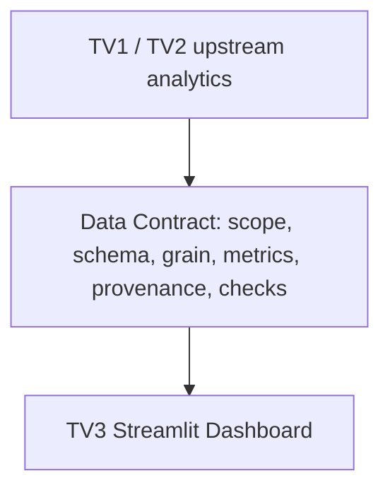

# V03.1 — DISCUSSION DRAFT: Dashboard Data Contract

> **NOT APPROVED**
> **NOT PRODUCTION READY**
> Bản nháp thảo luận cho TV1/TV2 review; không phải schema chính thức, không xác nhận production và không tự đánh V03 PASS.

## 1. Nguồn và phân loại bằng chứng

Ngày soạn: **19/10/2026**. Base TV3: `feat/tv3-dashboard`, commit `e0d5d96a9542d9c0a713d810429335ea4eb810e6`. Chỉ cập nhật tài liệu này, không triển khai loader/validator hoặc V04–V06.

Nguồn: [wireframe V01.3](dashboard_wireframe.md), [demo design](demo_script_draft.md), A01 và assessment V03.0 trong cuộc trao đổi TV3. A01 do TV2 bàn giao, khảo sát 07/10, cập nhật raw 08/10/2026; nguồn phía TV2 `docs/a01_analysis_questions.md`, branch `feat/tv2-analysis`, phiên bản khảo sát `2386394`; SHA-256 bản đã dùng `30CA76E433492F0ACA52CF2C0D05CF178552CB2CC8AEEDF4D4F6593BEA3B7F22`. Không mặc định file có trong checkout TV3, không tạo link tới đích chưa có.

| Nhãn | Ý nghĩa |
| --- | --- |
| VERIFIED ARTIFACT | Đã trực tiếp đọc tài liệu/artifact; audit/schema lịch sử chỉ chứng minh nội dung lưu sẵn, không xác minh lại output hiện tại |
| TEAM REPORTED | TV1/TV2 reported qua user; chưa kiểm chứng artifact tương ứng tại TV3 |
| PROPOSED | Logical datasets/fields/keys/types/capabilities để thảo luận; chưa phải physical schema hoặc enum cuối |
| PENDING CONFIRMATION | Cần owner bàn giao artifact/version/checks và phản hồi; chưa nhận là đã ký duyệt |

**Quy tắc tên:** Mọi logical dataset alias, metadata/metric field, key hoặc type mới trong tài liệu đều **PROPOSED**. Tên vật lý/file layout/enum/nullable encoding cuối **PENDING CONFIRMATION**. Cột nguồn A01/D04 không chứng minh canonical mới giữ cùng tên/dtype.

TV1 đồng ý có điều kiện với V01 là TEAM REPORTED, chưa thay acceptance đầy đủ. TV2 V01 design sign-off PENDING CONFIRMATION.

## 2. Contract overview

| Vai trò | Trách nhiệm dự kiến — PROPOSED, owner từng output cần xác nhận |
| --- | --- |
| TV1 | D05 canonical, D06 population/classification integration, D07 validity/source; schema/manifest, grain, audit, UTC/snapshot |
| TV2 | A02 taxonomy, A03 labels/source, A05 extraction, A06/A07/A08 aggregate; formulas/denominators và semantics Q01–Q08 |
| TV3 | Consumer mapping, filter capability, hiển thị count/denominator/missing/provenance; kiểm tra tiêu thụ contract sau ký duyệt |

Giữ nguyên scaffold hữu ích: tính toán nặng/aggregate ở upstream Spark, dự kiến trao đổi Parquet/CSV tại `data/analytics/`. Streamlit **không tự JOIN raw hoặc tính lại toàn bộ pipeline Spark**. Mỗi bảng cần cỡ mẫu đúng nghĩa; job_count không mặc nhiên thay denominator.

Overview dùng Q01–Q04/Q08; Skills dùng Q05/Q06; Salary & Quality dùng Q07/audit. Chỉ diễn giải dataset/scope đã công bố, không suy rộng toàn thị trường.

## 3. Bốn chiều metadata độc lập — PROPOSED

| Chiều logic | Ví dụ khái niệm, không chốt enum vật lý | Quy tắc |
| --- | --- | --- |
| Population scope | ALL_JOBS / IT subset | Có population version và predicate chọn tập |
| Classification decision | ACCEPT / REJECT / REVIEW | IT analytics chính thức dự kiến dùng ACCEPT được nhóm xác nhận; REVIEW không tự thành REJECT/ACCEPT |
| Data origin | REAL / SYNTHETIC_SAMPLE | Synthetic không được nhận như production findings |
| Release status | STAGING / ACCEPTED_PRODUCTION | Real vẫn có thể staging; production cần evidence/sign-off |

Không gộp SAMPLE, REVIEW, IT_ACCEPTED thành một enum. Cách mã hóa decision policy/không áp dụng classification cho ALL_JOBS còn PENDING CONFIRMATION. Missing file/lỗi schema là tình trạng khả dụng/validation, không là classification decision hoặc 0 tin.

IT scope phải có D06 Full population và policy version được duyệt; canonical ALL JOBS hoặc pilot không tự là T. Giữ reconciliation ACCEPT/REJECT/REVIEW theo policy, không âm thầm loại REVIEW như REJECT.

## 4. Semantics chung: population, missing, types, keys

T là tập CNTT đã xác nhận, một dòng/job_id không NULL; N=countDistinct(T.job_id). Với filter F hợp lệ, S=T trong F, B=countDistinct(S.job_id), không lọc thì B=N. T/N/S/B là ký hiệu toán học, không phải schema vật lý.

| Ký hiệu | Định nghĩa trong cùng run/scope/filter |
| --- | --- |
| L | Distinct tin trong S có location dùng được |
| R | Distinct tin trong S có remote flag TRUE/FALSE hợp lệ |
| K | Distinct tin trong S có ít nhất một nhãn Q05 mapping hợp lệ |
| D / D_g | Description dùng được và xử lý thành công toàn scope/theo nhóm, **gồm zero-skill** |
| B_g | Tổng distinct tin IT nhóm nghề/experience tương ứng, **gồm thiếu lương** |
| V_basis | Distinct tin có timestamp hợp lệ của đúng mốc trong S; hai mốc có denominator riêng |

- Count bằng DISTINCT job_id; Q05/Q06 khử trùng cặp job-label/job-skill. Không dùng row count JOIN/explode làm số tin, không dùng nhánh nhiều skill rows tính lương.
- Giữ tập nền/NULL qua LEFT JOIN/bridge hoặc aggregate trước JOIN; orphan ngoài phép đo, audit riêng; kiểm tra unique key/grain trước và sau JOIN.
- Missing bucket trình bày không ghi đè NULL nguồn. Không gán thiếu thành 0/FALSE/nhãn thật; IT_OTHER không tự là unknown.
- d=0 -> rate NULL/“Không đủ dữ liệu”; không điền 0%. Count 0 có thể hợp lệ khi scope/manifest xác nhận, không tạo zero giả thay file thiếu.
- Rate=100*n/d với denominator có tên rõ. Tổng rate nhiều nhãn/skill có thể >100%, nhưng từng numerator nhãn/skill vẫn <= denominator tương ứng.
- Không cộng percentage, denominator lặp hoặc median-of-medians. Không tính pooled quantiles/IQR từ quantiles/IQR nhóm.
- Chỉ cộng counts khi cells loại trừ nhau, đủ phạm vi, cùng version; nhóm chính A02 cần xác nhận, SOFTWARE cha/con không được đếm cùng cấp.

### 4.1. Field types và bằng chứng

VERIFIED ARTIFACT: `data/audit/d04_schema_changes.csv` ghi kiểu D04 lịch sử, không phải schema D05 50 cột hoặc analytics mới; không có Parquet hiện tại để đọc lại tại TV3.

| Cột nguồn lịch sử | Kiểu ghi trong audit D04 |
| --- | --- |
| postings.job_id, salaries.job_id | bigint |
| postings.title/description/location/formatted_experience_level | string |
| postings.formatted_work_type/work_type/currency/pay_period/compensation_type | string |
| postings.remote_allowed | boolean, giữ NULL |
| postings.original_listed_time/listed_time | timestamp; raw epoch milliseconds -> UTC, bản sao *_raw string |
| postings/salaries.min_salary/max_salary/med_salary | decimal(20,4); cast chưa phải D07 business validity |

PROPOSED aggregate types: count/denominator số nguyên không âm; rate numeric nullable; mã/nhãn/version chuỗi hoặc mã được duyệt; quantiles numeric precision/scale chờ D07; time/period encoding chờ UTC contract. Không tự chốt int width/decimal scale/physical timestamp/null encoding mới.

### 4.2. Grain/key conventions — PROPOSED

Scope identity gồm dataset/run/version, population/decision policy và filter context không nhập nhằng. Unique key logic = scope identity + dimensions của từng dataset. Summary một dòng/context như từng Q định nghĩa; không SUM summary lặp khi JOIN detail.

Mã NULL bucket, ALL/subtotal và giá trị thật phải phân biệt, encoding còn PENDING CONFIRMATION. Metadata có thể ở manifest thay vì lặp trên mọi dòng. Mọi contract Q dưới đây kế thừa mục 3–4 và provenance/acceptance mục 9.

## 5. Upstream readiness

| Nguồn | Bằng chứng và trạng thái | Hệ quả |
| --- | --- | --- |
| D05 | TEAM REPORTED canonical 123849 jobs, 50 columns, unique job_id; chưa VERIFIED trực tiếp tại TV3 | Chưa khóa physical fields/types; 123849 là ALL JOBS, không phải N IT |
| D06 | TEAM REPORTED runner/parity/pilot/preflight PASS, chưa Full output | IT ACCEPT population/T/N chưa VERIFIED |
| D07 | TEAM REPORTED staging ALL JOBS: 36059 USABLE, 87776 MISSING, 14 INVALID; production acceptance còn chờ | Không dùng 36059 làm số tin IT có lương |
| A01 | VERIFIED ARTIFACT đủ Q01–Q08, hash khớp nguồn mục 1 | Requirements, không phải findings IT |
| A02/A03/A05 | Latest artifacts chưa VERIFIED tại TV3; A05 parity 105 mẫu phát triển TEAM REPORTED | Chưa khóa taxonomy/mapping/method; parity không là production |
| A06/A07/A08 | Production aggregate chưa VERIFIED tại TV3 | Chưa có analytics nghiệm thu để integration |
| Local data/processed và data/analytics | VERIFIED ARTIFACT kiểm kê: chỉ .gitkeep ở thời điểm review | Không có output hiện hành để xác minh schema |
| Audit D03/D04/D05 pre-check | VERIFIED ARTIFACT lịch sử; d04_validation.csv ghi 67 PASS | Không thay checks D05/D06/D07 mới |

[Project status](../handoff/project_status.md), [D05 pre-check](../d05_precheck.md), [scaffold](../d05_implementation_scaffold.md) còn ghi D05 chưa official. Khác phiên bản với TEAM REPORTED mới; không sửa nguồn cũ hoặc coi báo cáo mới thay artifact. Chưa có docs D06/D07 hoặc A02/A03/A05/A06/A07/A08 mới trong checkout.

A01 08/10 còn ghi A05 chưa triển khai; parity 105 mẫu được reported sau đó cần artifact/version mới để đối soát. Raw/staging/sample không dùng làm thống kê IT chính thức.

## 6. Contract logic Q01–Q08

Tất cả aliases/fields/keys/types mới dưới đây **PROPOSED**, không bắt buộc mỗi logical dataset là một file hoặc Q dùng chung một physical table. Layout cuối PENDING CONFIRMATION.

### Q01 — Cơ cấu nhóm nghề

| Thuộc tính | Nội dung thảo luận |
| --- | --- |
| Question ID | Q01 — Cơ cấu các nhóm nghề trong tập tin CNTT như thế nào? |
| Producer / Owner | PROPOSED: TV2 A02/A06 định nghĩa/aggregate; TV1 D05/D06 cung cấp T và grain evidence |
| Consumer page/section | Overview / Cơ cấu nhóm nghề |
| Proposed logical dataset | PROPOSED: Q01_CATEGORY_DISTRIBUTION + POPULATION_SUMMARY |
| Required fields | Scope identity; mã/nhãn main category, unknown indicator/bucket; distinct count; B; tỷ trọng; taxonomy/filter version. job_id là khóa chứng minh upstream, không bắt UI nhận toàn bộ IDs |
| Field type | Source job_id bigint chỉ ghi trong audit D04 lịch sử; category output mới chưa VERIFIED. Aggregate types PROPOSED theo mục 4.1 |
| Grain | Một dòng/scope-filter context × main category; summary một dòng/context |
| Primary/unique key | PROPOSED: scope identity + main-category bucket; summary key=context; unknown/ALL encoding chờ xác nhận |
| Count/metric semantics | Mỗi tin một nhóm chính hoặc chưa xác định theo A02; DISTINCT, không dùng ngành hoặc nhãn IT thay main category |
| Numerator | n_g = distinct tin trong S thuộc nhóm g |
| Denominator | B cho tỷ trọng 100*n_g/B, giữ unknown. Khi filter category, ghi đây là phân bố có điều kiện trong S |
| Filter capability | Category/experience/location theo mục 8; cộng count chỉ nếu disjoint. SOFTWARE subgroup chờ official artifact và aggregate |
| Missing/NULL policy | Giữ NULL nguồn; unknown theo A02, không tự gộp IT_OTHER |
| Data source | T từ D05/D06; A02 dùng postings.title/description; JS/SK/JI/IN chỉ hỗ trợ nếu A02/A03 cho phép |
| Taxonomy/method version | A02 và classification policy version bắt buộc, giá trị cụ thể PENDING CONFIRMATION |
| Provenance requirements | Mục 9; canonical/D06 run, predicate, aggregate run, unique/grain checks |
| Current readiness | Có A01/wireframe; production aggregate chưa VERIFIED; UNSUPPORTED / PENDING |
| Open questions | TV2: official category/priority/unknown/subgroup? TV1: T/N/assignment schema? Cả hai: filter context/ALL aggregate? |

### Q02 — Nhãn kinh nghiệm/cấp bậc

| Thuộc tính | Nội dung thảo luận |
| --- | --- |
| Question ID | Q02 — Các nhãn cấp kinh nghiệm/cấp bậc phân bố thế nào trong tin CNTT? |
| Producer / Owner | PROPOSED: TV2 A06/alias rules; TV1 T và source fields |
| Consumer page/section | Overview / Kinh nghiệm |
| Proposed logical dataset | PROPOSED: Q02_EXPERIENCE_DISTRIBUTION + EXPERIENCE_COVERAGE_SUMMARY |
| Required fields | Scope identity; experience label/mapping reference; missing bucket; count; B; có nhãn count; tỷ trọng/coverage |
| Field type | formatted_experience_level string chỉ ghi trong D04 audit lịch sử; normalized/count/rate outputs PROPOSED |
| Grain | Scope-filter context × experience/missing bucket; summary một dòng/context |
| Primary/unique key | PROPOSED: scope identity + experience bucket; summary key=context |
| Count/metric semantics | DISTINCT jobs từng nhãn, thiếu riêng; cấp bậc không tương đương số năm kinh nghiệm |
| Numerator | Distinct tin từng nhãn và distinct tin thiếu trong S |
| Denominator | B cho phân bố có thiếu; conditional distribution trên tập có nhãn chỉ khi mẫu số riêng và coverage/B được ghi |
| Filter capability | Category/experience/location cần joint aggregate đúng scope; không suy intersections từ marginal charts |
| Missing/NULL policy | Giữ thiếu mặc định; không gán Entry level hoặc 0 năm |
| Data source | T + postings.formatted_experience_level và alias rules được duyệt |
| Taxonomy/method version | A02 cho category; experience normalization/alias version PROPOSED, chờ TV2 |
| Provenance requirements | Mục 9; source/alias version, scope và normalization checks |
| Current readiness | Có field schema lịch sử; IT aggregate chưa VERIFIED; UNSUPPORTED / PENDING |
| Open questions | TV2: alias/nhóm nào được duyệt? TV1/TV2: missing summary và denominator từng filter context? |

### Q03 — Địa điểm đăng tuyển

| Thuộc tính | Nội dung thảo luận |
| --- | --- |
| Question ID | Q03 — Tin CNTT tập trung ở những địa điểm đăng tuyển nào? |
| Producer / Owner | PROPOSED: TV2 A06/usable rules; TV1 source/population |
| Consumer page/section | Overview / Top location |
| Proposed logical dataset | PROPOSED: Q03_LOCATION_DISTRIBUTION + LOCATION_COVERAGE_SUMMARY |
| Required fields | Scope identity; location nguồn/trimmed label hoặc mapping reference; usable/missing/invalid summary; n_location, L, B; tỷ lệ/coverage |
| Field type | location string trong D04 audit lịch sử; aggregate/bucket types PROPOSED |
| Grain | Scope-filter context × location dùng được; coverage summary một dòng/context |
| Primary/unique key | PROPOSED: scope identity + location label theo rule duyệt; summary key=context |
| Count/metric semantics | DISTINCT jobs theo chuỗi trim; không tự explode nhiều địa điểm. Top-k chỉ giới hạn hiển thị |
| Numerator | n_location từng location, L cho coverage |
| Denominator | % từng location=100*n_location/L; coverage=100*L/B; missing/invalid theo policy summary |
| Filter capability | Category/experience/location cần đúng context. Top-k không đổi L/B; đổi k cần distribution đầy đủ hoặc đủ capability được công bố |
| Missing/NULL policy | Giữ NULL; thiếu không là Remote hoặc địa chỉ công ty; thiếu/invalid tách theo rules |
| Data source | T + postings.location; zip_code/fips chỉ đối chiếu khi phù hợp |
| Taxonomy/method version | A02; trim/usable/parse rule version cần xác nhận |
| Provenance requirements | Mục 9; source field, normalization rule, coverage scope và phép parse được duyệt |
| Current readiness | Schema nguồn lịch sử có; IT aggregate chưa VERIFIED; UNSUPPORTED / PENDING |
| Open questions | TV2: usable/multiple-location semantics? Không tự parse thành phố/quốc gia. TV1/TV2: L/B được xuất theo filter grain nào? |

### Q04 — Employment work type và remote riêng

| Thuộc tính | Nội dung thảo luận |
| --- | --- |
| Question ID | Q04 — Các loại việc làm được ghi trong tin CNTT phân bố thế nào? Remote khảo sát riêng theo A01 |
| Producer / Owner | PROPOSED: TV2 A06/A03 semantics; TV1 nullable source/canonical |
| Consumer page/section | Overview / Employment và khối Remote riêng |
| Proposed logical dataset | PROPOSED: Q04_EMPLOYMENT_DISTRIBUTION + Q04_REMOTE_DISTRIBUTION + Q04_COVERAGE_SUMMARY |
| Required fields | Scope identity; employment label/missing; remote state TRUE/FALSE/NULL riêng; distinct counts; B/R; rates/coverage; mapping references |
| Field type | formatted_work_type/work_type string, remote_allowed boolean ghi trong D04 audit lịch sử; output bucket/enum/count/rate PROPOSED |
| Grain | Employment: context × work-type bucket. Remote: context × remote-state bucket. Summary một dòng/context |
| Primary/unique key | PROPOSED: scope identity + bucket của đúng dataset; không trộn employment và remote vào cùng dimension |
| Count/metric semantics | DISTINCT jobs theo formatted_work_type sau đối chiếu work_type; remote không là employment hoặc location |
| Numerator | n_worktype; n_true/n_false/n_null trong S, không tạo false từ NULL |
| Denominator | Employment %/B gồm thiếu; remote conditional %/R với R=n_true+n_false, coverage R/B; NULL count/% trên B. R=0 -> NULL rates |
| Filter capability | Theo scope category/experience/location của tab Cơ cấu khi có output; không thêm remote/employment business filter riêng V01 |
| Missing/NULL policy | TRUE/FALSE/NULL tách; NULL không onsite/hybrid/FALSE. Invalid decode audit riêng nếu có; không giả định đã quan sát false |
| Data source | T + postings.formatted_work_type/work_type; postings.remote_allowed độc lập |
| Taxonomy/method version | A02, work-type mapping và boolean interpretation version PENDING CONFIRMATION |
| Provenance requirements | Mục 9; boolean source/cast policy, mapping và reconciliation counts |
| Current readiness | Có source schema lịch sử; scaffold contract cũ trộn remote; production chưa VERIFIED; UNSUPPORTED / PENDING |
| Open questions | TV2: mapping/semantics? TV1: NULL/invalid giữ thế nào? Cả hai: employment và remote summary có cùng S không? |

### Q05 — Nhãn chức năng/lĩnh vực nguồn LinkedIn

| Thuộc tính | Nội dung thảo luận |
| --- | --- |
| Question ID | Q05 — Những nhãn chức năng/lĩnh vực nào trong mapping gốc được gắn nhiều nhất cho tin CNTT? |
| Producer / Owner | PROPOSED: TV2 A03 semantics/analytics Q05, owner thực thi cần xác nhận; TV1 bridge/grain |
| Consumer page/section | Skills / Tab Nhãn chức năng-lĩnh vực, độc lập technical skills Q06 |
| Proposed logical dataset | PROPOSED: Q05_JOB_FUNCTION_DISTRIBUTION + JOB_FUNCTION_COVERAGE_SUMMARY |
| Required fields | Scope identity; skill_abr/skill_name hoặc mapping reference; distinct job-label count; K/B; no-valid-label count; tỷ lệ/coverage; unmapped/orphan audit reference |
| Field type | VERIFIED ARTIFACT d05_precheck_skills.csv có headers skill_abr/skill_name và 35 dòng; CSV không xác minh Spark dtype. Output code/count/rate types PROPOSED |
| Grain | Scope/nhóm context × label code; denominator summary một dòng/context |
| Primary/unique key | PROPOSED: scope identity + label code; bridge upstream unique (job_id, skill_abr); summary key=context |
| Count/metric semantics | Giới hạn job_skills theo T, loại orphan, khử trùng job-label, JOIN skills bằng skill_abr; mỗi tin một lần mỗi nhãn |
| Numerator | Distinct tin gắn từng nhãn hợp lệ; K cho coverage; B-K không có nhãn hợp lệ |
| Denominator | K=distinct tin có ít nhất một nhãn mapping hợp lệ trong S; % nhãn=100*n_label/K; coverage=100*K/B. Không SUM K lặp theo nhãn |
| Filter capability | Category cần membership/aggregate đúng; Top-k chỉ ranking; không cộng counts giữa scope chồng lặp |
| Missing/NULL policy | Không nhãn, mã không mapping và orphan phân biệt; thiếu nhãn không chứng minh không có kỹ năng |
| Data source | T + jobs/job_skills + mappings/skills theo job_id/skill_abr và A03 |
| Taxonomy/method version | A03 mapping/label contract, A02 cho filter; latest artifacts còn chờ |
| Provenance requirements | Mục 9; mapping version, pair dedup/checks, population và orphan audit |
| Current readiness | Mapping audit lịch sử VERIFIED ARTIFACT; IT aggregate/K chưa VERIFIED; UNSUPPORTED / PENDING |
| Open questions | TV2: tên gọi/valid mapping/output owner? TV1: bridge/unmapped/orphan summaries? Không gọi Q05 technical skills hoặc thay bằng ngành |

### Q06 — Kỹ năng công nghệ được nhắc trong description

| Thuộc tính | Nội dung thảo luận |
| --- | --- |
| Question ID | Q06 — Kỹ năng công nghệ nào được nhắc nhiều trong mô tả tin CNTT và khác nhau ra sao giữa nhóm nghề? |
| Producer / Owner | PROPOSED: TV2 A05/A07 extraction/aggregate và A02/A03; TV1 T từ D06 |
| Consumer page/section | Skills / Tab Kỹ năng công nghệ description |
| Proposed logical dataset | PROPOSED: Q06_TECHNICAL_SKILL_DISTRIBUTION + DESCRIPTION_PROCESSING_SUMMARY; evidence reference nếu bàn giao, không ép file layout |
| Required fields | Scope identity; skill code/name, nhóm; distinct job-skill count; D/D_g; B/tổng nhóm; processed-zero-skill count; missing/failed/not-processed summary; %, coverage; source_method, dictionary/method version |
| Field type | description string trong D04 audit lịch sử; skill/status/metric/output types PROPOSED; processing enum chưa chốt |
| Grain | Skill: context/nhóm × skill. Processing summary: một dòng/context/nhóm kể cả nhóm không có skill rows; bridge/evidence có grain riêng nếu bàn giao |
| Primary/unique key | PROPOSED: scope identity + category context + skill; summary key=context; upstream unique (job_id, skill) sau normalization |
| Count/metric semantics | DISTINCT tin nhắc skill thực tìm thấy qua A05. Nhắc đến không nghĩa bắt buộc/trình độ; không có keyword không chứng minh không yêu cầu skill |
| Numerator | n_skill hoặc n_skill,g sau dedup; D/D_g cho coverage; processed-zero-skill count riêng |
| Denominator | D/D_g=description dùng được và xử lý thành công **gồm zero-skill**; % skill trên D/D_g; processing coverage trên B/tổng nhóm. Không suy summary từ skill-positive rows |
| Filter capability | Category theo context; overall cần aggregate riêng hoặc disjoint union có checks. Top-k không đổi D; matrix mỗi nhóm có D_g, không cộng percentages |
| Missing/NULL policy | Thiếu description, lỗi/chưa xử lý, processed-zero-skill phân biệt. Không tạo skill “missing” cho zero-skill; d=0 -> NULL rates |
| Data source | T + postings.description + A05. title phục vụ A02, không tự dùng TITLE_MATCH thay description; skills_desc chỉ bổ sung sau TV2 xác nhận, coverage riêng |
| Taxonomy/method version | A02/A03; A05 method/dictionary/alias version bắt buộc; nguồn phụ/version riêng nếu áp dụng |
| Provenance requirements | Mục 9; extraction run, processed population, evaluation và evidence/source reference. Parity phát triển không production sign-off |
| Current readiness | A05 parity 105 mẫu TEAM REPORTED; latest output/processing summary/A07 chưa VERIFIED; UNSUPPORTED / PENDING |
| Open questions | TV2: usable/success/zero-skill semantics và artifact parity/version? TV1/TV2: D/D_g export ở đâu, overall grain/evidence policy, nguồn phụ được duyệt chưa? |

### Q07 — Lương theo nhóm nghề và kinh nghiệm

| Thuộc tính | Nội dung thảo luận |
| --- | --- |
| Question ID | Q07 — Lương công bố khác nhau thế nào theo nhóm nghề/nhãn kinh nghiệm trong cùng tiền tệ và kỳ trả? |
| Producer / Owner | PROPOSED: TV1 D07 validity/source/units; TV2 A08 aggregate và A02 nhóm nghề |
| Consumer page/section | Salary & Quality / Salary; hai panel min_salary và max_salary độc lập |
| Proposed logical dataset | PROPOSED: Q07_SALARY_QUANTILES + SALARY_POPULATION_COVERAGE_SUMMARY |
| Required fields | Scope identity; main category, experience; currency, pay_period, compensation_type; min_salary P25/P50/P75/IQR; max_salary P25/P50/P75/IQR; n_min/n_max; B_g; eligible-bundle count/definition; coverage; D07 source/validity/quantile references |
| Field type | Nguồn min/max/med decimal(20,4), units/experience string ghi trong D04 audit lịch sử; output precision/scale/count/rate types PROPOSED, chưa xác minh D07 schema |
| Grain | Scope × main category × experience × (currency, pay_period, compensation_type). Population summary ở đúng nhóm/experience, không chỉ tập đã có unit/lương |
| Primary/unique key | PROPOSED: scope identity + category + experience bucket + bộ đơn vị; summary key=population context. ALL/subtotal riêng và có output riêng |
| Count/metric semantics | P25/P50/P75 của min_salary riêng, max_salary riêng trên các giá trị D07 hợp lệ tương ứng; IQR=P75-P25. n_min/n_max DISTINCT jobs có thể khác nhau |
| Numerator | n_min/n_max trong đúng nhóm/bộ đơn vị; eligible-bundle count theo D07 riêng, không mặc định bằng n_min/n_max |
| Denominator | n_min/n_max là cỡ mẫu của phân vị từng chỉ số. Coverage dùng B_g=tổng distinct tin IT nhóm/experience **gồm thiếu lương**; unit selector chọn numerator, không biến B_g thành tập chỉ có unit/lương. Chi tiết policy PENDING CONFIRMATION |
| Filter capability | Category multiselect so sánh hàng; experience; một bộ currency/pay_period/compensation_type. ALL/pooled cần quantile riêng, không median-of-medians/IQR từ extrema |
| Missing/NULL policy | Missing unit không gán default; n=0 -> quantiles NULL. Missing/invalid giữ trong population coverage; không đưa vào valid statistics hoặc gán lương 0 |
| Data source | T + postings salary fields; salaries đối chiếu/bổ sung theo job_id và D07. Không coalesce từng cột P/SA thành bộ hỗn hợp, không dùng exploded label branch tính lương |
| Taxonomy/method version | A02, D07 validity/source-priority, A08 quantile exact/approx và tolerance, đều cần xác nhận |
| Provenance requirements | Mục 9; source-bundle lineage, valid counts, D07 acceptance, unit consistency, quantile method/cỡ mẫu |
| Current readiness | D07 staging ALL JOBS TEAM REPORTED; IT Full/A08 production chưa VERIFIED; UNSUPPORTED / PENDING |
| Open questions | TV1/TV2: validity/outlier/eligible bundle, source priority, units, quantile method/tolerance/ngưỡng mẫu nhỏ? Raw med_salary không là median thống kê mặc định, chỉ báo riêng nếu D07 xác nhận. Không tự midpoint/annualize/convert hoặc dùng normalized_salary chưa xác minh |

### Q08 — Phân bố tin theo thời gian trong dataset

| Thuộc tính | Nội dung thảo luận |
| --- | --- |
| Question ID | Q08 — Tin CNTT phân bố theo tuần/tháng ra sao khi dùng từng mốc đăng? |
| Producer / Owner | PROPOSED: TV1 timestamp/UTC/snapshot; TV2 aggregation/semantics; owner output Q08 cần xác nhận, không tự nhận đã thuộc A08 |
| Consumer page/section | Overview / Tab Thời gian |
| Proposed logical dataset | PROPOSED: Q08_TIME_DISTRIBUTION + TIMESTAMP_COVERAGE_SUMMARY |
| Required fields | Scope identity; basis original_listed_time hoặc listed_time; granularity; ISO week-year/week hoặc month year/key; period boundaries; distinct count; V_basis/B; missing/invalid; observed min/max; snapshot/window; partial-period indicator/basis |
| Field type | Timestamp UTC và *_raw string ghi trong D04 audit lịch sử; output period/basis/flag/count encoding/types PROPOSED |
| Grain | Context/nhóm × timestamp basis × granularity × kỳ; summary một dòng/context/basis, không lẫn tuần và tháng khi cộng |
| Primary/unique key | PROPOSED: scope identity + category context + basis + granularity + period key. ISO week-year khác calendar year khi qua biên |
| Count/metric semantics | DISTINCT job_id theo tuần ISO/tháng UTC. original_listed_time chính, listed_time đối chiếu riêng; không fallback hoặc cộng hai basis |
| Numerator | Distinct tin từng kỳ của đúng basis; V_basis cho coverage |
| Denominator | V_basis=distinct tin timestamp hợp lệ tương ứng trong S, riêng từng mốc; % kỳ=100*n_period/V_basis nếu hiển thị; coverage=100*V_basis/B |
| Filter capability | Category cục bộ; week/month chỉ đổi granularity; chưa có date-range business filter hoặc global time filter. Mỗi granularity cần output đúng |
| Missing/NULL policy | Missing/invalid ngoài bins, báo riêng; V=0 -> NULL rates; không impute từ mốc kia hoặc tự tạo kỳ đầy đủ khi file thiếu |
| Data source | T + postings.original_listed_time/listed_time và *_raw. Raw epoch milliseconds khác timestamp D04 đã cast UTC; không chia 1.000 lần nữa |
| Taxonomy/method version | A02, timestamp decode/timezone/period policy và snapshot policy PENDING CONFIRMATION |
| Provenance requirements | Mục 9; basis, UTC, window/run, min/max và căn cứ partial periods; observed min/max không tự chứng minh cửa sổ thu thập đầy đủ |
| Current readiness | Time audit lịch sử VERIFIED ARTIFACT; IT time aggregate chưa VERIFIED; UNSUPPORTED / PENDING |
| Open questions | TV1: semantics mốc/UTC/snapshot? TV2: output owner/period rules? Không suy xu hướng thị trường hoặc repost từ phân bố/chênh lệch hai mốc |

## 7. Quality — hỗ trợ Q01–Q08, không thêm câu hỏi business

| Thuộc tính | Contract logic PROPOSED |
| --- | --- |
| Producer / Consumer | TV1 audit/quality, TV2 analytics coverage; TV3 Salary & Quality, hai section riêng |
| Logical datasets | PROPOSED: RAW_CLEAN_AUDIT_PROFILE và IT_ACCEPTED_QUALITY_PROFILE; không ép cùng schema/file |
| Required fields | Source table/metric/check/field nếu áp dụng; scope/run/version; đơn vị rows/distinct jobs/cells; numerator/denominator/rate; missing/invalid/rejected/orphan counts; check status; source artifact/audit time |
| Types / Grain / Key | Output types PROPOSED; một dòng/scope-run × source table × field/metric/check; key gồm đủ chiều áp dụng, NULL encoding chờ duyệt |
| Semantics | Raw/clean audit lịch sử khác IT accepted quality; N/grain/missing/description/salary/time coverage thuộc đúng run. Không so orphan row count với job count khác đơn vị |
| Filters / Denominator | Không mặc định theo Salary; scope/capability riêng, mỗi rate có denominator/scope/unit rõ; IT output chưa có -> MISSING |
| Missing / Provenance | Artifact thiếu chưa là 0 lỗi/tin; source/time/run độc lập banner Salary. Không hard-code raw metrics thay IT production |
| Readiness / Open questions | Audit lịch sử có, IT production quality chưa VERIFIED. TV1 cần manifest/scope/units/checks; TV2 xác nhận coverage rules |

## 8. Filter capability matrix — PROPOSED / DESIGN ONLY

Chưa có business filter IT production đạt SUPPORTED BY VERIFIED OUTPUT tại checkout. “Supported grain” là **grain cần producer xác nhận**, không phải tính năng đang có. Không suy capability production từ sample UI. Output thiếu -> **UNSUPPORTED / PENDING**.

| Page/section | Filter | Input field | Supported grain cần có | Denominator changes? | Requires upstream aggregate? | Current readiness | Pending owner |
| --- | --- | --- | --- | --- | --- | --- | --- |
| Overview Cơ cấu | Category | A02 main category | Category × experience × location context, Q01–Q04 + summaries | Có B/L/R và numerator | Có, với taxonomy/membership đã duyệt | UNSUPPORTED / PENDING | TV2 A02/A06; TV1 D06 |
| Overview Cơ cấu | Experience | formatted_experience_level | Joint context trên, giữ missing | Có S/B/L/R | Có; không suy intersections từ marginals | UNSUPPORTED / PENDING | TV2 alias/A06; TV1 source |
| Overview Cơ cấu | Location | location | Joint context + usable summary | Có S/B/L/R, coverage có điều kiện | Có | UNSUPPORTED / PENDING | TV2 usable rules; TV1/TV2 aggregate |
| Q03 | Top-k | Location ranking | L/B toàn context và đủ distribution | Không, chỉ trình bày | Cần distribution; không aggregate denominator theo Top-k | DESIGN ONLY; output PENDING | TV2 A06 |
| Q04 | Employment / remote | work-type fields; remote_allowed | Hai distributions độc lập cùng S | Theo context tab; R khác B | Có; không thêm business filter riêng V01 | UNSUPPORTED / PENDING | TV1 source; TV2 semantics/A06 |
| Q08 | Category | A02 category | Category × basis × granularity × period + summary | Có B/V_basis | Có | UNSUPPORTED / PENDING | TV1 population/time; TV2 output owner |
| Q08 | Week/month | original_listed_time, listed_time | Bins UTC từng basis/granularity | Không đổi V/B, đổi granularity | Có; re-bin chỉ khi period-compatible có checks, không mặc định tuần cộng ra tháng | DESIGN ONLY; aggregate PENDING | TV1 UTC/snapshot; TV2 aggregation |
| Q05 | Category | A02 category | Context × label + K/B summary | Có B/K/count nhãn | Có, distinct pairs trước aggregate | UNSUPPORTED / PENDING | TV1 bridge; TV2 A02/A03/analytics |
| Q05 | Top-k | Label distribution | Ranking + K/B toàn context | Không | Cần distribution, không đổi K | DESIGN ONLY; output PENDING | TV2 analytics Q05 |
| Q06 | Category | A02 category | Category × skill + processing D_g; overall riêng | Có B/D/D_g | Có, gồm zero-skill/status summaries | UNSUPPORTED / PENDING | TV2 A05/A07; TV1 T |
| Q06 | Top-k | Skill distribution | Ranking và D/D_g đúng scope | Không, không tính % trên Top-k | Cần distribution | DESIGN ONLY; output PENDING | TV2 A07 |
| Salary | Category | A02 category | Category × experience × bộ đơn vị, so sánh hàng | B_g/n của hàng; không pooled quantiles | Có, ALL riêng nếu cần | UNSUPPORTED / PENDING | TV1 D07; TV2 A02/A08 |
| Salary | Experience | formatted_experience_level | Strata/missing riêng, ALL aggregate riêng | Có B_g/n | Có, không median-of-medians | UNSUPPORTED / PENDING | TV1/TV2 |
| Salary | Currency | D07 currency | Bộ currency/pay_period/compensation_type | Đổi numerator/n; B_g gồm thiếu lương | Có + population summary riêng | UNSUPPORTED / PENDING | TV1 D07; TV2 A08 |
| Salary | Pay period | D07 pay_period | Cùng bộ đơn vị | Như currency, không annualize | Có | UNSUPPORTED / PENDING | TV1 D07; TV2 A08 |
| Salary | Compensation type | D07 compensation_type | Cùng bộ đơn vị | Như currency, không default NULL | Có | UNSUPPORTED / PENDING | TV1 D07; TV2 A08 |
| Quality | Raw/clean vs IT scope | Manifest/scope identity | Metric/check đúng scope/run | Riêng source; không theo Salary ngầm | IT profile cần output; raw audit riêng | Raw lịch sử có; IT UNSUPPORTED / PENDING | TV1; TV2 coverage |
| Mỗi page | Sample control | Data origin/availability | Từng nguồn/section/run | Đổi nguồn, không business filter | Sample/real tách biệt | Sample scaffold có; production gate DESIGN ONLY | TV3 consumer; TV1/TV2 acceptance |

Business multiselect không bảo đảm mọi tổ hợp có output đúng; chưa có thì disable/ẩn hoặc báo chưa hỗ trợ, không ước lượng. Không global state giữa page/tab mặc định. Summary JOIN vào detail chỉ để hiển thị không được SUM; không cộng percentage/denominator lặp. ALL/unknown/bỏ hết lựa chọn phải rõ context theo wireframe, không drop NULL ngầm. Muốn overall quantile phải có output đúng, không median của các median.

## 9. Provenance và validation/acceptance — DESIGN ONLY

### 9.1. Metadata logic đề xuất

Mọi field/encoding sau **PROPOSED**, có thể ở manifest hoặc metadata table có khóa tham chiếu; không chốt tên cột vật lý.

| Metadata | Ý nghĩa / người xác nhận |
| --- | --- |
| Dataset/run identifier | Phiên bản nguồn và lần tạo aggregate; TV1/TV2 |
| Population scope + predicate + denominator scope | ALL JOBS hay IT subset, filter context và N/B; TV1/TV2 |
| Classification decision policy | ACCEPT/REJECT/REVIEW, policy version, quyết định chọn tập; TV1/TV2 |
| Data origin | REAL/SYNTHETIC_SAMPLE, không suy từ định dạng file; producer |
| Release/acceptance status | STAGING/accepted production có evidence/sign-off đúng scope; team |
| Source artifact/path + version/checksum nếu bàn giao | Lineage D05/D06/D07/analytics; đường dẫn độc lập máy cá nhân; producer |
| Generated timestamp + timezone | Thời điểm xuất/representation UTC đã duyệt, khác timestamp đăng tin; producer |
| Taxonomy version | A02 chính thức, mã/nhãn/subgroup/priority/unknown; TV2 |
| Method/dictionary version | A05/A07 nếu áp dụng, mapping/normalization versions; TV2 |
| D07 validity/source rules version | Unit/source priority/outlier/eligible bundle; TV1 |
| Quantile/period method | Exact/approx và tolerance; ISO/UTC/snapshot policy; TV1/TV2 |
| Schema/contract version + producer | Contract áp dụng và người tạo; producer/team |
| Validation evidence | Check report, counts/reconciliation, schema/grain/semantics; producer/team |
| Sign-off reference | Ai xác nhận phần nào, ngày nào, artifact/version nào; conditional agreement không là acceptance toàn bộ |

### 9.2. Proposed checks, chưa triển khai

| Check | Điều kiện thiết kế |
| --- | --- |
| File format/readability | Artifact khớp manifest và format đã duyệt; lỗi đọc không là production hoặc 0 rows |
| Required columns / data types | Physical schema đã bàn giao; precision/timezone/nullable, không dùng D04 audit thay canonical schema mới |
| Non-null / nullable | Scope/key constraints theo contract; NULL nguồn giữ thiếu, không default remote/units/salary |
| Unique grain | Không trùng key dataset/context; NULL bucket/ALL không va chạm giá trị thật |
| DISTINCT semantics | CountDistinct job_id, dedup job-label/job-skill; grain trước/sau JOIN; orphan audit độc lập |
| Nonnegative counts | Counts/denominators nguyên >=0, có scope/unit rõ |
| Numerator <= denominator | Từng nhãn/skill/location/coverage khi áp dụng; tổng nhiều nhãn có thể vượt denominator, không kiểm tra sai tổng như partition |
| Coverage/rates | d>0: [0,100], khớp 100*n/d theo tolerance được duyệt; d=0 -> NULL, không Infinity/NaN/0% thay thế |
| Missing / summary reconciliation | Partition theo policy: category/experience/employment giữ missing; remote hợp lệ/missing/invalid rõ; processing D và zero-skill đúng summary, không lẫn lỗi và thiếu |
| Units / source consistency | Mỗi Q07 cell cùng currency/pay_period/compensation_type và source bundle đúng D07; không annualize hoặc coalesce từng cột ngầm |
| Quantile order / IQR | P25<=P50<=P75; IQR=P75-P25, min/max riêng, n và precision/tolerance phù hợp; không median-of-medians |
| Timestamp / period validity | UTC; raw milliseconds khác timestamp đã cast; ISO week-year/period boundaries; hai basis riêng; partial period có snapshot evidence |
| Version consistency | Detail và summary cùng dataset/run/filter/rule version; không count run này chia denominator run khác |
| No synthetic production | Data origin synthetic không được ACCEPTED_PRODUCTION hoặc dùng làm findings IT thật |

Tất cả checks **PROPOSED / DESIGN ONLY**, chưa sửa `contract_validator.py` hoặc loader. Current validator chỉ kiểm tra DataFrame/nonempty và tên cột tối thiểu; đọc được tên file không thay gate. Empty output hợp lệ cần manifest/checks phân biệt MISSING; consumer behavior cho trường hợp này còn PENDING CONFIRMATION.

### 9.3. Acceptance gate đề xuất

1. Producer bàn giao artifact + physical schema/grain + manifest/source/version + validation evidence. TV3 kiểm tra khả năng tiêu thụ trong task được duyệt sau này.
2. TV1 xác nhận dữ liệu/grain/IT scope/D07/UTC/audit; TV2 xác nhận taxonomy/mapping/method/formulas/denominator/filter semantics và V01 design sign-off.
3. Team đối chiếu aggregate với population/processing summary, khóa capabilities và acceptance theo đúng artifact/version/scope. Parity pilot hoặc staging ALL JOBS không thay production IT acceptance.
4. Chỉ đủ evidence/sign-off mới chấp nhận production; Sample/Missing/Staging ghi trung thực, không nâng trạng thái bằng đổi tên file.

Gate còn **PENDING CONFIRMATION**. Document vẫn **NOT APPROVED / NOT PRODUCTION READY**.

## 10. Team sign-off questions — tất cả PENDING CONFIRMATION

Chưa có dòng nào được tài liệu này tự đánh dấu ký duyệt. Mỗi owner cần phản hồi bằng artifact/version/evidence.

| ID | Owner | Artifact / câu hỏi cần nhận | Quyết định bị chặn |
| --- | --- | --- | --- |
| T1-01 | TV1 | D05 schema 50 cột, manifest/run, unique/non-null/grain checks và source lineage? | Physical fields/types/keys và canonical evidence |
| T1-02 | TV1 + TV2 | D06 Full output, ACCEPT/REJECT/REVIEW policy/version/reconciliation; T/N chính thức? | IT scope, classification metadata, denominators |
| T1-03 | TV1 | D07 staging schema/manifest/validity reasons và production acceptance; 36059/87776/14 ALL JOBS thuộc run nào? | Staging khác IT production; validity/status semantics |
| T1-04 | TV1 + TV2 A08 | Salary source P/SA, unit/compensation, eligible bundle, validity/outlier, precision/quantile method? | Q07 grain, n/coverage và min/max phân vị riêng |
| T1-05 | TV1 | UTC/schema/raw decode, original/listed semantics, snapshot/window/partial periods; đối soát +7 giờ giữa D05 employee snapshot doc và time_profile lịch sử? | Q08/provenance; không tự kết luận postings timestamp sai |
| T1-06 | TV1 | Raw/clean audit và IT quality output/manifest, metric units/source/time/checks? | Quality contract và production gate |
| T1-07 | TV1 + TV2 | Supported filter contexts/ALL output, summaries và multiselect limits? | Capability matrix, chống cộng lặp và median-of-medians |
| T2-01 | TV2 | Official A02 artifact/version: 9 nhóm, IT_OTHER, SOFTWARE subgroup, priority/unknown? | Category codes/roll-up; AWAITING OFFICIAL A02 ARTIFACT |
| T2-02 | TV2 | A03 source-label contract, mapping/version/semantics và Q05 output owner? | Q05 khác Q06, valid labels/unmapped/orphans |
| T2-03 | TV2 | A05 method/dictionary/output/processing/zero-skill/evidence, parity 105 mẫu version mới? | Q06 denominator/source/version/readiness |
| T2-04 | TV2 | A06 schema/grain, alias/usable/missing/coverage Q01–Q04? | Overview datasets/keys/filters |
| T2-05 | TV2 | A07 skill aggregate và summary D/D_g, overall/nhóm, source_method, nguồn phụ? | Q06 count/rate/coverage đúng scope |
| T2-06 | TV2 + TV1 | A08 min/max quantiles riêng, n/coverage, method/tolerance/ngưỡng mẫu nhỏ? | Q07 metrics và ALL/pooled capability |
| T2-07 | TV2 + TV1 | Ai tạo Q08, output schema/basis/UTC/week-month và summary? | Ownership/contract thời gian |
| T2-08 | TV2 + TV1 | Formulas/denominators/grain/filter semantics từng Q, đặc biệt B_g và many-label rates? | Khóa semantics và validation criteria |
| T2-09 | TV2 | V01 design sign-off hoặc điều kiện/thay đổi có evidence? | Requirements baseline cho final contract |

## 11. Scaffold cũ giữ / SUPERSEDED

| Nội dung scaffold | Xử lý trong discussion draft |
| --- | --- |
| Tách Spark analytics khỏi UI, dự kiến Parquet/CSV tại data/analytics | Giữ nguyên tắc hữu ích; layout/version cuối vẫn chờ bàn giao |
| Minh bạch cỡ mẫu | Giữ; count không luôn là denominator, summary riêng và không SUM lặp |
| overview_analytics grain (category, experience_level, location, work_type) | Tên/grain scaffold không là final; có thể dùng nếu capabilities/checks đáp ứng. SUPERSEDED như contract đầy đủ vì thiếu remote riêng và Q08 |
| work_type gồm Remote/kết hợp remote | SUPERSEDED: employment khác remote, NULL không FALSE |
| NULL -> Unknown như thay dữ liệu nguồn | SUPERSEDED nếu ghi đè nguồn: chỉ bucket trình bày, giữ NULL và policy; code/label A02 chờ duyệt |
| skills_analytics category × technical_skill, sample_size toàn bộ tin nhóm | SUPERSEDED denominator: Q06 dùng D/D_g thành công gồm zero-skill; Q05 có logic riêng |
| frequency_pct nghĩa yêu cầu skill, TITLE_MATCH tương đương description | SUPERSEDED: tỷ lệ nhắc đến; TITLE_MATCH không thay description nếu TV2 chưa xác nhận; nguồn phụ riêng |
| salary_quality_analytics category × currency × pay_period, median_salary chung, min/max quan sát | SUPERSEDED: thêm experience/compensation, min/max phân vị riêng, n/coverage/validity; Quality scope/source riêng |
| job_count>=1 cho mọi output | SUPERSEDED: counts không âm, zero hợp lệ có manifest/checks; missing không là 0; encoding còn thảo luận |
| TV1/TV2 xác nhận schema, TV3 tiêu thụ, ba thành viên ký duyệt | Giữ đồng thuận, thêm artifact/version/scope/checks/capability. data_contract_v03.md chỉ là tên dự kiến scaffold, chưa tạo final file |

Không đổi sample schemas để ép khớp draft. Aliases mới không buộc đổi physical files ngay; adapter/schema migration/loader/validator là FUTURE IMPLEMENTATION sau review. Không dùng raw/staging/sample làm IT findings.

## 12. Checklist và recommendation

- Đủ tám contract logic Q01–Q08: owner/consumer/dataset, fields/type evidence, grain/key, count/numerator/denominator, filter/missing, source/version/provenance, readiness/questions.
- Quality raw/clean khác IT accepted production; bốn chiều metadata độc lập, chưa chốt physical enum/schema.
- Có filter capability matrix, provenance/checks/acceptance gate DESIGN ONLY, không hứa mọi tổ hợp hoặc cộng sai denominator/percentage/quantile.
- TEAM REPORTED khác VERIFIED ARTIFACT; output chưa có và sign-off chưa nhận vẫn PENDING CONFIRMATION.
- Giữ scaffold hữu ích và đánh dấu SUPERSEDED; không sửa code/docs khác hoặc tạo output.

**PROPOSED recommendation: READY FOR TEAM CONTRACT REVIEW.** Owner trả lời mục 10 và bàn giao evidence trước khi khóa physical schema, final sign-off hoặc production integration. Trạng thái vẫn **V03.1 — DISCUSSION DRAFT / NOT APPROVED / NOT PRODUCTION READY**; không tự đánh V03 PASS hoặc bắt đầu V04/V05/V06.
