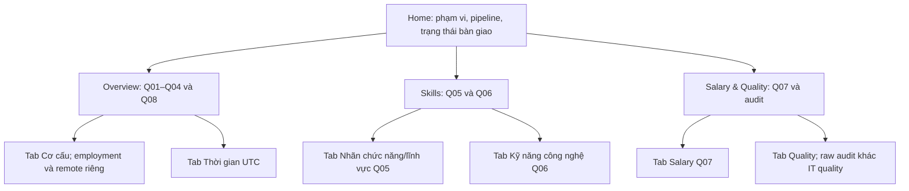

# Dashboard Wireframe V01.3 — A01 Q01–Q08

## 1. Nguồn, phạm vi và trạng thái

Ngày thiết kế: **19/10/2026**. Trạng thái: **READY FOR TEAM DESIGN REVIEW**; chưa phải V01 PASS hoặc ký duyệt chung. Đây là thiết kế đích, không tuyên bố toàn bộ chức năng đã có trong UI.

- **DOCUMENT:** A01 do TV2 Đồng Viết Dũng bàn giao, khảo sát 07/10, cập nhật raw 08/10/2026. File nguồn trong repo TV2: `docs/a01_analysis_questions.md`, thuộc branch `feat/tv2-analysis`; phiên bản khảo sát `2386394`. SHA-256 bản A01 đã dùng: `30CA76E433492F0ACA52CF2C0D05CF178552CB2CC8AEEDF4D4F6593BEA3B7F22`. File thuộc branch TV2, không mặc định có trong checkout TV3; không tạo liên kết Markdown tới đích chưa có tại đây.
- **REVIEW:** V01.1/V01.2 trong cuộc trao đổi TV3: giữ ba trang; Q05/Q08 thiếu; Q04/Q07 xung đột; Q06 cần sửa denominator.
- **CODE BASELINE:** `feat/tv3-dashboard`, commit `60b0bb2d4dbe72af6ba00657fd712c5668a10f0e`. Baseline gap bên dưới được đọc từ code, không phải xác nhận runtime mới.
- **USER-REPORTED:** TV2 đã cung cấp qua tin nhắn thông tin A02 có 9 nhóm chính, IT_OTHER, phân nhóm SOFTWARE; A05 PASS parity trên 105 mẫu phát triển. Chưa có artifact chính thức tương ứng trong checkout được review. A01 ngày 08/10 còn ghi A05 chưa triển khai: cần đối soát phiên bản, không coi khác thời điểm là kết luận lỗi hoặc coi parity phát triển là production output.

| Nhãn quyết định | Ý nghĩa |
| --- | --- |
| DECIDED BY TV3 | Chốt bố cục/UX của bản thiết kế; không ký thay upstream về dữ liệu/nghiệp vụ |
| PENDING TV2 | Chờ taxonomy, nguồn kỹ năng, ngữ nghĩa, phép đo/denominator và artifact được xác nhận |
| PENDING TV1 | Chờ D05/D06/D07, dữ liệu, grain, audit, timezone/snapshot và bàn giao |
| FUTURE IMPLEMENTATION | Thực hiện sau ở V03/V04/V05/V06; chưa coi là tính năng đã chạy |

Mỗi section có quyết định UX và dependency tương ứng, không nhận phần PENDING là đã ký duyệt. Không thêm câu hỏi ngoài A01; giữ nguyên [contract draft](dashboard_data_contract_draft.md).

## 2. Quy tắc count, denominator, missing và provenance

**DECIDED BY TV3 — UX:** Mỗi khối có Q ID, scope/filter, count, denominator được gọi tên rõ, coverage/missing và nguồn/version. Chỉ mô tả tập tin trong dataset LinkedIn Job Postings (2023–2024) đã được xác nhận CNTT, không suy rộng toàn thị trường hay một quốc gia.

**DOCUMENT — A01:** T là tập CNTT một dòng/job_id; N = countDistinct(T.job_id). Với bộ lọc hợp lệ F của section, S = T trong F, B = countDistinct(S.job_id); không lọc thì B=N. Đây là ký hiệu thiết kế, không phải tên bảng/cột đã chốt.

- Count là DISTINCT job_id; nhiều giá trị phải khử trùng `(job_id, giá trị)`. Không dùng số dòng sau JOIN/explode làm số tin, không dùng nhánh skill nhiều dòng để tính lương.
- T làm nền; giữ thiếu bằng LEFT JOIN/bridge hoặc aggregate trước JOIN, loại orphan khỏi phép đo và audit riêng. Upstream phải kiểm tra unique key/grain trước và sau JOIN.
- Giữ NULL nguồn. Mục hiển thị “Thiếu/Chưa xác định” không ghi đè NULL, không gán thành 0/false/nhãn thật; IT_OTHER không tự đồng nhất unknown.
- Denominator=0: NULL/“Không đủ dữ liệu”, không điền 0%. Top-k chỉ giới hạn hiển thị, không đổi denominator. Nhiều nhãn/skill có thể có tổng tỷ lệ >100%.
- `123,849` là tổng raw mọi lĩnh vực, không phải N. Tỷ lệ raw hoặc mẫu phân tầng không phải tỷ lệ IT.
- Không cộng denominator lặp trên mỗi skill, không lấy median của các median. Chỉ cộng counts khi có bằng chứng nhóm loại trừ nhau và đủ phạm vi.

**PENDING TV2:** Xác nhận taxonomy, nhãn, giá trị dùng được và denominator theo A01. **PENDING TV1:** T/N và aggregate có kiểm tra grain. **FUTURE IMPLEMENTATION:** V03 chốt schema; V04–V06 chỉ tiêu thụ aggregate phù hợp, không chạy ETL/Spark trong Streamlit.

### Trạng thái từng nguồn/section

**DECIDED BY TV3:** Banner/provenance riêng từng section, không suy trạng thái cả trang từ một bảng.

| Trạng thái | Hiển thị và giới hạn |
| --- | --- |
| SYNTHETIC_SAMPLE | “Dữ liệu giả định chỉ demo UI”; không dùng số hoặc ranking làm findings |
| PRODUCTION analytics | Dataset/artifact/run version, scope, taxonomy/method version, generated_at và bằng chứng acceptance; có file không tự nghĩa là đã nghiệm thu |
| MISSING / lỗi nạp / schema không phù hợp | Chưa có dữ liệu dùng được; dependency cụ thể; không vẽ số 0 thay missing. Phân biệt lỗi với không có file khi triển khai |
| Audit lịch sử | Nguồn, ngày và raw/clean/IT scope riêng; không là trạng thái IT hiện tại |

**CODE:** Loader hiện có enum `SAMPLE` và thông báo synthetic; ưu tiên production, sau đó fallback sample. Checkbox không ép sample nếu production đã nạp được. `SYNTHETIC_SAMPLE` là nhãn provenance thiết kế, chưa đổi enum. Overview/Skills dừng khi Missing; Salary thiếu không ngăn Quality hard-code xuất hiện.

**PENDING TV1/TV2:** Metadata và tiêu chí acceptance. **FUTURE IMPLEMENTATION:** V03–V06 hiện thực hóa trạng thái chi tiết.

## 3. Kiến trúc điều hướng và Home

**DECIDED BY TV3:** Giữ Home và ba analysis pages theo thứ tự scaffold.



**Home — DECIDED BY TV3:** Giới thiệu mục tiêu/giới hạn dataset, sơ đồ `raw -> Spark -> analytics -> Streamlit` như kiến trúc dự kiến hoặc phần đã xác minh; liên kết ba trang và mapping Q. Trạng thái có nguồn/version; không nhận raw count là số tin IT, không khẳng định pipeline production đã hoàn thành khi chưa xác minh.

**PENDING TV1/TV2:** Tiến độ và artifact thực tế. **FUTURE IMPLEMENTATION:** Cập nhật Home sau; nội dung code baseline còn hard-code, gồm trạng thái A03 cũ.

## 4. Overview — Q01–Q04 và Q08

**DECIDED BY TV3 — bố cục:** Header/provenance -> bộ lọc cục bộ -> tab Cơ cấu / Thời gian. Giữ layout 2×2 hữu ích: Q01/Q02 hàng đầu, Q03/Q04 hàng sau; remote là khối riêng dưới Q04. Mỗi chart có bảng count/%/denominator. Expander cuối là aggregate đúng scope, không gọi là raw data.

### 4.1. Tab Cơ cấu

Thanh KPI: **B — Tin CNTT trong phạm vi**, nhóm nghề count cao nhất, địa điểm count cao nhất, độ phủ location. B=0 thì không có thứ hạng; đồng hạng được nêu rõ. Bỏ thiết kế KPI độ phủ lương raw cố định trên Overview.

| Section | Chart/bảng và metric | Denominator/missing | Giới hạn |
| --- | --- | --- | --- |
| Q01 — nhóm nghề | Cột theo nhóm chính, count n_g và 100*n_g/B | B; giữ chưa xác định theo A02 | Nhãn ngành/IT không tự là nhóm nghề; không tự gộp IT_OTHER và unknown |
| Q02 — kinh nghiệm | Cột count/% từng nhãn; KPI/bảng số và % thiếu | B gồm thiếu; phân bố có điều kiện trên tập có nhãn chỉ khi ghi mẫu số riêng | Nhãn cấp bậc không là số năm; missing không là Entry level |
| Q03 — địa điểm | Cột ngang Top 10 mặc định, bảng n_l và 100*n_l/L | L = distinct tin location dùng được trong S; L/B, số thiếu; Top-k không đổi L | Trước hết trim chuỗi nguồn; chưa parse/gộp địa lý nếu không có quy tắc; không dùng địa chỉ công ty |
| Q04 — employment | Cột theo formatted_work_type đã đối chiếu work_type; count/% | B gồm thiếu | Không đặt Remote vào loại việc làm |
| Q04 — remote riêng | Ba hàng TRUE/FALSE/NULL, count; tỷ lệ TRUE/FALSE trên R nếu dùng | R = distinct tin cờ hợp lệ; coverage R/B; missing/B; R=0 -> không đủ dữ liệu | NULL không false/onsite/hybrid; false=0 chỉ theo dữ liệu, không suy từ NULL |

**PENDING TV2:** A02/A03, alias experience/work type/location, định nghĩa remote và location dùng được. **PENDING TV1:** T, aggregate tích hợp/A06 giữ grain, nullable boolean. **FUTURE IMPLEMENTATION:** V04. **CODE baseline:** Có ba filter, bốn chart count, KPI salary coverage cố định; chưa đáp ứng toàn bộ thiết kế trên.

### 4.2. Tab Thời gian — Q08

**DECIDED BY TV3:** Hai biểu đồ theo kỳ, `original_listed_time` chính trước, `listed_time` đối chiếu sau; không fallback/gộp hai mốc thành một series. Selector tuần ISO/tháng, UTC; tuần có ISO week-year + week number để tránh nhầm đầu năm.

- Từng mốc có countDistinct theo kỳ; V là distinct tin có timestamp hợp lệ tương ứng trong S, denominator riêng từng mốc. Báo V/B và số thiếu/không hợp lệ; nếu có % theo kỳ thì 100*n_period/V.
- KPI min/max UTC; đánh dấu kỳ biên không trọn vẹn theo cửa sổ dataset/snapshot được xác nhận.
- Không thêm date-range filter trong phạm vi V01 này. Selector tuần/tháng chỉ đổi độ hạt, không đổi tập nền.
- Chú thích “Phân bố tin trong dataset, không phải xu hướng nhu cầu toàn thị trường”. Không gọi chênh lệch hai mốc là repost khi chưa xác minh.

**PENDING TV1:** Raw epoch milliseconds khác timestamp D04 đã là UTC; không chia 1.000 lần nữa. Xác nhận semantics hai mốc, snapshot window và kỳ biên. **PENDING TV2:** Aggregation/diễn giải Q08. **FUTURE IMPLEMENTATION:** V03/V04; baseline chưa có section/schema thời gian.

## 5. Skills — hai tab độc lập Q05/Q06

### 5.1. Q05 — Nhãn chức năng/lĩnh vực gốc LinkedIn

**DECIDED BY TV3:** Tab riêng trước Q06; banner “Nhãn nguồn không phải technical skills hoặc taxonomy nghề CNTT”. Cột ngang Top 15 và bảng mã/tên/count/%; expander toàn bộ nhãn và mapping provenance.

Nguồn: giới hạn `job_skills` theo T, khử trùng `(job_id, skill_abr)`, JOIN `skills` theo `skill_abr`, loại orphan và audit mã không mapping riêng. K = distinct tin trong S có ít nhất một nhãn mapping hợp lệ. KPI K, coverage K/B, B-K tin không có nhãn hợp lệ. Mỗi nhãn có distinct count n_label và tỷ lệ 100*n_label/K. Top-k không đổi K; tổng tỷ lệ có thể >100%; thiếu nhãn không chứng minh không có kỹ năng.

**PENDING TV2:** A03 thuật ngữ/mapping/version và nhãn hợp lệ. **PENDING TV1:** Bridge, grain, orphan, aggregate. **FUTURE IMPLEMENTATION:** V03/V05; baseline mới có cảnh báo, chưa có view Q05.

### 5.2. Q06 — Kỹ năng công nghệ được nhắc trong description

**DECIDED BY TV3:** Giữ Top 15 + bảng tần suất + ma trận so sánh nhóm; chart đích dạng cột ngang. Dùng từ “được nhắc đến”, không mặc định “bắt buộc”.

- D = distinct tin trong S có description dùng được và xử lý thành công, **kể cả tin không trích được skill**; từng nhóm dùng D_g tương ứng. Không lấy denominator từ danh sách chỉ gồm tin có skill.
- KPI B, D, D/B, số tin xử lý hợp lệ nhưng zero-skill. Phân biệt thiếu description, lỗi và chưa xử lý theo trạng thái upstream; không coi mọi tin ngoài D đều thiếu description.
- Khử trùng `(job_id, technical_skill)`; mỗi skill có distinct count và 100*n_skill/D; theo nhóm là 100*n_skill,g/D_g.
- Bảng hiển thị skill, nhóm, count, denominator, %, coverage và source_method/version. Expander phương pháp/bằng chứng theo chính sách bàn giao. TITLE_MATCH không tự chứng minh nhắc trong description.
- Matrix theo các nhóm đã chọn, mỗi cột có D_g. View toàn tập chỉ hiện khi có aggregate đúng; không cộng tỷ lệ hoặc denominator lặp.
- `skills_desc` là nguồn phụ có điều kiện, coverage riêng; không âm thầm gộp vào denominator description. Chưa có contract thì không bật lựa chọn nguồn phụ.

**PENDING TV2:** A02/A03/A05/A07; dictionary/alias, xử lý thành công, zero-skill, method/version và artifact parity mới. PASS trên 105 mẫu phát triển do user báo chưa là production. **PENDING TV1:** T và tổng nhóm. **FUTURE IMPLEMENTATION:** V03/V05; baseline có chart/table/pivot nhưng pivot dùng toàn df và không hiển thị sample_size.

## 6. Salary & Quality

### 6.1. Salary — Q07

**DECIDED BY TV3 — bố cục:** Header -> nhóm nghề/experience và bộ đơn vị -> n/coverage -> hai panel song song -> bảng phân vị chi tiết.

```text
[Scope/provenance] [Category] [Experience] [Currency] [Pay period] [Compensation type]
[B theo nhóm] [n_min, coverage_min] [n_max, coverage_max] [coverage bộ đủ điều kiện]
[min_salary: P25 — P50 — P75; IQR] [max_salary: P25 — P50 — P75; IQR]
[Bảng nhóm × experience × bộ đơn vị: n, phân vị, IQR, coverage và missing]
```

- Grain phân tích: nhóm nghề × kinh nghiệm × `(currency, pay_period, compensation_type)`. Một bộ đơn vị mỗi lần; tiêu đề dùng đơn vị thực chọn, không hard-code USD/Năm.
- B_g = distinct tin nhóm nghề/experience trong phạm vi, **gồm tin thiếu lương**. Selector đơn vị chọn bộ lương cần đo, không lọc mất missing khỏi B_g. Mapping chính xác coverage cần ký duyệt V03.
- Riêng min_salary: P25/P50/P75, IQR_min=P75-P25, n_min. Riêng max_salary: P25/P50/P75, IQR_max=P75-P25, n_max. Coverage từng chỉ số = n_valid/B_g; bộ đủ điều kiện có numerator riêng theo D07.
- Chart khoảng P25–P75 với điểm P50; không gọi boxplot đầy đủ khi chưa có whisker rule. Min/max quan sát không phải IQR.
- Chọn nhiều nhóm chỉ để so sánh hàng; không tính pooled quantile từ median các hàng. ALL/toàn tập/tất cả experience chỉ có khi upstream xuất aggregate riêng đúng phạm vi.
- Raw med_salary không phải median thống kê; chỉ báo riêng nếu D07 xác nhận. Không midpoint, normalized_salary chưa xác minh, annualize/quy đổi hoặc coalesce từng cột P/SA tạo bộ lương hỗn hợp.
- Unit thiếu không gán USD/YEARLY/BASE_SALARY; giữ trong coverage, không đưa vào so sánh. B_g hoặc n=0 -> không đủ dữ liệu. Ngưỡng cảnh báo mẫu nhỏ chưa tự đặt.

**PENDING TV1:** D07, nguồn P/SA, xung đột/đơn vị/hợp lệ/outlier, quantile method, n và coverage. **PENDING TV2:** A02/A08 và experience. **FUTURE IMPLEMENTATION:** V03/V06. **CODE baseline:** YEARLY nhưng chưa lọc currency; median_salary chung, thiếu experience/compensation và IQR riêng.

### 6.2. Quality — hai phạm vi riêng

**DECIDED BY TV3:** Giữ tab Quality nhưng tách hai section, provenance độc lập với Salary:

1. **Raw / clean audit lịch sử:** Giữ tổng raw, missingness, rejected, encoding và referential coverage hữu ích; mỗi metric ghi artifact/ngày/scope, tử số/mẫu số hoặc đơn vị dòng/tin. Không suy số dòng bảng con là số tin hoặc kết quả lịch sử là lần chạy hiện tại.
2. **IT production quality:** N, grain/unique checks, missing/coverage thuộc tính, description processing, salary valid và timestamp coverage của đúng run. Chưa có output nghiệm thu -> MISSING; không điền raw hard-code thay IT.

Audit raw không chạy theo Salary filters. Nếu IT quality hỗ trợ scope riêng thì ghi filter và denominator riêng; không mặc định đồng bộ. Quality hỗ trợ giải thích giới hạn Q01–Q08, không tạo thêm câu hỏi business.

**PENDING TV1:** Audit/run/scope, D05/D06/D07, grain/timezone/snapshot. **PENDING TV2:** Coverage analytics. **FUTURE IMPLEMENTATION:** V03/V06; baseline Quality là KPI/bảng/text cố định, chưa đọc audit trực tiếp.

## 7. Filter design

**DECIDED BY TV3 — UX:** Filter cục bộ từng tab/page; không hứa global filters liên trang. Mặc định Tất cả gồm thiếu khi phép đo yêu cầu. Bỏ hết lựa chọn nghĩa là chưa chọn tập, không ngầm quay về tất cả; Reset riêng. Đây là hành vi thiết kế đích, chưa phải code hiện tại.

Filter business đổi count và denominator của cùng scope. Top-k/tuần-tháng chỉ đổi trình bày. Nếu lọc chính chiều đang vẽ thì ghi tỷ trọng có điều kiện trong tập chọn. Không có aggregate đúng thì disable/ẩn hoặc báo chưa hỗ trợ, không ước lượng. Không mặc định hỗ trợ mọi tổ hợp.

| Page/section — filter | Control | Nguồn trường/lựa chọn | KPI/chart áp dụng | Missing handling | Tử số và mẫu số | Dependency còn chờ |
| --- | --- | --- | --- | --- | --- | --- |
| Overview Cơ cấu — category | Multiselect + Reset | A02 từ title/description; mã vật lý chờ V03 | B và Q01–Q04/remote | Unknown theo A02, IT_OTHER riêng | Đổi S/B, L/R và numerator | PENDING TV2 A02; PENDING TV1 D06; FUTURE IMPLEMENTATION V04 |
| Overview Cơ cấu — experience | Multiselect | P.formatted_experience_level | B, Q01–Q04/remote | Có Thiếu, không suy năm | Đổi S/B/L/R và numerator | PENDING TV2 alias; PENDING TV1 aggregate; FUTURE IMPLEMENTATION V04 |
| Overview Cơ cấu — location | Searchable multiselect | P.location trim | B, Q01–Q04/remote | Có Thiếu; parse có điều kiện | Đổi S/B/L/R; coverage có điều kiện | PENDING TV2 location; PENDING TV1 grain; FUTURE IMPLEMENTATION V04 |
| Q03 — Top-k | Selectbox, mặc định 10 | Giá trị trình bày | Ranking Q03 | Thiếu vẫn báo riêng | Không đổi L/B | DECIDED BY TV3; FUTURE IMPLEMENTATION V04 |
| Q04 — employment/remote | Không thêm filter riêng V01 | P.formatted_work_type/work_type; remote_allowed | Hai khối độc lập | Employment Thiếu; remote TRUE/FALSE/NULL | Theo S tab; remote dùng R, coverage R/B | PENDING TV2 semantics; PENDING TV1 nullable boolean; FUTURE IMPLEMENTATION V04 |
| Q08 — category | Multiselect cục bộ tab | A02 | Hai chart và KPI thời gian | Giữ unknown theo A02 | Đổi S/B và V riêng từng mốc | PENDING TV2 A02; PENDING TV1 aggregate; FUTURE IMPLEMENTATION V04 |
| Q08 — tuần ISO/tháng | Radio/segmented | original_listed_time, listed_time | Cả hai chart Q08 | Invalid/missing ngoài bins | Chỉ đổi grain, không đổi V/B | DECIDED BY TV3 UX; PENDING TV1 UTC/snapshot; FUTURE IMPLEMENTATION V04 |
| Q05 — category | Multiselect cục bộ tab | A02 | K, coverage, chart/bảng Q05 | Unknown nhóm; mã không mapping báo riêng | Đổi S/B/K và count nhãn | PENDING TV2 A02/A03; PENDING TV1 bridge; FUTURE IMPLEMENTATION V05 |
| Q05 — Top-k | Selectbox, mặc định 15 | Nhãn mapping hợp lệ | Ranking Q05 | Không ẩn coverage thiếu | Không đổi K/B | DECIDED BY TV3; FUTURE IMPLEMENTATION V05 |
| Q06 — category | Multiselect cục bộ tab | A02 + A05/A07 | D/D_g, count/%, chart/table/matrix | Thiếu mô tả/lỗi/zero-skill riêng | Đổi S/B/D; zero-skill vẫn trong D | PENDING TV2 A02/A05/A07; PENDING TV1 T; FUTURE IMPLEMENTATION V05 |
| Q06 — Top-k | Selectbox, mặc định 15 | Skill thực trích được | Ranking; matrix giới hạn skill nếu ghi rõ | Không tự tạo skill | Không đổi D/B, không % trên Top-k | DECIDED BY TV3; PENDING TV2 output; FUTURE IMPLEMENTATION V05 |
| Salary — category | Multiselect so sánh hàng | A02 | Hai panel và bảng Q07 | Unknown/IT_OTHER theo artifact | Đổi hàng/B_g/n; không pooled quantile | PENDING TV2 A02; PENDING TV1 D07; FUTURE IMPLEMENTATION V06 |
| Salary — experience | Selectbox; ALL có điều kiện | P.formatted_experience_level | Q07 | Thiếu là strata riêng | Đổi B_g/n; ALL cần quantile riêng | PENDING TV2 alias; PENDING TV1 grain; FUTURE IMPLEMENTATION V06 |
| Salary — currency | Single select | Bộ lương P/SA được D07 duyệt | Q07, tiêu đề đơn vị | Thiếu báo coverage, không so sánh | Chọn numerator bộ đơn vị; B_g gồm thiếu lương | PENDING TV1 D07; PENDING TV2 A08; FUTURE IMPLEMENTATION V06 |
| Salary — pay_period | Single select | P/SA.pay_period | Q07 | Không gán YEARLY | Như currency; không annualize | PENDING TV1 D07; FUTURE IMPLEMENTATION V06 |
| Salary — compensation_type | Single select | P/SA.compensation_type | Q07 | Không gán BASE_SALARY | Như currency; B_g theo nghề/experience | PENDING TV1 D07; FUTURE IMPLEMENTATION V06 |
| Quality — raw / IT | Hai section cố định | Audit manifest/run metadata | Metric đúng section | Artifact chưa có -> MISSING | Denominator riêng; không theo Salary filter | DECIDED BY TV3 UX; PENDING TV1 audit; FUTURE IMPLEMENTATION V06 |
| Mỗi page — Sample control | Checkbox + banner nguồn thực | Loader/provenance | Trạng thái từng nguồn | MISSING không là 0 tin | Đổi nguồn, không trộn denominator sample/production | DECIDED BY TV3 UX; PENDING TV1/TV2 acceptance; FUTURE IMPLEMENTATION V03–V06 |

Không thêm filter remote/employment/date-range toàn cục hoặc experience/location trên Skills trong V01. SOFTWARE subgroup chỉ là control có điều kiện sau A02 và contract, không cam kết đã hỗ trợ.

## 8. Taxonomy chính thức

**PENDING TV2 — AWAITING OFFICIAL A02 ARTIFACT.** Theo user, có 9 nhóm chính, IT_OTHER, phân nhóm SOFTWARE; chưa có artifact trong checkout để đối chiếu mã/tên, quan hệ cha-con, version, ưu tiên và unknown. Không tự liệt kê/định nghĩa lại; không mặc định IT_OTHER là nhóm thứ mười hoặc chính là NULL.

**DECIDED BY TV3:** Dùng mã ổn định + nhãn từ A02; nhóm chính/subgroup tách cấp. Chỉ hiện SOFTWARE subgroup khi artifact và aggregate hỗ trợ, roll-up cha không đếm trùng. Nhãn scaffold Software Engineering/Data & AI chưa được nhận là taxonomy chính thức.

**PENDING TV1:** D06 áp dụng version được duyệt, bàn giao T/N. **FUTURE IMPLEMENTATION:** V03 mapping/schema, V04–V06 áp dụng.

## 9. Q01–Q08 traceability

| Q | Page/section | Metric / denominator | Baseline gap | Quyết định và dependency |
| --- | --- | --- | --- | --- |
| Q01 | Overview / Nhóm nghề | Distinct count, %/B, unknown | PARTIAL: count category, thiếu xác minh taxonomy/% | DECIDED BY TV3 layout; PENDING TV2 A02/A03; PENDING TV1 D05/D06; FUTURE IMPLEMENTATION V03/V04 |
| Q02 | Overview / Kinh nghiệm | Count, %/B, missing; conditional riêng | PARTIAL: chart count, filter dropna | DECIDED BY TV3 layout; PENDING TV2 alias; PENDING TV1 T; FUTURE IMPLEMENTATION V03/V04 |
| Q03 | Overview / Địa điểm | Top-k, %/L, L/B, missing | PARTIAL: Top 10, thiếu coverage | DECIDED BY TV3 layout; PENDING TV2 usable/parse; PENDING TV1 aggregate; FUTURE IMPLEMENTATION V03/V04 |
| Q04 | Overview / Employment + Remote | Employment %/B; remote count, %/R, R/B | CONFLICT: title/contract trộn remote với work type | DECIDED BY TV3 tách khối; PENDING TV2 semantics; PENDING TV1 boolean/grain; FUTURE IMPLEMENTATION V03/V04 |
| Q05 | Skills / Nhãn nguồn | Count, %/K, K/B, B-K | MISSING: chỉ cảnh báo, chưa view | DECIDED BY TV3 tab; PENDING TV2 A03; PENDING TV1 bridge; FUTURE IMPLEMENTATION V03/V05 |
| Q06 | Skills / Description skills | Count, %/D hoặc D_g, D/B, zero-skill | PARTIAL: denominator draft sai, pivot toàn df, chưa sample_size | DECIDED BY TV3 tab/layout; PENDING TV2 A02/A03/A05/A07; PENDING TV1 T; FUTURE IMPLEMENTATION V03/V05 |
| Q07 | Salary / Hai bộ phân vị | P25/P50/P75/IQR/n min và max riêng, coverage/B_g | CONFLICT: median_salary chung, thiếu experience/compensation; chưa lọc USD | DECIDED BY TV3 layout; PENDING TV1 D07; PENDING TV2 A02/A08; FUTURE IMPLEMENTATION V03/V06 |
| Q08 | Overview / Thời gian | Count tuần/tháng UTC, V riêng, V/B, min/max/partial periods | MISSING: chưa chart/schema | DECIDED BY TV3 tab; PENDING TV1 timestamp/snapshot; PENDING TV2 aggregate; FUTURE IMPLEMENTATION V03/V04 |

Nguồn cột theo A01: Q01 title/description + A02, tín hiệu JS/SK/JI/IN chỉ nếu A02/A03 cho phép; Q02 formatted_experience_level; Q03 location, zip_code/fips chỉ đối chiếu; Q04 formatted_work_type/work_type và remote_allowed riêng; Q05 JS.skill_abr -> SK.skill_abr/skill_name; Q06 description + A05, skills_desc có điều kiện; Q07 min_salary/max_salary/med_salary, currency/pay_period/compensation_type P/SA, kinh nghiệm và A02; Q08 original_listed_time/listed_time và bản sao raw. Mọi count gắn job_id; UI nhận aggregate, không JOIN raw tại runtime.

## 10. Thiết kế cũ được giữ / thay thế

| Thiết kế scaffold | V01.3 |
| --- | --- |
| Home + ba pages; Overview 2×2; Skills chart/detail/matrix; Salary/Quality hai tab | Giữ cấu trúc hữu ích, bổ sung Q đúng A01 — DECIDED BY TV3 |
| Empty-result warning, Missing hướng dẫn nguồn/sample, cảnh báo nhãn nguồn khác technical skills | Giữ, bổ sung scope/denominator/provenance — DECIDED BY TV3 |
| KPI minh họa cố định và 29.13% tại Overview | SUPERSEDED: không là IT metric; chuyển KPI coverage có nguồn — FUTURE IMPLEMENTATION V04 |
| Work type kết hợp Remote; suy remote từ location | SUPERSEDED: hai thuộc tính riêng, NULL không onsite — PENDING TV2/TV1; FUTURE IMPLEMENTATION V04 |
| Skills chỉ technical skills, từ ngữ skill bắt buộc | SUPERSEDED: Q05 riêng, Q06 nhắc trong description — FUTURE IMPLEMENTATION V05 |
| Salary mặc định USD/YEARLY, min–median–max chung; quantile chỉ TODO | SUPERSEDED: bộ đơn vị chọn được và hai bộ phân vị riêng là yêu cầu Q07 — PENDING TV1/TV2; FUTURE IMPLEMENTATION V06 |
| Quality hard-code như IT production hiện tại | SUPERSEDED: audit lịch sử khác IT quality — FUTURE IMPLEMENTATION V06 |

Số wireframe cũ là minh họa/audit chép lại, không là findings IT. Chi tiết cũ còn trong Git baseline mục 1; tài liệu này không sửa code hoặc contract để thực hiện thiết kế.

## 11. V03 CONTRACT QUESTIONS

Đây là bàn giao câu hỏi, **chưa phải schema đã ký duyệt**; giữ nguyên dashboard_data_contract_draft.md trong V01.3.

1. **PENDING TV2 / PENDING TV1:** A02/A03 artifact/version chuẩn nào? Mã nhóm/subgroup, unknown/IT_OTHER; T/N và kiểm tra DISTINCT/grain/orphan xuất thế nào?
2. **PENDING TV1 / PENDING TV2:** Section nhận bảng/grain nào, filter nào được hỗ trợ, có ALL aggregate riêng không? B/L/R/K/D/D_g/B_g/V xuất ở đâu để không cộng denominator lặp?
3. **PENDING TV2 / PENDING TV1:** Q05 có output riêng nào, mapping version, unknown codes, distinct count và coverage? Không trộn với technical_skill.
4. **PENDING TV2:** Q06 description dùng được/xử lý thành công/zero-skill có trạng thái gì? Artifact A05 parity 105 mẫu, dictionary/method version mới nào? Nguồn phụ có coverage riêng không? TITLE_MATCH không tự đáp ứng description.
5. **PENDING TV1 / PENDING TV2:** Q07 nguồn P/SA, bộ đơn vị, hợp lệ/outlier, experience/compensation grain; phân vị/n min-max riêng và numerator coverage bộ đủ điều kiện thế nào? B_g giữ thiếu lương; quantile exact/approx và ngưỡng mẫu nhỏ nào được duyệt?
6. **PENDING TV1 / PENDING TV2:** Q08 raw milliseconds hay timestamp UTC, semantics hai mốc, ISO week-year, snapshot window, partial periods, missing/invalid và denominator riêng bàn giao thế nào?
7. **PENDING TV1:** Audit raw/clean lịch sử và IT quality có artifact/run/scope độc lập nào, không dùng hard-code thay missing?
8. **PENDING TV1 / PENDING TV2:** Metadata acceptance gồm dataset/rule/method version, generated_at/timezone và checks gì? Validator cần dtype, unique grain, range, denominator/coverage và unit checks nào thay vì chỉ tên cột?

**FUTURE IMPLEMENTATION:** V03 chốt contract; V04 Q01–Q04/Q08; V05 Q05/Q06; V06 Q07/Quality. Các phần PENDING không được coi đã ký duyệt.

## 12. Tiêu chí gửi review

- Đủ Q01–Q08, giữ Home và ba analysis pages.
- Q05 khác Q06; work type khác remote; Q07 min/max phân vị riêng; Q08 UTC có section riêng.
- Filter có phạm vi, missing, numerator/denominator và capability gate.
- Provenance/sample/missing/audit rõ; demo theo [kịch bản V01.3](demo_script_draft.md).
- Dependencies còn mở được ghi; không tự công bố findings hoặc V01 PASS.

**DECIDED BY TV3:** Sẵn sàng TEAM DESIGN REVIEW. Ký duyệt nghiệp vụ/dữ liệu và triển khai vẫn PENDING/FUTURE IMPLEMENTATION như từng mục.
