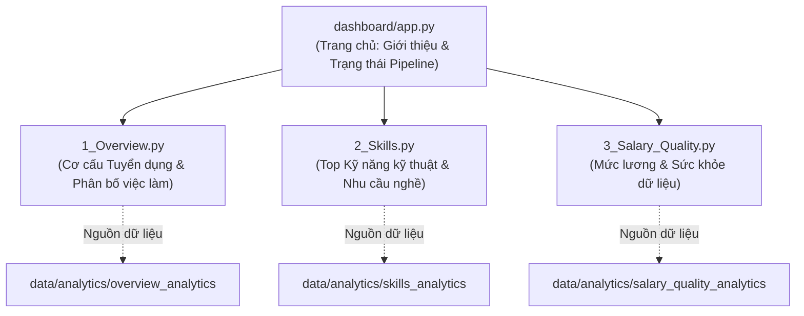

# Dashboard Wireframes & Layout Specifications

Tài liệu này mô tả kiến trúc bố cục giao diện (wireframes), các bộ lọc, biểu đồ và trạng thái xử lý dữ liệu của Streamlit Dashboard dành cho **Thành viên 3 (TV3)**.

---

## 1. Sơ đồ Kiến trúc Điều hướng (Navigation Flow)



---

## 2. Trang 1: Cơ cấu Tuyển dụng (`1_Overview.py`)

### A. Mục tiêu
Cung cấp cái nhìn toàn cảnh về quy mô thị trường việc làm CNTT trong bộ dữ liệu: cơ cấu theo nhóm ngành nghề, cấp bậc kinh nghiệm, địa điểm làm việc và tỷ lệ làm việc từ xa (remote).

### B. Bộ lọc người dùng (Sidebar Filters)
- **Job Category:** Lựa chọn đa nhóm nghề (`Software Engineering`, `Data & AI`, `Cloud & DevOps`...).
- **Experience Level:** Lựa chọn đa cấp bậc (`Entry level`, `Mid-Senior level`, `Associate`...).
- **Location:** Lựa chọn địa điểm (`San Francisco`, `New York`, `Remote`...).

### C. Khung hiển thị KPI
```text
+-----------------------+-----------------------+-----------------------+-----------------------+
|  Tổng số tin tuyển    |  Nhóm nghề hàng đầu   |  Địa điểm nhiều nhất  |  Độ phủ thông tin lương|
|       12,450          |  Software Engineering |     San Francisco     |         29.13%        |
+-----------------------+-----------------------+-----------------------+-----------------------+
```

### D. Bố cục Biểu đồ (Charts Layout)
```text
+-------------------------------------------+-------------------------------------------+
| [Biểu đồ Cột 1] Nhu cầu theo Nhóm nghề    | [Biểu đồ Cột 2] Phân bố theo Cấp bậc      |
|  - Trục X: Category                       |  - Trục X: Experience Level               |
|  - Trục Y: Job Count                      |  - Trục Y: Job Count                      |
+-------------------------------------------+-------------------------------------------+
| [Biểu đồ Cột 3] Top 10 Địa điểm tuyển dụng| [Biểu đồ Cột 4] Hình thức làm việc        |
|  - Trục X: Location                       |  - Trục X: Work Type (Full-time, Contract)|
|  - Trục Y: Job Count                      |  - Trục Y: Job Count                      |
+-------------------------------------------+-------------------------------------------+
```

### E. Trạng thái Trống / Thiếu Dữ liệu (Empty State)
- Nếu người dùng chọn bộ lọc không có bản ghi nào: Hiển thị cảnh báo màu vàng `"Không tìm thấy tin tuyển dụng nào phù hợp với bộ lọc đã chọn. Vui lòng điều chỉnh lại bộ lọc."`
- Nếu tệp analytics chưa được tạo: Hiển thị hộp thông báo màu đỏ `"Analytics data is not available yet. Run upstream pipeline or enable sample development mode."`

### F. Phụ thuộc dữ liệu
- **Phụ thuộc pipeline chính thức:** Nhiệm vụ **A06** (Phân tích cơ cấu tuyển dụng của TV2).

---

## 3. Trang 2: Phân tích Kỹ năng (`2_Skills.py`)

### A. Mục tiêu
Trực quan hóa nhu cầu kỹ năng kỹ thuật cụ thể (lập trình, công cụ, hạ tầng đám mây) trên thị trường tuyển dụng CNTT và so sánh giữa các nhóm nghề khác nhau.

### B. Lưu ý và Cảnh báo Hiển thị
- Bắt buộc có thông báo cảnh báo nổi bật: Bảng `job_skills` / `skills.csv` gốc **chỉ là nhóm ngành nghề**; kỹ năng kỹ thuật cụ thể tại trang này được trích xuất từ `description` (hoặc hiển thị từ tập dữ liệu mẫu ở chế độ phát triển).

### C. Khung hiển thị & Biểu đồ
```text
+-------------------------------------------------------+---------------------------------------+
| [Biểu đồ Cột Ngang] Top 15 Kỹ năng Kỹ thuật hàng đầu  | [Bảng Chi tiết] Bảng tần suất kỹ năng |
|  - Trục Y: Technical Skill (Python, SQL, AWS, Docker) |  - Cột: Skill, Category, Count, Tỷ lệ%|
|  - Trục X: Số lượng tin yêu cầu                       |                                       |
+-------------------------------------------------------+---------------------------------------+
| [Ma trận Bảng Pivot] Kỹ năng theo từng Nhóm nghề                                              |
|  - Hàng: Technical Skill                                                                      |
|  - Cột: Software Engineering | Data & AI | Cloud & DevOps | Cybersecurity                     |
+-----------------------------------------------------------------------------------------------+
```

### D. Trạng thái Trống (Empty State)
- Hiển thị hướng dẫn khi nhóm nghề được chọn chưa có từ điển kỹ năng tương ứng.

### E. Phụ thuộc dữ liệu
- **Phụ thuộc pipeline chính thức:** Nhiệm vụ **A05** (Trích xuất kỹ năng từ mô tả) và **A07** (Phân tích nhu cầu kỹ năng) của TV2.

---

## 4. Trang 3: Lương & Chất lượng Dữ liệu (`3_Salary_Quality.py`)

### A. Mục tiêu
Trực quan hóa dải lương tuyển dụng theo nhóm nghề tương thích (tránh so sánh khập khiễng giữa các tiền tệ và kỳ lương khác nhau), đồng thời cung cấp dashboard kiểm soát chất lượng dữ liệu phục vụ bảo vệ đồ án.

### B. Bố cục Hai Tab chức năng

#### Tab 1: Phân tích Mức lương (Salary Analysis)
- **Nguyên tắc:** Lọc riêng theo `pay_period = YEARLY` và `currency = USD`.
```text
+-------------------------------------------+-------------------------------------------+
| [Biểu đồ Cột] Mức lương Trung vị (USD/Năm)| [Bảng Thống kê] Dải lương chi tiết        |
|  - Trục X: Category                       |  - Cột: Nhóm nghề                         |
|  - Trục Y: Median Salary (USD)            |  - Cột: Lương tối thiểu, Trung vị, Tối đa |
|                                           |  - Cột: Số lượng tin có thông tin lương   |
+-------------------------------------------+-------------------------------------------+
| [Placeholder TODO] Biểu đồ phân vị chi tiết (P25 - Median - P75)                      |
+---------------------------------------------------------------------------------------+
```

#### Tab 2: Sức khỏe Dữ liệu (Data Quality Dashboard)
```text
+-----------------------+-----------------------+-----------------------+-----------------------+
|  Tổng số tin thô ban  |  Độ phủ thông tin lương|  Bản ghi bị cách ly   |  Lỗi Mojibake UTF-8   |
|       123,849 dòng    |         29.13%        |       142 dòng        |   83 bản ghi đã sửa   |
+-----------------------+-----------------------+-----------------------+-----------------------+
| [Bảng Tổng hợp 1] Bảng xếp hạng các trường khuyết thiếu cao nhất (closed_time, skills_desc...)|
| [Bảng Tổng hợp 2] Độ phủ khóa ngoại và số lượng bản ghi mồ côi (Orphans) của các bảng con     |
+-----------------------------------------------------------------------------------------------+
```

### C. Phụ thuộc dữ liệu
- **Phụ thuộc pipeline chính thức:** Nhiệm vụ **D07** (Chuẩn hóa lương) của TV1 và **A08** (Phân tích lương và thời gian) của TV2.
