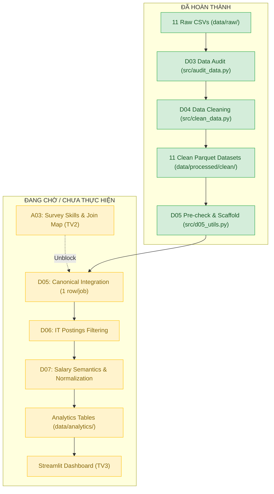

# Project Status & Handoff

## 1. Project Goal

Dự án xây dựng pipeline Big Data sử dụng Apache Spark để xử lý bộ dữ liệu LinkedIn Job Postings (2023–2024), xác định các tin tuyển dụng liên quan đến lĩnh vực Công nghệ thông tin (CNTT), và tiến hành phân tích đa chiều:
- Nhóm nghề CNTT và kỹ năng tuyển dụng;
- Yêu cầu kinh nghiệm, địa điểm làm việc, hình thức làm việc;
- Mức lương và thông tin doanh nghiệp tuyển dụng.

*Lưu ý phạm vi:* Kết quả chỉ phản ánh tập dữ liệu thực tế được thu thập trong bộ dữ liệu, không suy rộng thành toàn bộ thị trường lao động Việt Nam hoặc bất kỳ quốc gia cụ thể nào.

---

## 2. Current Progress

| Mã Task | Tên công việc | Trạng thái | Ghi chú |
| :--- | :--- | :---: | :--- |
| **D01** | Chốt dữ liệu và phạm vi | **PASS** | Hoàn thành README, Data Manifest, xác định phạm vi dataset. |
| **D02** | Thiết lập môi trường Spark | **PASS** | Hoàn thành PySpark trên Windows, smoke test 123,849 dòng CSV. |
| **D03** | Kiểm kê và đọc dữ liệu | **PASS** | Hoàn thành Data Dictionary và Báo cáo chất lượng dữ liệu 11 bảng. |
| **D04** | Làm sạch bằng Spark | **PASS** | Chuẩn hóa schema, khử trùng, sửa lỗi encoding, lưu 11 bảng Parquet sạch. |
| **D05 Pre-check** | Tiền kiểm định Cardinality & Join | **PASS** | Định lượng quan hệ nhiều-nhiều, 35 nhãn nghề nghiệp, snapshot nhân sự, khóa mồ côi. |
| **D05 Scaffold** | Khung tiện ích an toàn & kiểm thử | **PASS** | Xây dựng generic bridge aggregation, latest snapshot, và guard chống row explosion. |
| **D05 Official** | JOIN tạo Canonical Dataset | **BLOCKED** | **Bị chặn bởi dependency A03 từ Thành viên 2 (TV2).** |

---

## 3. Dataset

- **Tên bộ dữ liệu:** LinkedIn Job Postings (2023–2024) (tác giả: Arsh Koneru, nguồn: Kaggle).
- **Cấu trúc tệp:** 11 tệp CSV gốc (~530.72 MB).
- **Quy mô bảng chính:** `postings.csv` gồm **123,849 dòng** và 31 cột thô.
- **Quy tắc Git:** Dữ liệu gốc (`data/raw/`) được khai báo trong `.gitignore` và **KHÔNG** lưu trên Git repository.

---

## 4. Runtime Environment

- **Hệ điều hành:** Windows
- **Python:** 3.11 (chạy trong virtual environment `.venv`)
- **Java:** OpenJDK 21 LTS (Eclipse Temurin)
- **Apache Spark / PySpark:** 4.2.0
- **Chế độ thực thi:** Spark `local[*]`
- **Session Timezone:** `UTC`
- **Bộ ghi Parquet Windows:** Sử dụng adapter phân quyền cục bộ Java (`NoPermissionLocalFileSystem`) tích hợp tại `tmp/d04-localfs/d04-localfs-adapter.jar`; không bắt buộc cài đặt Hadoop hay `winutils.exe`.

---

## 5. Important Data Findings (Từ Audit & Pre-check)

1. **Khóa chính duy nhất:** `postings.job_id` là duy nhất tuyệt đối (123,849 distinct keys, 0 null, 0 duplicate).
2. **Bản chất 35 Skill Labels:** Bảng `skills.csv` (và `job_skills.csv`) chứa 35 nhãn là **Job Functions / Domains** (ví dụ: `IT` - Information Technology, `ENG` - Engineering, `FIN` - Finance, `SALE` - Sales), **HOÀN TOÀN KHÔNG PHẢI là kỹ năng kỹ thuật cụ thể** (như Python, Java, SQL, AWS).
3. **Quan hệ nhiều-nhiều (Many-to-Many):**
   - 71,658 tin có từ 2 đến 3 skills.
   - 24,406 tin có từ 2 đến 3 industries.
   - 16,101 tin có từ 2 đến 12 benefits.
   - 16,970 công ty có nhiều chuyên môn (tối đa tới 84 specialities).
4. **Độ phủ lương (Salary Coverage):** Chỉ có 36,073 / 123,849 tin trong `postings` có bản ghi trong `salaries` (độ phủ đạt **29.13%**).
5. **Khóa ngoại mồ côi (Orphan Records):** Có 4,712 bản ghi trong `salaries`, 7,990 dòng trong `job_skills`, 5,845 dòng trong `job_industries`, và 2,550 dòng trong `benefits` có `job_id` không tồn tại trong `postings`.
6. **Bản ghi biến động nhân sự (Employee Snapshots):** 5,694 / 24,473 công ty có nhiều hơn 1 snapshot (tối đa 13 snapshots trong khoảng thời gian từ 06/04/2024 đến 20/04/2024).
7. **Lỗi Encoding (Mojibake):** 83 bản ghi chứa ký tự lỗi UTF-8 (dấu nháy, gạch ngang) đã được sửa chữa tất định tại D04.
8. **Dữ liệu sạch hiện có:** 11 bảng Parquet sạch đã được lưu tại `data/processed/clean/` và đối soát khớp 100% về số dòng.

---

## 6. Current Architecture

- **Đã hoàn thành:** Tầng Raw $\rightarrow$ Audit $\rightarrow$ Clean $\rightarrow$ Parquet sạch $\rightarrow$ Scaffold tiện ích an toàn D05.
- **Chưa thực hiện:** Tầng Canonical JOIN $\rightarrow$ Bộ lọc CNTT $\rightarrow$ Chuẩn hóa lương $\rightarrow$ Bảng tổng hợp Analytics $\rightarrow$ Giao diện Dashboard.

---

## 7. D05 Design Constraint (Ràng buộc thiết kế D05)

- **Grain mục tiêu:** Chuẩn **1 dòng = 1 tin tuyển dụng (`job_id`)**.
- **Nguy cơ Row Explosion đã được chứng minh qua runtime test:**
  - Nếu JOIN phẳng trực tiếp `postings` với `job_skills` thô: Số dòng bùng nổ từ **123,849 lên 207,531 dòng** (+83,682 dòng trùng lặp tin tuyển dụng).
  - Nếu kết hợp thêm `benefits` và `specialities`, một tin tuyển dụng cực đại sẽ bị nhân bản thành **18,144 dòng**!
- **Nguyên tắc bắt buộc:** **Aggregate-Before-Join**.
  - Gom các bảng quan hệ nhiều-nhiều thành mảng (`job_function_codes`, `industry_ids`, `benefit_types`) trước khi JOIN.
  - Lấy snapshot mới nhất của `employee_counts` trước khi JOIN với doanh nghiệp.
  - Đảm bảo sau JOIN: Số dòng giữ nguyên **123,849** và số distinct `job_id` giữ nguyên **123,849**.

---

## 8. Team Dependencies (Phân công và phụ thuộc nhóm)

Theo kế hoạch dự án 3 người (`Ke_hoach_BigData_Tuyen_dung_CNTT_3_nguoi.xlsx`):
- **Thành viên 1 (TV1 - Kỹ thuật dữ liệu & Spark):**
  - Đã xong: D01, D02, D03, D04, D05 Pre-check, D05 Scaffold.
  - Đang dừng chờ: D05 official (bị chặn bởi A03).
  - Tiếp theo: D05 official $\rightarrow$ D06 (tích hợp bộ lọc CNTT) $\rightarrow$ D07 (chuẩn hóa lương) $\rightarrow$ D08 (benchmark Spark).
- **Thành viên 2 (TV2 - Nghiệp vụ phân tích & Taxonomy):**
  - **Task A03 (ĐANG CHỜ - Critical Path):** Khảo sát kỹ năng và ngành nghề, bàn giao *Bản đồ JOIN và nguồn kỹ năng*.
  - Tiếp theo: A04 (kiểm tra mẫu bộ lọc CNTT), A05 (trích xuất kỹ năng Python/SQL từ description), A06–A08 (phân tích nghiệp vụ).
- **Thành viên 3 (TV3 - Trực quan hóa & Dashboard):**
  - Tiếp theo: Xây dựng Streamlit dashboard dựa trên hợp đồng dữ liệu đầu ra và các bảng analytics sau khi TV1 và TV2 hoàn thành pipeline.

---

## 9. What TV2 Needs To Do (Thành viên 2 cần làm gì ngay)

1. Đọc kỹ báo cáo tiền kiểm và các bảng audit đã tạo:
   - [docs/d05_precheck.md](file:///d:/Learning/Bigdata/BigData-IT-Recruitment/docs/d05_precheck.md)
   - [data/audit/d05_precheck_skills.csv](file:///d:/Learning/Bigdata/BigData-IT-Recruitment/data/audit/d05_precheck_skills.csv)
   - [data/audit/d05_precheck_join_coverage.csv](file:///d:/Learning/Bigdata/BigData-IT-Recruitment/data/audit/d05_precheck_join_coverage.csv)
2. **Hoàn thành Task A03:**
   - Xác nhận phạm vi kết nối các trường từ `skills` và `industries`.
   - Chốt phương án xử lý 35 nhãn nghề nghiệp (không coi là kỹ năng lập trình).
   - Đề xuất phương án trích xuất kỹ năng kỹ thuật từ trường văn bản `description`.

---

## 10. What TV3 Can Read Now (Thành viên 3 có thể đọc gì)

- [README.md](file:///d:/Learning/Bigdata/BigData-IT-Recruitment/README.md)
- [docs/handoff/project_status.md](file:///d:/Learning/Bigdata/BigData-IT-Recruitment/docs/handoff/project_status.md) (tài liệu này)
- [docs/data_dictionary.md](file:///d:/Learning/Bigdata/BigData-IT-Recruitment/docs/data_dictionary.md)
- [docs/d03_data_quality_report.md](file:///d:/Learning/Bigdata/BigData-IT-Recruitment/docs/d03_data_quality_report.md)
- [docs/d04_cleaning_report.md](file:///d:/Learning/Bigdata/BigData-IT-Recruitment/docs/d04_cleaning_report.md)

*Lưu ý cho TV3:* Chưa xây dựng dashboard cuối (final dashboard) trên dữ liệu thật vì tầng analytics chưa hoàn thành. TV3 hiện có thể dựng wireframe hoặc khung ứng dụng với dữ liệu giả lập (mock data).

---

## 11. Important Paths (Cấu trúc thư mục quan trọng)

| Đường dẫn | Mục đích | Theo dõi trên Git |
| :--- | :--- | :---: |
| `src/` | Mã nguồn pipeline PySpark (`clean_data.py`, `d05_utils.py`, v.v.) | **CÓ** |
| `docs/` | Báo cáo kỹ thuật, data dictionary, handoff status | **CÓ** |
| `data/audit/` | Các tệp CSV ghi nhận số liệu kiểm kê và hồ sơ chất lượng dữ liệu | **CÓ** |
| `data/raw/` | 11 tệp CSV thô tải từ Kaggle | **KHÔNG** (bị `.gitignore`) |
| `data/processed/clean/` | 11 bảng Parquet đã làm sạch chuẩn hóa | **KHÔNG** (bị `.gitignore`) |
| `data/processed/rejected/` | Các bản ghi trùng lặp / cách ly | **KHÔNG** (bị `.gitignore`) |
| `data/analytics/` | Thư mục đích cho các bảng tổng hợp sau này | **CÓ** (chứa `.gitkeep`) |
| `tmp/` | Build adapter Java và kiểm tra tạm thời | **KHÔNG** (bị `.gitignore`) |

---

## 12. Do Not Do Yet (Những việc tuyệt đối CHƯA ĐƯỢC LÀM)

1. **KHÔNG** chạy D05 official để tạo dataset kết hợp trước khi A03 được bàn giao.
2. **KHÔNG** thực hiện bộ lọc tin CNTT (D06).
3. **KHÔNG** tự ý trích xuất kỹ năng kỹ thuật (Python, Java, SQL...) khi chưa có taxonomy từ TV2.
4. **KHÔNG** quy đổi tiền tệ hoặc chuẩn hóa mức lương hàng năm (thuộc D07).
5. **KHÔNG** xây dựng final dashboard kết nối dữ liệu sản xuất.
